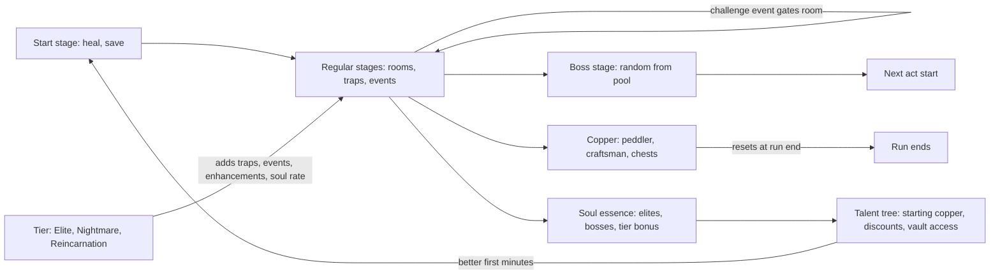

# Gunfire Reborn run pacing and economy (comps note)

Evidence: wiki (public), read by scouts at file:line (level 2); shipped data tables (level 4 at measurement, scripts outside the repo) for stage layers only. The wiki gives no main-run length in minutes, no copper per kill and no soul per normal kill; those are marked not stated below. The wiki's numbers are likely data-mined, so they corroborate the structure, not the design.

## What it does

**Run shape.** A full run crosses up to four acts. Acts 1 to 3 are mandatory with 4, 3 and 3 regular stages; act 4 is optional with 2. Each act opens with a small starting stage and ends in a boss stage whose boss is rolled from a short pool (one available by default). From act 2 the starting stage heals, revives and allows save-and-quit. The shipped tables agree on the skeleton and add a fifth layer: the main mode lists 5 layers with 4, 3, 3, 2 and 2 fight slots, each slot drawing from 8 to 19 candidate levels, each layer with a weighted boss pool. The wiki does not explain the fifth layer (see gaps).

**Difficulty ladder.** Four tiers, each unlocked by winning a run that reaches act 3 or 4: Normal, Elite, Nightmare, Reincarnation. Elite multiplies enemy health plus shield by 1.4 and damage by 1.4; Nightmare uses 2.4 and 1.8. Both raise soul income (a bonus chance on normal-enemy drops, a higher soul value per elite and per boss), add traps to normal rooms and, at Nightmare, raise trap and event frequency. Elite also unlocks enemy enhancements. Reincarnation is a ladder of levels above Nightmare with fixed per-act health and damage steps (act 1 health 2.9x to 5.9x over levels 1 to 7, acts 3 and 4 4.0x to 13.6x), a higher soul rate, and discounts on soul prices that shrink as the level rises. Levels 8 and up add rules rather than stats: many challenge events per act, a guaranteed one at the boss stage, and a small soul payment per completed challenge.

**Currencies.**

- Copper is the in-run currency. It is spent at the peddler (heal items, grenades, ammo, weapons, scrolls, revives), the craftsman (enhance, reforge, etch) and peculiar chests, and it resets when the run ends. The carry cap is 65,535.
- Soul essence is the premium currency. It comes from elites, bosses and Reincarnation bonuses, and buys spiritual blessings at shrines (one of three offered, refresh price rising), the Phantom Peddler's rotating stock, revives and, after the run, talent levels.
- Peddler prices step up within an act by a roughly fixed amount per stage and jump at each act boundary. Heal items run 55, 105, 155, 205 on each act's first stage; a weapon runs 190 to 310 in act 1 and 550 to 610 in act 4. Price is therefore a pacing signal: the same shelf costs more as the run deepens.
- The craftsman charges 50 to 600 per enhance level (+15% base damage per level), 300 for a reforge and 200 per level to etch, with 2 enhancements per visit (3 with a talent).
- Chests come in tiers: blue at stage end, green as a choice of three scrolls, purple from challenge events and elite events, and a peculiar chest that is a trade menu of 35 choice groups. Its options cost health (25, 50 or 75 percent tiers) or copper, and pay in a scroll or an upgrade.

**Time and kill pressure.** The main run has no stated timer. The wiki states that clearing a room opens the exit and that a challenge event gates progress past its room. Timed modes exist off the main run: a 20-minute survival mode with no enemy drops, copper per kill (6, 12 or 400 by enemy class) and soul by survival time; and an endless loop after act 4 that starts at 10 minutes, adds 35 to 40 seconds per stage cleared and freezes the clock during portals and boss fights.

**Between-run talent tree.** After each run soul essence buys talent levels in five shared categories (expedition, battle, skill, survival, weapon) plus a tree per hero. Maximum soul cost per tree: 1805, 3575, 1300, 3645, 1475, and 500 per hero; the full tree is about 17,800 (wiki-stated). Talent level counts talents spent, so partial progress always counts. Refunds return the full essence and can only buy talents. The expedition tree changes what a run offers: starting copper 100 to 500, a chance to double copper, copper per critical kill, a 5% to 25% peddler discount, more peddler stock, and the talent that lets a player open optional vaults. One weapon talent places a weapon chest at the act 1 entrance. Hero unlocks come from talent level (25, 40, 55), soul cost (400, 600), DLC or by default.

## Parameters

| Parameter | Value | Source |
|---|---|---|
| Regular stages per act | 4 / 3 / 3 / 2 (act 4 optional) | wiki (public): Acts page |
| Starting stage per act | 1, heals and saves from act 2 | wiki (public): Acts page |
| Bosses per act | 1 by default, random | wiki (public): Acts page |
| Layers and fight slots, main mode | 5 layers, 4/3/3/2/2 slots, 8 to 19 candidate levels per slot | shipped data tables (level 4 at measurement, scripts outside the repo) |
| Elite tier multipliers | health and shield 1.4, damage 1.4 | wiki (public): Difficulty page |
| Nightmare tier multipliers | health and shield 2.4, damage 1.8 | wiki (public): Difficulty page |
| Soul bonus, normal-enemy drop chance | +10% Elite, +20% Nightmare | wiki (public): Difficulty page |
| Soul per elite | 14 Elite, 18 Nightmare | wiki (public): Difficulty page |
| Soul per boss | 45 to 90 Elite, 60 to 105 Nightmare | wiki (public): Difficulty page |
| Reincarnation level count | 8 or 10 (pages conflict) | wiki (public): Difficulty and Reincarnation pages |
| Reincarnation health, act 1 | 2.9x to 5.9x over levels 1 to 7 | wiki (public): Reincarnation page |
| Reincarnation health, acts 3 and 4 | 4.0x to 13.6x | wiki (public): Reincarnation page |
| Reincarnation damage, act 1 / act 2 | 2.1x to 3.9x / 2.0x to 3.2x | wiki (public): Reincarnation page |
| Soul price discount by level | -45% to -10%, none at 9 | wiki (public): Reincarnation page |
| Soul rate, normal enemies | 1.25x to 1.55x | wiki (public): Reincarnation page |
| Challenge events outside vaults | at most 1 per act (many from level 8) | wiki (public): Challenge Events page |
| Challenge event waves | 4 or 5 | wiki (public): Challenge Events page |
| Heal item price, act first stage | 55 / 105 / 155 / 205 | wiki (public): Peddler page |
| Weapon price | 190 to 310 act 1, 550 to 610 act 4 | wiki (public): Peddler page |
| Scroll price, act 1 stage 1 / act 4 boss | 135 to 198 / 495 to 726 | wiki (public): Peddler page |
| Peddler weapon stock | 3, choose 1 | wiki (public): Peddler page |
| Craftsman enhance cost | 50 to 600 by level, +15% base damage each | wiki (public): Craftsman page |
| Copper carry cap | 65,535 | wiki (public): Copper page |
| Peculiar chest | 35 groups, 2 to 3 options, 25/50/75% health tiers | wiki (public): Chests page |
| Green chest | choice of 3 scrolls | wiki (public): Chests page |
| Survival mode | 20 min, copper per kill 6 / 12 / 400 | wiki (public): Spiritual Assault page |
| Endless loop timer | 10 min start, +35 to 40 s per stage | wiki (public): Reincarnation page |
| Talent trees, max soul cost | 1805 / 3575 / 1300 / 3645 / 1475 / 500 per hero | wiki (public): Talents page |
| Full talent cost, level cap, essence cap | about 17,800; 208; 25,000 | wiki (public): Talents page |
| Starting-copper talent | 100 to 500 by level | wiki (public): Talents page |
| Expedition peddler discount | 5% to 25% | wiki (public): Talents page |
| Main-run minutes; copper per normal kill; soul per normal kill | not stated | gap |
| Chests per stage; hazard damage; rooms per stage | not stated | gap |

## Why it works

- **Threat and reward rise together.** Each tier raises enemy health and damage and also soul income, so choosing a harder tier is a bet with a visible payoff.
- **Health and damage climb on separate curves,** and later acts start at a higher step. Difficulty grows per act as well as per tier, which keeps act 3 feeling different from act 1 on any tier.
- **Price is the pacing clock.** There is no stated run timer; the shelf cost steps each stage, so the player feels the run deepening through what the same item costs.
- **The meta tree works as teaching.** Early talents hand over small, legible head starts (copper, a discount, a chest) and the vault-access talent teaches a risk pocket exists before the player can use it. Level counts talents, not points, so a short session always moves the bar.
- **Resetting copper at run end keeps the run a closed loop.** Only soul essence crosses the boundary, and it can only buy talents.

## What Scrapkeep borrows

- **Price steps as the pacing signal** (principle: momentum is sacred; no timer interrupts a fast player, the shelf deepens instead). Anchor: BIBLE.md "Runs, regions, exits and saves" (line 578) and TADR-010.
- **Threat and reward rising together per tier** (principle: opt-in layers; a harder layer pays more and the player chooses it). Anchor: BIBLE.md "Encounters, waves and enemies" (line 517).
- **Health and damage on separate curves, with a per-region step** (principle: readable-capped scaling; two named dials, each capped). Anchor: BIBLE.md "Encounters, waves and enemies" (line 517), TADR-010.
- **A between-run tree whose first nodes are small head starts and unlock an optional side pocket** (principle: quick restart; the next run begins better in seconds). Anchor: BIBLE.md "Four slots and milestone progression" (line 527).
- **Gate one room with a short event that pays a graded chest** (principle: harmonize apparent contradictions; a required beat that still feels optional because the reward is visible). Anchor: BIBLE.md "Encounters, waves and enemies" (line 517) and TADR-002.
- **A trade chest paying health or copper for power at fixed percentages** (principle: readability first; cost in the same units the HUD already shows). Anchor: BIBLE.md "Electromagnetic collection, recycling and growth" (line 507).
- **Reset run currency, keep one meta currency** (principle: quick restart). Anchor: TADR-008.

## What it must not copy

- Hero kits and names, enemy designs and silhouettes, boss arenas and act environments.
- Weapon, scroll, talent, blessing and shop-item names and descriptions; the 203-scroll and 216-inscription lists.
- The numbers: tier multipliers, price lists, the 65,535 cap and the talent costs. Scrapkeep tunes its own in the lab.
- Voice, text and the tier names (Elite, Nightmare, Reincarnation).
- The Reincarnation wording and any layout of the fifth layer, which the wiki does not explain.

## Lab measure

In the headless lab, run the Scrapkeep shop model alone for 3 regions, 20 seeds. Log the price of one reference item at each stage and the player's copper income per stage from a fixed-skill bot. Pass: price is non-decreasing across stages within a region, jumps at every region boundary, and the ratio of item price to income per stage stays within a band the lab config sets (target 0.5 to 2.0), with no seed outside the band.
