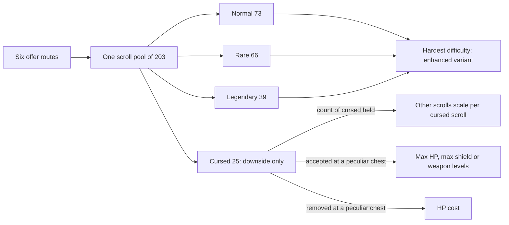

# Scrolls and synergies: passive picks, cursed downsides and counted payouts

Evidence: public wiki pages read by scouts (level 2, "wiki (public)", cited by page and line), a rendered-table count pass whose totals match the page's stated totals (level 4 for counts, level 2 for the keyword categories, only the 73 normal rows hand-checked), and shipped data tables (level 4 at measurement, scripts outside the repo). Scroll effect numbers sit in unexpanded templates, so they are not stated here. Nothing was checked in the running game.

## What it does

A scroll is a passive pickup; every run starts with none. There are 203 of them in four tiers: 73 normal, 66 rare, 39 legendary and 25 cursed. They arrive from six routes: a vault chest, a vendor, a peculiar chest (a chest that trades HP, copper or scrolls for changes), an elite or boss kill, a challenge event and a first-time unlock. All routes draw on one pool.

A cursed scroll is a pure downside: all 25 describe a penalty or a neutral condition and nothing positive. The payout sits elsewhere. Other scrolls scale with the number of cursed scrolls the player holds, and peculiar chests hand out a cursed scroll in exchange for max HP, max shield or weapon levels. Some chest options also remove a cursed scroll for an HP cost. On the hardest difficulty, every non-cursed scroll has an enhanced variant (a bigger bonus, a smaller downside, or both), and a player cannot carry both versions of one scroll.

## Parameters

| Parameter | Value | Source |
|---|---|---|
| Total scrolls | 203 | wiki (public): Occult_Scrolls page; rendered-table pass (matches page total) |
| Tier counts | normal 73, rare 66, legendary 39, cursed 25 | same |
| Always-available pool | 101 scrolls (38 / 23 / 15 / 25 by tier); the rest unlock by act (35, 28, 30, 1, plus 8 other) | wiki (public): Unlockables page |
| Offer routes | 6 (vault chest, vendor, peculiar chest, elite or boss, challenge event, first unlock) | wiki (public): Occult_Scrolls page |
| Run start | no scrolls | wiki (public): Occult_Scrolls page |
| Cursed shape | all 25 describe a downside or neutral condition only (examples: vendor wares cost 20% more, a crit multiplier cut, slower movement) | rendered-table pass |
| Cursed payout | +20% weapon and skill damage per cursed scroll held; +15 max shield or armor per cursed scroll held (two examples) | rendered-table pass |
| Cursed-for-reward trades | +30 max HP, +20 max shield or +3 weapon levels | wiki (public): Chests page |
| Cursed removal | HP cost, 75% in one option | wiki (public): Chests page |
| Non-discardable | all cursed scrolls plus a named list of exploit-prone ones | wiki (public): Occult_Scrolls page |
| Category spread (keyword heuristic, total of 203) | shield or health 43; economy 27; reload or ammo 25; element 20; trade-off 20; skill 20; weapon damage 18; utility 16; movement 14 | rendered-table pass (first matching rule wins) |
| Vendor scroll stock | 1 at a time, 2 with a talent | wiki (public): Peddler page |
| Vendor price, act 1 stage 1 | 135 / 180 / 198 (normal / rare / legendary) | wiki (public): Peddler page |
| Vendor price, act 4 boss | 495 / 660 / 726 | same |
| Price ratio | about 1.33x rare over normal and 1.10x legendary over rare (derived, inference) | same |
| Price-changing scrolls | two give -25% on all wares; a cursed one gives +20% | wiki (public): Peddler page |
| Green chest offer | 3 scrolls, pick one | wiki (public): Chests page |
| Enhancement | hardest difficulty only; 178 non-cursed rows carry an enhanced text; example kinds: bonus doubled, broader condition, changed condition, new clause | wiki (public): Reincarnation page; rendered-table pass |
| Carry cap | 60 non-cursed in the endless mode; base-game cap not stated | wiki (public): Reincarnation page |
| Drop or offer weights per tier | not stated (words only, such as "great chance") | wiki (public): Chests page |
| Per-scroll effect numbers | not stated (unexpanded templates) | wiki (public): Occult_Scrolls page |
| Cursed offer frequency, sell values, enhanced price | not stated | wiki (public): absent |
| Scrolls in shipped data | no scroll table identified; talent nodes number 360 and are a different system (the in-run ascension tree, inference) | shipped data tables (level 4 at measurement, scripts outside the repo): talentdata schema |

Weapons and scrolls form two layers of one build. An inscription changes one weapon's own stats (crit multiplier, magazine, reload, rate of fire, element chance) and lives on that weapon. A scroll changes the player's rules for every weapon held. Scroll families key on the same stats an inscription tunes: the reload or ammo, element and weapon-damage families (25, 20 and 18 of 203 by the keyword heuristic) read the weapon's magazine, reload, element and damage, so a scroll's value depends on the weapon in hand (inference from category names and effect text; wiki (public): Occult_Scrolls page; rendered-table pass). The rare inscription kind changes a weapon's damage type and so unlocks scroll scaling that needs that type (wiki (public): Inscriptions page). The explicit bridge between the layers is the peculiar chest option that takes a cursed scroll and adds an exclusive inscription to a weapon (wiki (public): Inscriptions and Chests pages). Everything else in this paragraph beyond that trade is the scout's synthesis and is not stated by the pages.

## Why it works

1. **One pool, many doors.** Every route draws on the same list, so a scroll is the same object whether bought or found. Stated on the pages.
2. **A downside is a currency.** A cursed scroll costs the player something, and other scrolls and chests pay for holding it. The player chooses how much risk to carry. The payout structure is stated; the choice framing is inference.
3. **Synergy is mostly by family.** Counts by category show shield, ammo, movement, reload and element families, and the explicit conditional rules are few (a set lock, one exception, one chest-blocking scroll). Inference: the families come from names and effect text, not from a developer statement.
4. **Late variants keep the slot.** Enhancement changes numbers and conditions but not rarity or slot, so a hard mode adds depth without a new list.

## What Scrapkeep borrows

Principles: **opt-in layers** and **readable-capped scaling**. Relationships to build on: a visible downside item that pays out through a counted effect, a single offer pool with several doors, and a late variant that keeps the slot. Bible anchors that exist today: "Themed loot, attunement and fixed secrets" (`BIBLE.md:556`), "Inventory, equipment and transformations" (`BIBLE.md:546`) and "5.3 Finds that belong to their area" (`BIBLE.md:434`). TADR-010 (open stages and the event director) is where an optional pocket could offer a trade.

Proposed relationships (design inference):

- A two-layer build: weapon-local parts (change one built weapon's stats) and player-global parts (change rules for every weapon), with the build screen labelling which layer each part changes and which weapon stats a global part reads, plus at least one explicit trade that turns a global burden into a local weapon gain.
- A rare "burden" part with a stated cost, taken only in an optional pocket the player can see from the open stage, so taking it is a choice.
- A payout that reads the count of burdens held and caps through the ceiling curve from the RoR2 note, not a straight multiple.
- One list of parts with several sources (find, shop, pocket reward), shown with its weights on the screen.
- A cap on how many passive parts of one family apply at once, shown in the build screen.

## What it must not copy

- Scroll names, scroll icons and the border-color scheme.
- Scroll effect text, tier lists and the category list as content.
- Hidden offer weights. Scrapkeep should show what an offer can contain.
- A price curve as numbers; the pages call the vendor pricing a stub with unspecified randomness.
- An uncapped per-cursed-scroll payout; the pages show no cap on it.
- Permanent HP loss as the only way to shed a burden.

## Lab measure

Add a headless "burden sweep": give a dummy build 0 to 10 burden parts, each paired with a payout that scales per burden, and record damage per second and damage taken against a fixed target. Pass when (a) at every count the payout's total contribution is below its declared cap and the step from n to n+1 does not grow, (b) the net build power with 10 burdens stays within a declared multiple (propose 3x) of the zero-burden build, and (c) a build with 5 burdens survives a fixed-length scripted encounter at least as often as a build with none, so the downside is felt but not a trap.
