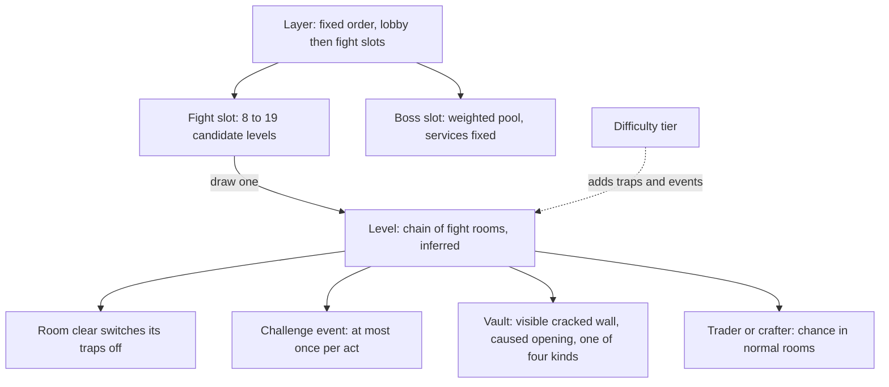

# Gunfire Reborn stage anatomy (comps note, lead)

Evidence: public wiki, read by a scout at level 2 (file and line cited per row); shipped data tables, counts and schemas at level 4 at measurement (read from the repo alone, level 2); decoded stage-chunk files, statistics only, level 4 at measurement. Nothing in the logic was read: the game is native code, so every statement about how levels are chosen comes from tables and the wiki, not from a code path. Rooms per stage, how rooms connect and enemies per room are not stated by any source. The card asks for "room-by-room" structure and "wave events per room"; this note cannot supply either, and says where it stops. Units: sizes are engine units, read as metres (inference).

## What it does

A run is a fixed sequence of slots. Each slot draws one level from a pool (the tables show pools of level ids; that the levels are hand-authored is inference, since neither source says hand-made or generated), so the run's skeleton never changes and its contents do. A level is, by inference, a chain of fight rooms cleared in order (the scout report states that connection shape is not documented), with a few things layered on top:

1. **Slots and pools.** The level-choose table holds 5 layers with 4, 3, 3, 2 and 2 fight slots, a lobby level per layer and a weighted boss pool per layer. Each fight slot lists 8 to 19 candidate levels. The wiki names 4 acts with 4, 3, 3 and 2 regular stages, each opened by a small starting stage and closed by a boss. The two sources disagree: the table has a fifth layer and 14 slots, the wiki has 12 regular stages. The table is the more direct source, but its fifth layer may belong to another mode (inference), so this note quotes both and builds on neither.
2. **Two gates.** Clearing a room opens its exit (Enemies page, line 5, as read in the enemies note). A challenge event in a normal room is a second gate: it must be beaten before the player moves past that room. The wiki gives no doors, loops or branches, so the chain shape is inference. The tables show no branching beyond layer order.
3. **One vault per non-boss stage.** The vault is hidden behind a visibly cracked wall. A player who carries the right talent opens it, and every player is told. The vault is one of four kinds: no-enemy movement course, fight, fight with an elite, or objective (defend something, or chase something under a time limit).
4. **Services by chance.** A trader and a crafter appear in some normal rooms at random odds (not stated), and always in the boss stage.
5. **A challenge event at most once per act.** Event kinds are timed waves, seal defence, elite guardian, enemy transformation on death and rule modifiers. Reincarnation levels 8 and 9 allow many per act and guarantee one at the boss stage (the wiki names those two levels; its pages disagree on whether the ladder has 8 or 10 levels in all).
6. **Hazards that clear with the room.** Traps sit in rooms and vaults, mostly fixed or on a fixed path. Clearing a room switches its traps off for good.
7. **Difficulty adds, it does not rebuild.** Higher tiers add traps and events to the same rooms and raise enemy health and damage. The room count does not change.

What the sources do not give: waves per room (no spawn-wave table exists in the shipped data), time to clear, how many rooms a stage holds, and where the start and exit sit.

**Footprint reading.** Across 118 decoded chunk files the floor extent has a median of 238 by 240 units, a 90th percentile of 602 by 585 and a maximum of 2243 by 1541; the height median is 88 units. The median bounding box is about 5.7 ha. The ordinary Risk of Rain 2 stages in the trimmed table of [ror2/stage-anatomy.md](../ror2/stage-anatomy.md) run from 352 by 418 m (about 14.7 ha) to 603 by 611 m (about 36.8 ha), so a median Gunfire chunk is well under half the smallest of them, and only the 90th-percentile chunks reach the Risk of Rain 2 range. Two cautions. First, chunks are not mapped to acts or levels, and a chunk may be one room or a whole level (unknown). Second, the walkable-share figure (median 0.958 of grid cells) does not read like a corridor chain, so the mask may describe the bounding grid and not the route (inference); treat the footprint as an upper bound on a level's size, not a measure of its length. A join from the chunk header id to the 554 level definitions was attempted and found no shared key in any table, so the mapping stays open. One gradient does show: chunks whose mask has two or more layers (51 files) have a median floor of 252 by 300 units and a 90th percentile of 750 by 731, against a median near 200 a side for chunks with a flat or empty mask (67 files), so the layered chunks are the better candidates for whole levels (inference).

**Shape by act** (wiki, via the scout report lines 56 to 59). The corridor reading holds for act 1 only.

| Act | Shape | Source |
| --- | --- | --- |
| 1 | Indoor, tight corridors, stairs and bridges | wiki: scout report, lines 56 to 59 |
| 2 | Stage 1 open ground; stages 2 and 3 walls and buildings | wiki: scout report, lines 56 to 59 |
| 3 | Mountain, village, beach; very large areas | wiki: scout report, lines 56 to 59 |
| 4 | Climb by day then night; very large rooms | wiki: scout report, lines 56 to 59 |

## Parameters

| Parameter | Value | Source |
| --- | --- | --- |
| Layers in the main mode | 5 | tables: level-choose table, level 4 at measurement |
| Fight slots per layer | 4, 3, 3, 2, 2 | tables: level-choose table |
| Candidate levels per slot | 8 to 19 across the 15 populated slots; 12 of the 27 slots across all five modes are empty | tables: level-choose table |
| Regular stages per act | 4, 3, 3, 2 (act 4 optional) | wiki: Acts page, lines 14, 21, 28, 35 |
| Layer and act counts reconciled | no: 5 layers and 14 slots against 4 acts and 12 stages | tables and wiki disagree; inference: a fifth layer belongs to another mode |
| Starting stage per act | 1, not counted as regular; heals and saves from act 2 | wiki: Acts page, line 5 |
| Default bosses per act | 1 from a small pool; table weights 10 or 0 | wiki: Acts page, line 7; tables: boss pool per layer |
| Level definitions | 554 main-line, 49 boss, 21 prep-room, 1 hidden | tables: level config and its type table (labels translated from Chinese) |
| Hidden-room pool | 877 weighted entries, weights 0 to 30 | tables: level-addition table; relation to the wiki vaults not established |
| Vaults per non-boss stage | usually 1, rarely 0; daily challenges up to 2 | wiki: Vaults page, line 7 |
| Vault layouts listed per act | 19, 14, 11, 6 (50 in all) | wiki: Vaults page, lines 47 to 170 (scout's row count) |
| Vault kinds | movement course, fight, elite fight, objective | wiki: Vaults page, lines 11 to 14 |
| Vault trigger | cracked wall, opened by a talent, all players notified | wiki: Vaults page, line 1 |
| Chase vault limit | 1 minute | wiki: Vaults page, line 87 |
| Optional harder path in a vault | 2 minutes | wiki: Vaults page, lines 101, 103, 131 |
| Room gate | clearing a room opens its exit | wiki: Enemies page, line 5 (via the enemies note) |
| Challenge events | at most 1 per act, vaults excluded | wiki: Challenge Events page, line 9 |
| Waves in a timed-wave event | 4 or 5 | wiki: Challenge Events page, lines 20, 136 |
| Seal failure outcome | locks the chest | wiki: Challenge Events page, line 22; Vaults page, line 83 |
| Event reward | 1 scroll or heal item; elite event adds weapon and rare goblet | wiki: Challenge Events page, lines 3, 5 |
| Hazards | fixed or on a fixed path; off for good on room clear | wiki: Hazards page, lines 3, 5 |
| Elite tier | enemy health x1.4, damage x1.4, adds traps and events | wiki: Difficulty page, lines 20, 21, 27 (traps), 28 (events) |
| Nightmare tier | enemy health x2.4, damage x1.8, raises trap and enemy frequency, and enlarges the event pool | wiki: Difficulty page, lines 38, 39, 44, 45 |
| Services | random in normal rooms, fixed in the boss stage | wiki: Peddler page, line 3; Craftsman page, line 3 |
| Floor extent x (units) | median 238, p90 602, max 2243 | measured: 118 decoded chunk files |
| Floor extent z (units) | median 240, p90 585, max 1541 | measured: 118 decoded chunk files |
| Height extent (units) | median 88, p90 261, max 612 | measured: 118 decoded chunk files |
| Floor raster cell | 2 units | measured: 118 decoded chunk files |
| Floor extent by mask layers, median x by z | 2+ layers: 252 by 300 (51 files); 1 layer: 203 by 211 (22); none: 198 by 239 (45) | measured: 118 decoded chunk files |
| Chunk id joined to a level id | no shared key in any shipped table | measured: join attempted over 7 candidate fields |
| Point pairs per chunk | median 113, p90 420, max 774; meaning undetermined | measured: 66 chunks with real pairs |
| Risk of Rain 2 ordinary footprint, for comparison | 352 by 418 m to 603 by 611 m | measured: [ror2 stage table](../ror2/stage-anatomy.md) |
| Rooms per stage, connection shape, enemies per room, waves per room | not stated | gap in every source read |

## Why it works

- **Variety without a generator.** The skeleton is fixed and each slot draws from a pool of 8 to 19 levels (hand-made is inference). If so, authors control every room and the run still differs from the last. The variety lives in the pool breadth, not in an algorithm.
- **Optional content with a visible trigger.** The cracked wall is seen before it is used, and opening it tells the whole group. The player chooses the detour with full information. The four vault kinds form a ladder from a pure movement test to an objective under a clock, so the player can guess the kind of challenge from the cost.
- **Difficulty layered on the same structure.** Higher tiers add traps and events to rooms that already exist, so the player's map knowledge stays valid while the pressure rises.
- **A cleared room is a safe room.** Hazards that stop when the room is cleared make combat pay twice: the fight ends and the floor becomes safe. This turns clearing into a readable reward and not only a gate.
- **A budget on the big set pieces.** At most one challenge event per act keeps the set pieces rare and learnable, until the top difficulty tiers override it on purpose.

## What Scrapkeep borrows

Principles below are Andrew's, named in the comps README vocabulary. They are not Bible text. Each row names the heading or decision record it would amend; nothing is applied.

| Relationship | Principle | Would amend |
| --- | --- | --- |
| **Slot and pool.** Keep one open stage, and give it a fixed number of authored pocket slots (starting value: 3 slots on the first stage, plus one per stage, cap 8, matching pocket-placement.md's 3 to 8; minimum authored pool of 8 pockets per slot type, the low end of Gunfire's 8-to-19 breadth); each slot draws one pocket from an authored pool. The pool is the variety, so the pocket library's breadth, not generator cleverness, sets how fresh stages feel. This refines pocket-placement.md step 4 (the ror2 note's draw of pocket cards by weight; step numbers follow that note's seven-step proposal, which pocket-placement.md reconciles): draw by slot type from a pool, not only by price among cards. | Opt-in layers; readability first | TADR-010 (open stages and event director); BIBLE.md section 3 "Reading the catalogue" |
| **The vault's visible trigger and four-kind ladder, as a refinement of Andrew's pocket set.** Andrew's set is arenas, secret rooms and trade rooms (comps README, decision 1), and pocket-placement.md guarantees one reward and one trade pocket and one hidden pocket. The ladder refines the arena part only: the movement test, the arena and the elite arena are kinds of arena pocket, and the objective-under-a-limit kind is a fourth arena variant. Secret pockets and trade pockets are unchanged and keep pocket-placement.md's guarantees; none is dropped. Each arena kind sets a reward tier and a credit price. Starting ladder, lab to tune: movement test tier 1 at 1x price, arena tier 2 at 1.5x, elite arena tier 3 at 2x, objective under a limit tier 4 at 2.5x. This refines pocket-placement.md steps 3 and 5 (pocket credit pool and card price, ror2/stage-anatomy.md lines 105 and 107): price by kind first, then by detour. | Opt-in layers; momentum is sacred | TADR-010; BIBLE.md section 3 "Reading the catalogue" and section 6 "Themed loot, attunement and fixed secrets" |
| **Once-per-act event budget.** Treat the event director's set pieces as a per-world allowance (one major event per world by default) and let a stage modifier or a high difficulty dial lift it. Compatible with the pocket credit pool in pocket-placement.md, which prices pockets and does not cap events. | Readable-capped scaling | TADR-010; BIBLE.md section 6 "Encounters, waves and enemies" |
| **Hazards as a clear reward.** A pocket arena's traps switch off when it is cleared, so a cleared pocket becomes a safe place to stop. Fits the crew: a crew bot can be repaired there at no hazard risk (the repair cost is TADR-013's open question, not decided here). | Readability first; opt-in layers | TADR-013 (scrap-bot crew); BIBLE.md section 6 "Encounters, waves and enemies" |
| **Difficulty adds to the same map.** Scale pressure by adding events and hazards to the authored pockets and the open stage, not by changing the stage's route. Consistent with the stage-order credit climb already borrowed from Risk of Rain 2. | Readable-capped scaling | TADR-010; BIBLE.md section 6 "Runs, regions, exits and saves" |

**Where Gunfire is the opposite of Scrapkeep.** Act 1 is a corridor of rooms: the player is gated room by room and the map is a sequence. Scrapkeep's decision is one open stage that carries the main objective, with pockets as optional content, so that part has no counterpart, and copying it would contradict Andrew's stage decision and the principle that momentum is sacred. The median chunk of about 240 units a side sits far below Risk of Rain 2's 352 to 611 m, but chunks are not mapped to levels (inference: chunk size is not level size). The vault is the only Gunfire element that maps onto a pocket, because it is the only optional room.

**The open acts are the closest analogue.** Acts 2 to 4 move to open ground, very large areas and very large rooms (per-act table above). How the one vault per stage sits in those wider spaces, hidden behind a visible cracked wall and announced on opening, is the nearest thing in the three games to Scrapkeep's open stage with a pocket reachable from open ground. The sources do not say where the vault sits relative to the route there, so what to measure is open: CS-03 or a play note should record how far the vault is from the main route in an open act. Until then the vault ladder works as it stands when a pocket is reached from open ground; if a pocket is a long chain of rooms, it stops being optional in feel.

## What it must not copy

- Act, stage, level, vault and event names, boss pools and the act themes. They appear above only as evidence labels.
- Any vault layout, room layout, trap placement or enemy placement. The notes hold counts and kinds, not layouts, and the tables give no layout to describe.
- The corridor-of-rooms gate. A required clear to advance is the opposite of a stage the player crosses at speed.
- The talent gate on the vault. Scrapkeep's trigger is caused by an action (a pull plate, a breakable wall, as in pocket-placement.md), not by owning a talent, so no pocket is locked by a rare drop.
- Code, data structures, table schemas, art and text.

## Lab measure

In the headless Godot lab, generate 1,000 seeded stages from the open-stage-with-pockets shape, drawing each pocket slot from an authored pool. Log per stage the pocket count and, per pocket, the detour ratio: the extra walking distance from the main route to the door and back, divided by the spawn-to-objective path length. Pass when, on at least 95% of seeds, the pocket count is 3 to 8 (the pocket-placement.md range) and the detour ratios span at least a factor of 2 between the 10th and 90th percentile (so the player faces real price differences). As a variety floor, count distinct pocket sets per stage template across the 1,000 seeds: pass at 8 or more, the low end of Gunfire's 8-to-19 pool breadth. Starting values; tune in the lab. A failure on the variety floor means the authored pocket library is too small for the slot count, not that the placer is wrong.
