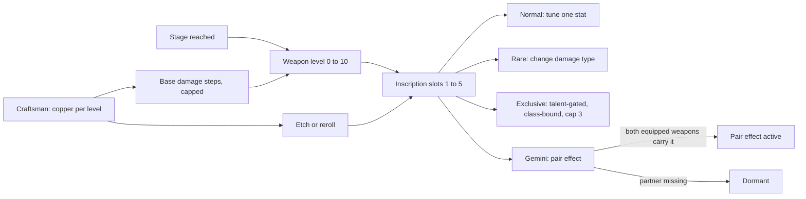

# Weapons and inscriptions: class envelopes, slot growth and paired affixes

Evidence: public wiki pages read by scouts (level 2, "wiki (public)", cited by page and line in the scout report), a rendered-table count pass reconciled against page totals (level 4 for counts, level 2 for category labels), and shipped data tables (level 4 at measurement, scripts outside the repo). The shipped tables hold no weapon or inscription stats; those come from the wiki only. Nothing was checked in the running game.

## What it does

A weapon belongs to one of nine classes (nine per-class counts are given, but the scout report names only eight classes; the ninth is not named in the material read, though shotguns and bows appear elsewhere in it). Eight classes have a stated trade-off envelope: for example, rifles trade accuracy and crit for rate of fire and magazine, snipers trade rate of fire for damage, and launchers put an explosion on every shot. Weapons vary inside that envelope. Each weapon shows damage, crit multiplier, rate of fire, magazine, reload time, an element with a per-hit effect chance, movement speed and one free column (projectile count, magnification or blast radius). Accuracy, stability, range, projectile speed and charge time are hidden.

A weapon also carries inscriptions, which are modifier slots. The number of slots follows the weapon's level, and the level follows the stage reached: a starting weapon has 1 slot, and slots grow to 5 by the third act. Inscriptions come in four kinds. Normal ones tune one stat. Rare ones change the weapon's damage type and so unlock scaling that other systems provide. Exclusive ones are gated by a talent, capped at 3, and often bound to a weapon class. Gemini ones only work when the second equipped weapon carries the same one, so each carries a visible partner. A craftsman spends copper to raise base damage in steps and to etch or reroll inscriptions, with fixed per-visit limits.

## Parameters

| Parameter | Value | Source |
|---|---|---|
| Weapon classes and total weapons | 9 classes, 67 weapons (per-class counts 9/7/11/7/10/9/7/4/3) | wiki (public): Weapons page, class list; stats table rows |
| Class envelopes | one stated trade-off for each of 8 named classes (rifle, SMG, pistol, sniper, launcher, injector, melee, staff); the ninth class is not named in the material read | wiki (public): Weapons page, class sections |
| Visible stat fields | damage, crit multiplier, rate of fire, magazine and ammo type, reload, element and chance, move speed, one free column | wiki (public): Weapon_Stats table header |
| Hidden stats | accuracy, stability, effective range, projectile speed, charge time, lucky-shot chance | wiki (public): Weapons page, hidden-stat list |
| Damage model | damage / (1/rate + reload/magazine); damage per projectile | wiki (public): rate-of-fire, magazine, reload and projectile pages (wiki formula, not checked in game) |
| Extra projectile | +1 is a full extra projectile; a fraction is a chance per shot | wiki (public): Projectile page |
| Slots, weapon level 0 | 1 slot (starting chest) | wiki (public): Weapons page, stage table; rendered-table pass |
| Slots, levels 1-2 | 2 slots (act 1 stages 1-2) | same |
| Slots, level 2 from act 1 stage 3 | 2 or 3 slots | same |
| Slots, levels 3-4 | 4 slots (act 2) | same |
| Slots, levels 5-10 | 5 slots (acts 3 and 4); a craftsman talent adds 1 | same |
| Boss-kill drop | uses the next stage's level and slots | wiki (public): Weapons page |
| Inscription rows by kind | normal 38, rare 47, class-bound exclusive 16, weapon-specific exclusive 108 rows (a row count, continuation rows share a weapon), gemini 7 | wiki (public): rendered inscription tables, counts |
| Exclusive cap | up to 3 per weapon, set by talent level | wiki (public): Inscriptions page |
| Gemini rule | works only if both equipped weapons carry the same one; guaranteed at weapon level 5 or higher on drop or reroll, never at 4 or lower | wiki (public): Inscriptions page |
| Gemini timing | etchable from act 2 stage 1; carried from act 3 stage 1 | wiki (public): rendered stage table |
| Gemini shapes (examples) | shared magazine that builds stacks; magazine fixed at 1 with a reload damage bonus; shared element with a chance to apply the partner's effect | wiki (public): rendered gemini rows |
| Craftsman enhance | +15% base damage per level, capped at 100,000 per projectile | wiki (public): Craftsman page |
| Enhance price | 50 to 600 copper by level; 2 enhances per craftsman, 3 with a talent | wiki (public): Craftsman page |
| Other craftsman prices | gemini reforge 300 copper (100 in the daily mode); etch 200 per level, one per weapon | wiki (public): Craftsman page |
| Free reroll | up to 3 per weapon, one difficulty mode only | wiki (public): Craftsman page |
| Peculiar chests | spend HP or copper to turn normal to rare, reroll all, or add an exclusive for a cursed scroll; weapon upgrade costs about 50% HP | wiki (public): Inscriptions and Chests pages |
| Weapon rarity tiers | not stated | wiki (public): absent from every page read |
| Cursed or negative inscriptions | not stated; cursed appears only as a scroll | wiki (public): Chests page |
| Hitscan vs projectile, pierce | not stated; one ricochet inscription only | wiki (public): Projectile page |
| Drop weights by act or difficulty | not stated | wiki (public): absent |
| Weapon stats in shipped data | none; builddata rows hold a name and a model id only | shipped data tables (level 4 at measurement, scripts outside the repo): builddata schema |

Known wiki inconsistencies: the backpack ammo totals do not add up (450 plus 225 is not the listed 625 for the largest pool), a twelfth pistol appears in the gallery but not in the 11-row stats table, and movement speed is called hidden while the table has a column for it.

## Why it works

Three choices keep a large weapon pool readable. The first is a code-free fact from the pages, the others are inference.

1. **One envelope per class.** A player learns a class by its single trade-off, and weapons spread inside it instead of on one power number. This is stated on the wiki; that it drives readability is inference.
2. **Slots grow with progress, not with grind.** A weapon is weak at the start and gains slots as stages pass, so a find late in a run is worth more than the same find early. The wiki states the table; the effect on pacing is inference.
3. **The pair is visible.** A gemini inscription only pays off with a matching partner, so the player can see what to hunt for. Inference: the condition turns a random affix into a goal.

Costs are explicit and bounded (copper per level, a damage cap, per-visit limits), so spending is a plan, not a gamble. The shipped data tables do not show how any of this is balanced.

## What Scrapkeep borrows

Principles: **opt-in layers** and **class identities**. The relationships worth building on are slot growth with progress and the pairing condition, not any content. Bible anchors that exist today: "5.1 Shared baseline and class roles" (`BIBLE.md:398`), "5.2 The mech builds its advances" (`BIBLE.md:418`), "5.4 Attunement and transformative combinations" (`BIBLE.md:448`) and "Four slots and milestone progression" (`BIBLE.md:527`). TADR-008 (one ability contract) is where a slot-granted effect would plug in.

Proposed relationships (design inference):

- A scrap-built weapon gains attachment slots as a stage milestone is passed, with a visible table in the build screen, so players can plan around it.
- A paired attachment pays off only when a second built part carries the matching tag, and the build screen shows the missing partner. This fits the scrap-bot crew of TADR-013, where the partner could be a bot.
- A per-class trade-off line, shown in the build screen, instead of a single power number.
- An upgrade that spends scrap at a fixed, visible price per step with a hard cap.

## What it must not copy

- Weapon names, weapon models and the class list as content.
- Inscription wording and the list of 216 rows, including rare and exclusive effect text.
- Hidden stats. Scrapkeep should show accuracy and range if it has them.
- The craftsman price table and the 100,000 damage cap as numbers; they belong to another damage scale.
- A damage-type switch (the rare kind) that silently decides which other systems scale. Scrapkeep would show it.
- Element art and VFX tied to a weapon's color coding.

## Lab measure

Add a headless "slot growth sweep": for a scrap-built weapon at each milestone from the first to the last, record slot count and the damage per second of the best legal attachment set against a fixed dummy, once with the pair condition met and once with the partner missing. Pass when (a) slot count never decreases with milestone and reaches its declared maximum at the last one, (b) the best paired set beats the best unpaired set by a declared margin (propose 15% to 40%) at every milestone with a pair available, and (c) the best set at the last milestone stays within a declared multiple (propose 6x) of the first-milestone baseline.
