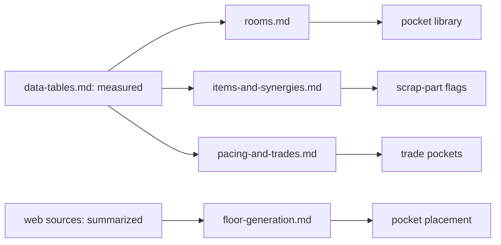

# Isaac comps pack (Rebirth through Afterbirth+)

Evidence: parsed game data (level 4, 15,965 rooms in 26 files, 674 items, 26 pools, 763 entities) and public web sources read through summaries (level 1 unless a note says it re-read the page). Written 2026-10-10 in the study's own words so a reader can implement Scrapkeep's version of each structure without the game. The notes carry no names, layouts, text or art from the game except wiki page titles used as citations.

## Why this pack

BIBLE AD-10 says Isaac informs transformative combinations and that relationships are borrowed while content is original. Andrew's answers this session widen that to placement and rooms: what makes a great room is layouts you can solve on entry, enemy mixes that force movement, and optional risk pockets (secret, curse, sacrifice, deal). He did not name the fixed hand-made library as the reason, so the library is treated as the means and those three as the ends. Scrapkeep's stage shape (decided this session): one open stage with the main objective, with authored pockets embedded as optional content visible from the open space. Isaac's special-room placement rules are the model for where pockets go.

## Reading order

| Note | One line | Scrapkeep decision it feeds |
| --- | --- | --- |
| [floor-generation.md](floor-generation.md) | The floorplan algorithm, source conflicts, and the same dead-end and adjacency logic applied to pocket anchors in an open stage | Pocket placement in TADR-010 |
| [rooms.md](rooms.md) | The room library's structure, the fairness complaints, and an authored pocket library with a readable-on-entry rule | Pocket authoring spec, BIBLE section 6 encounters |
| [items-and-synergies.md](items-and-synergies.md) | Item records, cache flags, 128-bit tear flags, pools with decay, transformations | Scrap-part combination rule, BIBLE section 5.4 |
| [pacing-and-trades.md](pacing-and-trades.md) | Deal odds with memory, sacrifice and curse rooms, ambush ladders, secrets, curses as modifiers | Opt-in trade pockets and stage modifiers |
| [data-tables.md](data-tables.md) | The measured tables worth keeping, with parser method | Evidence for the four notes |

## Open items

- The wiki refused a direct re-fetch (HTTP block), so its numbers (room-count formula, secret-room weights, dead-end quota, odds) are unchecked. Boris the Brave's article was re-read and matches the summary for the formula, grid, queue rules, 300 and 600 tries, and the x1.8 count curse.
- The 174 normal rooms Boris cites for the first chapter do not match the parsed first-family files (about 1,000 per file); unreconciled.
- The sacrifice combined odds (5/14) do not equal 1/7 plus 1/4; only the separate figures are used.
- Raw grid codes (for example 3000) have no verified mapping; the data note leaves them out.
- Repentance floor changes (alternate path, key rooms), quality tier definitions, and where the game hand-codes item pairs: not found.
- Every Scrapkeep number in the notes is a starting proposal for the lab, not data.
