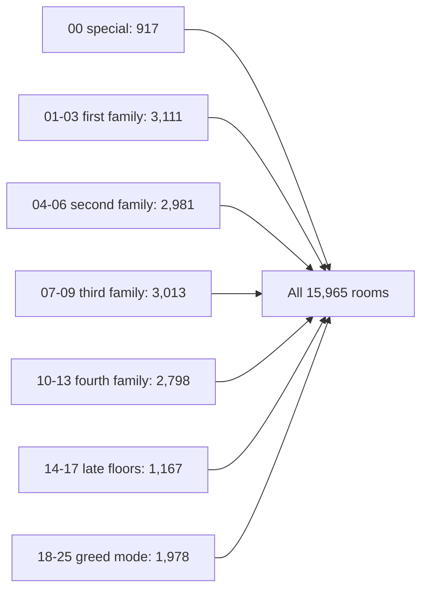

# Isaac data tables worth keeping

Evidence: parsed from the game's own data files with the official extractor, in the study's report `isaac-data.md` (level 4: every room file consumed byte for byte, every type and shape in range). Only counts and distributions are kept here. This note holds no names, text, layouts or art. It is a data note, so it does not use the six-heading design-note shape.

## Method

The room files are binary. A file starts with the 4-byte magic `STB1`, then a uint32 room count. Each room stores, little-endian and in this order: uint32 type, uint32 variant, uint32 subtype, uint8 difficulty, uint16 name length with the name bytes (skipped, never kept), float32 weight, then uint8 width, uint8 height, uint8 shape and uint8 door count (width and height come before shape), then a uint16 spawn count that comes before the door list, then the doors (int16 x, int16 y, uint8 exists), then the spawns (int16 x, int16 y, uint8 stack size, then per stack entry uint16 type, uint16 variant, uint16 subtype, float32 weight). All 26 files parsed to their last byte with no out-of-range type or shape, which is the check that the field order is right. Item, pool, entity, wave, curse and challenge files are plain XML. Floor files are named by two-digit prefix: 00 special rooms; 01 to 03 first family; 04 to 06 second; 07 to 09 third; 10 to 13 fourth; 14 to 17 late floors; 18 to 25 greed mode. Source for every table: `data: isaac-data.md`.

## Rooms

**Room totals per family** (7 rows; one reading: the four main families are about equal at 2,800 to 3,100 rooms, so a floor family has roughly 1,000 rooms per floor variant).

| family | files | rooms |
| --- | --- | --- |
| special | 00 | 917 |
| first | 01-03 | 3,111 |
| second | 04-06 | 2,981 |
| third | 07-09 | 3,013 |
| fourth | 10-13 | 2,798 |
| late floors | 14-17 | 1,167 |
| greed mode | 18-25 | 1,978 |

**Shape distribution, all files** (12 rows; reading: more than half of all rooms are a single cell, and each shape has exactly one stored size).

| shape | width x height | cells used | rooms |
| --- | --- | --- | --- |
| single cell | 13 x 7 | 91 | 8,785 |
| thin horizontal | 13 x 7 | 91 | 503 |
| thin vertical | 13 x 7 | 91 | 622 |
| tall (1 x 2) | 13 x 14 | 182 | 3,222 |
| thin tall | 13 x 14 | 182 | 209 |
| wide (2 x 1) | 26 x 7 | 182 | 1,096 |
| thin wide | 26 x 7 | 182 | 227 |
| large (2 x 2) | 26 x 14 | 364 | 658 |
| L top-left | 26 x 14 | 273 | 162 |
| L top-right | 26 x 14 | 273 | 161 |
| L bottom-left | 26 x 14 | 273 | 161 |
| L bottom-right | 26 x 14 | 273 | 159 |

**Room weight values** (6 rows; reading: weight is a tie-breaker, not a dial).

| weight | rooms | share |
| --- | --- | --- |
| 1 | 15,485 | 97.0% |
| 0.10 | 379 | 2.4% |
| 0.50 | 50 | 0.3% |
| 0.75 | 32 | 0.2% |
| 0.25 | 18 | 0.1% |
| 0.01 | 1 | 0.0% |

**Special room types, file 00** (22 rows; reading: nearly half of the special library is boss rooms, and the rest is one to four dozen rooms per kind).

| type | rooms | | type | rooms |
| --- | --- | --- | --- | --- |
| boss | 431 | | chest | 42 |
| treasure | 39 | | error | 28 |
| mini-boss | 87 | | player-home (parser label ROOM_ISAACS) | 28 |
| secret | 30 | | barren | 26 |
| curse | 25 | | arcade | 21 |
| dice | 21 | | super-secret | 20 |
| devil | 20 | | angel | 17 |
| library | 16 | | challenge | 13 |
| dungeon | 11 | | default | 10 |
| sacrifice | 10 | | hidden market | 9 |
| shop | 7 | | boss rush | 6 |

(The table keeps the parser's room-type labels. It has 22 types and 917 rooms in total.)

**Difficulty, normal rooms, by family** (6 value columns; reading: difficulty is three working values, 1, 5 and 10, split roughly evenly, with a handful of outliers).

| family | d=0 | d=1 | d=2 | d=5 | d=10 | d=15 |
| --- | --- | --- | --- | --- | --- | --- |
| first | 3 | 951 | 11 | 1,125 | 1,003 | 18 |
| second | 79 | 951 | 4 | 981 | 954 | 12 |
| third | 0 | 910 | 0 | 1,154 | 944 | 5 |
| fourth | 0 | 837 | 0 | 1,047 | 905 | 5 |

**Mean enemy health sum per normal room, by difficulty** (4 families x 3 values; reading: health sum rises with difficulty, more steeply in later families).

| family | d=1 | d=5 | d=10 |
| --- | --- | --- | --- |
| first | 29.3 | 41.4 | 57.4 |
| second | 48.7 | 64.3 | 72.6 |
| third | 69.3 | 95.7 | 130.5 |
| fourth | 96.9 | 129.3 | 177.0 |

**Median spawn points per normal room, one value per file** (reading: the density peak is in the second family, and late floors thin out hard).

| files | median spawns |
| --- | --- |
| 01 / 02 / 03 | 19 / 19 / 19 |
| 04 / 05 / 06 | 28 / 30 / 27 |
| 07 / 08 / 09 | 26 / 25 / 25 |
| 10 / 11 / 12 | 23 / 23 / 22 |
| 14 / 15 / 16 / 17 | 12 / 12 / 3 / 2 |

**Door counts, first family** (4 columns; reading: door count follows shape: 4 for single cell, 2 for thin shapes, 6 for two-cell shapes, 8 for large and L shapes).

| file | 2 doors | 4 doors | 6 doors | 8 doors |
| --- | --- | --- | --- | --- |
| 01 | 121 | 637 | 170 | 94 |
| 02 | 112 | 624 | 166 | 90 |
| 03 | 127 | 688 | 183 | 99 |

**Spawn content shares by family, normal rooms** (4 rows; reading: terrain dominates and falls with depth, enemies are about a tenth to a fifth, pickups about 1%).

| family | spawn points | terrain | enemy | pickup |
| --- | --- | --- | --- | --- |
| first | 88,172 | 83.9% | 13.5% | 1.2% |
| second | 122,746 | 88.9% | 9.4% | 0.9% |
| third | 110,903 | 87.4% | 10.5% | 0.8% |
| fourth | 104,205 | 86.1% | 12.4% | 0.5% |
| late floors | 20,643 | 75.9% | 19.3% | 1.3% |
| greed mode | 6,368 | 13.5% | 84.6% | 1.5% |

(The table has 6 rows.)

**Spawn content shares, selected special types** (reading: each pocket kind has its own content signature).

| type | rooms | terrain | enemy | pickup |
| --- | --- | --- | --- | --- |
| boss | 431 | 77.7% | 18.4% | 0.1% |
| secret | 30 | 65.5% | 15.8% | 16.7% |
| super-secret | 20 | 50.2% | 9.2% | 35.9% |
| curse | 25 | 52.1% | 19.9% | 24.7% |
| sacrifice | 10 | 92.7% | 0.0% | 7.3% |
| devil | 20 | 70.5% | 2.4% | 24.7% |
| challenge | 13 | 13.8% | 0.0% | 86.2% |
| arcade | 21 | 32.9% | 3.5% | 14.1% |

**Stack size** (reading: variety comes from choosing rooms, not from inside rooms): 468,193 spawn points; 466,262 hold one entry (99.6%), 1,611 hold two, the rest more.

## Items and pools

**Item entries by kind** (4 rows; reading: passives are the largest group at 322 of 674).

| kind | entries |
| --- | --- |
| passive | 322 |
| active | 123 |
| familiar | 102 |
| trinket | 127 |

**Active charge counts** (13 rows; reading: pacing of actives is mostly one to six charges).

| max charge | items |
| --- | --- |
| 0 | 17 |
| 1 | 9 |
| 2 | 19 |
| 3 | 14 |
| 4 | 20 |
| 6 | 28 |
| 12 | 3 |
| 60 / 70 / 90 | 1 each |
| 110 | 3 |
| 250 | 1 |
| 300 | 2 |

**Pool sizes** (26 rows; reading: one huge general pool, most pools under 80).

| pool | items | pool | items |
| --- | --- | --- | --- |
| item-room | 339 | greed item-room | 273 |
| shop | 78 | greed shop | 61 |
| boss | 56 | greed boss | 56 |
| devil | 61 | greed devil | 55 |
| angel | 42 | greed angel | 33 |
| secret | 31 | greed secret | 1 |
| library | 12 | greed library | 12 |
| challenge | 11 | golden chest | 20 |
| red chest | 10 | greed golden chest | 10 |
| beggar | 26 | devil-price beggar | 20 |
| curse | 23 | greed curse | 6 |
| key-giver | 11 | boss rush | 17 |
| dungeon | 26 | bomb-giver | 15 |

**Pool entry parameters** (3 small tables merged; reading: weight is nearly always 1; decay is the real control).

| field | values |
| --- | --- |
| weight | 1: 1,295; 0.2: 9; 0.4: 1 |
| decrease-by | 1: 942; 0.5: 290; 0.4: 40; 0.1: 29; 0.2: 3; 0.08: 1 |
| remove-on | 0.1: 1,295; 0.02: 9; 0.04: 1 |

**Pools per item** (7 rows; reading: most items sit in two pools).

| pools | items |
| --- | --- |
| 1 | 62 |
| 2 | 292 |
| 3 | 96 |
| 4 | 52 |
| 5 | 20 |
| 6 | 7 |
| 7 | 3 |

## Entities

**Entity definitions** (763 definitions, 223 distinct ids; reading: 133 are bosses, 121 can be champions).

| group | n | baseHP min | median | p90 | max |
| --- | --- | --- | --- | --- | --- |
| all | 763 | 0 | 0 | 190 | 10,000 |
| bosses | 133 | 0 | 215 | 750 | 10,000 |
| non-boss enemies | 239 | 0 | 20 | 50 | 450 |

**Base health histogram** (8 rows; reading: regular enemies sit under 50, bosses start around 50 and most are over 100).

| bucket | non-boss enemies | bosses |
| --- | --- | --- |
| 0 | 4 | 12 |
| 1-5 | 28 | 2 |
| 6-10 | 41 | 2 |
| 11-20 | 86 | 2 |
| 21-50 | 61 | 7 |
| 51-100 | 15 | 22 |
| 101-300 | 2 | 30 |
| over 300 | 2 | 56 |

**Per-floor health scaling** (reading: it is rarely used): 708 of 749 definitions have a stage-health value of 0; 41 scale with floor (largest values 15, 4, 2, 5, 6 and 24 on a handful of entities). Collision damage median is 0 for all, 1 for bosses and non-boss enemies.

## Waves and challenges

**Ambush waves** (reading: short ladders of mostly one enemy entry per wave).

| set | waves per stage | enemy entries per wave (min / median / max) |
| --- | --- | --- |
| regular ambush | 3 | 1 / 1 / 1 to 2 |
| boss ambush | 2 (3 on one stage) | 1 / 1 to 1.5 / 1 to 2 |
| gauntlet block | 15 waves of 2 spawns | 50 candidate spawns |

Count values over 115 enemy entries: 1: 70, 2: 6, 3: 23, 4: 10, 5: 6. Chunk values: absent 103, 3: 10, 5: 2. 66 distinct enemy types.

**Other tables** (reading: small closed sets). Curses: 7 entries. Challenges: 35; end-stage values 6: 13, 8: 9, 10: 8, 11: 2, 12: 3; starting items on 29 (median 3). Stages: 27 entries, ids 0 to 26. Music: 58 tracks, 40 loop and 18 do not; 16 floor themes, 15 of them with an intro-and-layer pair.
