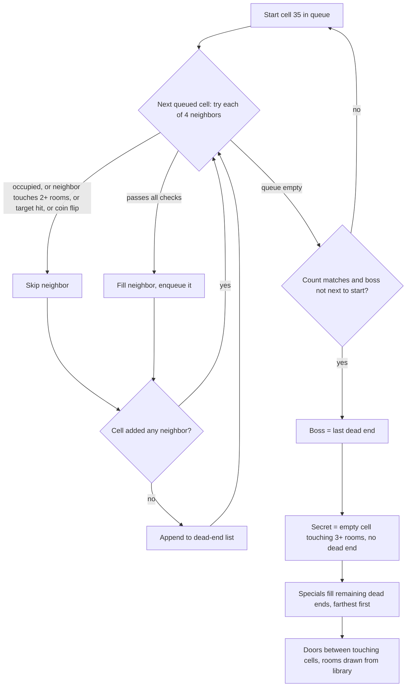

# Isaac floor generation, and pocket placement for an open stage

Evidence: Boris the Brave's article, re-fetched as raw page text on 2026-10-10 (level 2: the quoted formula, grid and queue rules were read in the page); wiki numbers come from a summarized fetch and the wiki refused a direct re-fetch (HTTP block), so they stay unchecked (level 1). The measured data (`isaac-data.md`) holds room libraries, not floor layouts, so it cannot check floor room counts.

## What it does

A floor is built in four passes: lay a floorplan of empty cells, mark some cells as special, fill each cell from a library, then connect neighbors with doors. The floorplan pass is the interesting one.

1. Use a small fixed grid (9 wide by 8 tall, cells numbered so that moving a step is a +1, -1, +10 or -10 on the number). Put the start room at cell 35.
2. Pick the room target for this floor from a formula of floor depth (see Parameters). Deeper floors get more rooms.
3. Put the start cell in a queue. Take cells from the queue one at a time and look at their four neighbors. Skip a neighbor if any of these is true: it already holds a room; it already touches more than one filled cell (this keeps corridors from merging into loops); the target count is reached; or a 50% coin flip says skip. Otherwise fill it and add it to the queue.
4. A cell that adds no neighbor is a dead end. Append it to the dead-end list in the order it finished. Growth moves outward, so later entries tend to be farther from the start.
5. Validate. The count must match the target and the boss cell must not touch the start cell. If either fails, throw the layout away and restart at step 3.
6. The boss room takes the last dead end on the list, which is one of the farthest from the start.
7. The secret room is the one loop-maker. Search random empty cells for one that touches at least three rooms and no dead end. If 300 tries fail, loosen the rule; after 600, loosen it again. It ends up wedged at an intersection, next to many rooms, and always gets placed.
8. Other special rooms take the remaining dead ends. Guaranteed ones (item room, shop, a second hidden room) go first, farthest first. Chance-based ones are rolled afterward at their own odds (see Parameters).
9. Large rooms (2x2, 2x1, L and narrow shapes) are tried before a normal room at an exit. Only the entry cell is checked for neighbors; the rest of the footprint must be empty, so large rooms can create loops. After use, a large room leaves the pool with 95% probability. A large boss room replaces the single boss cell if the bigger footprint fits without touching extra rooms.
10. Every room gets a door in the middle of each edge that touches a neighbor, so any room from the library fits any cell.
11. Curses change counts after the plan: one curse multiplies the room count by 1.8 (capped at 45) and restricts special rooms to the six farthest dead ends; another adds four rooms; hard mode adds two or three.

Where the sources disagree, both are stated and neither is silently chosen:

| Item | Boris the Brave | Wiki (summarized) | Status |
| --- | --- | --- | --- |
| Room count | `random(2) + 5 + depth * 2.6`, so floors start at 7 or 8 rooms and add 2 or 3 per floor | `3.33 * depth + 5 to 6`, maximum 20 | Boris verified in page text. Wiki unverified. Rebirth versus later versions may explain the gap. |
| Secret room | Needs at least 3 neighbors and no dead-end neighbor; relax at 300 and 600 tries | Weight 10 to 14, minus 3 for 2 neighbors, minus 6 for 1 neighbor; usually at least 2 neighbors | Boris verified. Wiki unverified. Both agree it prefers crowded cells. |
| Dead ends | Not stated as a quota | Base 5 on all floors, +1 on every floor but the first, +1 on large floors, +2 on the last floor, +1 with one named later-version item | Wiki only. |

## Parameters

| Parameter | Value | Source |
| --- | --- | --- |
| Grid size | 9 by 8 cells, number step +1/-1/+10/-10 | article: https://www.boristhebrave.com/2020/09/12/dungeon-generation-in-binding-of-isaac/ |
| Start cell | 35 | article: https://www.boristhebrave.com/2020/09/12/dungeon-generation-in-binding-of-isaac/ |
| Room target (Boris) | random(2) + 5 + depth x 2.6 | article: https://www.boristhebrave.com/2020/09/12/dungeon-generation-in-binding-of-isaac/ |
| Room target (wiki) | 3.33 x depth + 5 to 6, max 20 | wiki: https://bindingofisaacrebirth.wiki.gg/wiki/Level_Generation |
| Growth skip chance | 50% per neighbor | article: https://www.boristhebrave.com/2020/09/12/dungeon-generation-in-binding-of-isaac/ |
| Neighbor rule | skip if neighbor already has more than one filled neighbor | article: https://www.boristhebrave.com/2020/09/12/dungeon-generation-in-binding-of-isaac/ |
| Boss placement | last dead end on the list; must not touch start | article: https://www.boristhebrave.com/2020/09/12/dungeon-generation-in-binding-of-isaac/ |
| Secret placement tries before relaxing | 300, then 600 | article: https://www.boristhebrave.com/2020/09/12/dungeon-generation-in-binding-of-isaac/ |
| Dead-end quota | 5 base, +1 per floor after the first, +1 large floor, +2 last floor | wiki: https://bindingofisaacrebirth.wiki.gg/wiki/Level_Generation |
| Special-room order | boss, second-hidden room (guaranteed), shop and item room (guaranteed early floors), then chance rooms | wiki: https://bindingofisaacrebirth.wiki.gg/wiki/Level_Generation |
| Chance room odds | dice or sacrifice 1 in 7 (plus 1 in 4 at full health), library 1 in 20, curse room 1 in 7 (original) or 1 in 4 (later) | wiki: https://bindingofisaacrebirth.wiki.gg/wiki/Level_Generation |
| Large-room shapes | 11 shapes | article: https://www.boristhebrave.com/2020/09/12/dungeon-generation-in-binding-of-isaac/ |
| Large-room retire chance | 95% after placement | article: https://www.boristhebrave.com/2020/09/12/dungeon-generation-in-binding-of-isaac/ |
| Large-room dead-end resize | most dead ends become 1x1 during placement | wiki: https://bindingofisaacrebirth.wiki.gg/wiki/Level_Generation |
| Count-doubling curse | x1.8 rooms, cap 45, specials only in 6 farthest dead ends | article: https://www.boristhebrave.com/2020/09/12/dungeon-generation-in-binding-of-isaac/ |
| Other count curses | +4 rooms; hard mode +2 to 3 | wiki: https://bindingofisaacrebirth.wiki.gg/wiki/Level_Generation |
| Floors per chapter | typically two | article: https://www.boristhebrave.com/2020/09/12/dungeon-generation-in-binding-of-isaac/ |
| Stage-to-room-file link | 26 room files, ids 0 to 25, stage id equals file prefix | data: isaac-data.md |
| Floor room counts from data | not measurable: the room files hold room contents, not floorplans | data: isaac-data.md |

## Why it works

- Growth outward from one cell with a no-merge rule yields a tree. A tree has a unique path to every room, so "farthest dead end" is well defined and the boss is always the longest walk.
- Dead ends are the natural home for optional content: entering one is a choice, and leaving is the same way back. Guaranteed rooms taking the farthest dead ends makes the guaranteed reward cost the longest detour.
- The one deliberate loop is the hidden room, so finding it is a pattern the player can learn: look where many rooms meet.
- The retry-on-invalid loop moves all fairness rules into validation. The growth step stays three lines long.
- A fixed middle-of-edge door means content is interchangeable between cells. The generator and the library never need to know about each other.

## What Scrapkeep borrows

The relationship: optional content sits in dead ends ranked by detour cost, with one guaranteed reward at the most expensive one and a hidden pocket where paths cluster. This serves the principle "opt-in layers" (the player chooses how far to detour) and keeps momentum intact because pockets never sit on the objective route. It would amend the open-stage placement text in TADR-010 (open stages and the event director) and the discoveries wording in BIBLE section 6, "Themed loot, attunement and fixed secrets". Nothing here replaces the one-open-stage decision; the algorithm below places pockets inside it.

Adaptation to one open 3D stage:

1. Build a coarse walk graph. Cut the stage's walkable space into zones (landform basins, ramps, aprons) and join zones that a rolling mech can cross in one move. The authored stage supplies the zones; no grid is needed.
2. Compute walking distance from the spawn and from the main objective to every zone.
3. A pocket anchor is a zone with one entrance (a degree-1 node: a cul-de-sac, a ridge nook, a cave mouth). This is the analog of a dead end. List the anchors by distance from spawn.
4. The main objective must not sit in an anchor next to spawn. Re-roll the anchor set if the objective is closer than a set fraction of the farthest anchor (the analog of "boss not adjacent to start").
5. Guaranteed pockets (one reward pocket, one trade pocket) take the farthest anchors that are also not on the shortest spawn-to-objective route. Chance pockets roll for the remaining anchors.
6. Hidden pockets use the adjacency rule: choose a sealed volume that borders three or more different zones (it is visible from several places and reachable from none), then give it one opening the player has to cause, such as a pull plate or a breakable wall. This is the analog of the secret room next to three rooms.
7. A pocket must be visible from the open space before it is entered: a lit mouth, a prop line, a sound. Isaac's player sees the door on the map; Scrapkeep's player sees the landform.
8. Large pockets (an arena that needs space) are tried first and take an anchor only if the footprint fits without cutting an existing route.
9. A stage-level modifier (the analog of the count-changing curses) can scale the pocket count and shrink the usable anchor set to the farthest few.

Starting numbers to tune in the lab, all marked as proposals: pocket count 3 to 5 for the first stage rising by one per stage with a cap of 8; one guaranteed reward pocket and one guaranteed trade pocket; hidden pockets 1 per stage; chance pockets 25% per leftover anchor.

## What it must not copy

- The 9 by 8 grid, cell numbering, door-in-middle-of-edge rule and room-by-room screen locks. The open stage has no grid and no door screens.
- The exact formulas and odds as if they were tuned for a 3D stage; they are tuned for 20 or fewer 2D rooms.
- Boss-last-in-dead-end as a rule: Scrapkeep's objective is in the open stage, not at the end of a corridor.
- Any floor, room or special-room names, art or layouts.
- Hidden rooms that need blind bomb-throwing at every wall. The wiki and community call these luck-based and useless; Scrapkeep's hidden pocket must have a visible tell (see `rooms.md`).

## Lab measure

In the headless Godot lab, generate 1,000 stage seeds with the pocket placer and measure, per seed: (a) guaranteed pockets always sit on anchors, never on the shortest objective route (target 100%); (b) the median walking distance from spawn to the reward pocket is at least 1.5 times the median to the objective; (c) every hidden pocket borders at least 3 zones; (d) no seed fails to place the guaranteed pockets. Report the fraction of seeds that needed a re-roll; if above 20%, the anchor rules are too tight.
