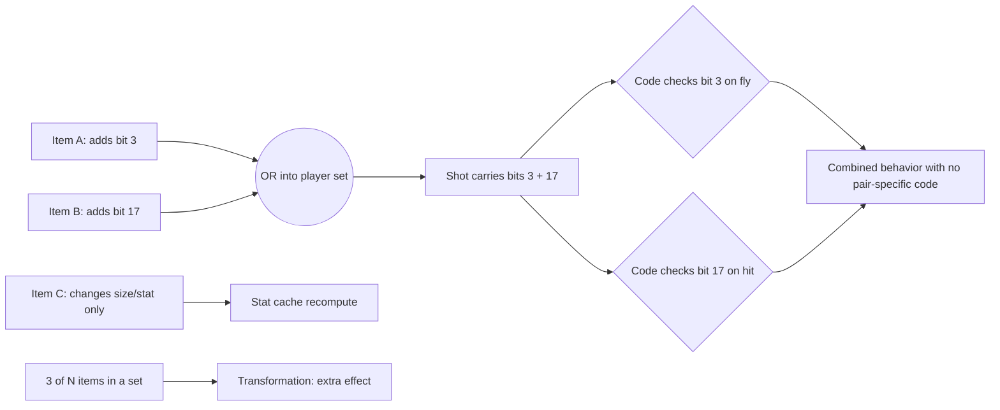

# Isaac items, flags and synergy, and what Scrapkeep's scrap parts borrow

Evidence: item and pool files parsed with the official extractor (level 4: 674 item entries, 26 pools, 1,305 pool entries); the modding documentation for item attributes and tear flags, read as a summarized fetch (level 1 for exact flag counts); synergy reasoning is inference (stated where it is used).

## What it does

**Item definitions.** An item is a short record: id, name, art, description, an element kind (passive, active, familiar, trinket) and a few optional numbers. The parsed data holds 322 passives, 123 actives, 102 familiars and 127 trinkets. Actives are defined by charge: 119 of 123 declare a maximum charge, and charge counts of 0 to 6 cover 107 of them. Only 19 entries declare a cooldown. The file used here has no tag list and no quality field; the later version of the documentation adds tags, a quality value from 0 to 4 and a price-in-health field, and those are listed below as documented, not measured.

**Cache flags.** The only composable field in the measured file is `cache`: a list of stat categories to recompute when the item is picked up (damage, fire delay, speed, range, shot speed, luck, tear color, tear flag, flying, familiars, weapon, or all). 211 of 674 entries carry it; 164 of 322 passives do (51%); 468 entries carry none; 124 carry one, the rest up to six. This is an invalidation hint for the engine, not a synergy tag.

**Tear flags.** Each projectile carries a 128-bit set. Bits 0 to 63 live in the first word, 64 to 83 in the second; 84 effect bits are defined and bits 104 to 127 are reserved. The empty set is a plain shot. An item that changes shots OR-s its bits into the player's set. The projectile code checks each bit independently when the shot is fired, flies and lands.

**Pools.** Each source (item room, shop, boss, trade room and so on) draws from a pool. A pool entry has a weight, a decrease-by amount and a remove-on threshold. Nearly everything has weight 1 (99.2%). When an item is drawn, its weight falls by the decrease-by amount; below the threshold it is out. Most items sit in two or three pools (292 in two), so one unlock feeds several sources. An exhausted pool falls back to the item-room pool, then a last-resort pool.

**Transformations.** Collect three different items from a named set and the player transforms, gaining a permanent effect. Before the later expansion only the first copy of an item counted; after it, duplicates all count and losing a required item can undo the transformation.

## Parameters

| Parameter | Value | Source |
| --- | --- | --- |
| Item entries | 674: passive 322, active 123, familiar 102, trinket 127 | data: isaac-data.md |
| Entries carrying `cache` | 164 passives (50.9%), 16 actives, 3 familiars, 28 trinkets | data: isaac-data.md |
| `cache` tokens | 12 distinct; top: damage 65, tearflag 52, fire delay 46, range 40, speed 37 | data: isaac-data.md |
| Cache tokens per entry | 0: 468; 1: 124; 2: 49; 3: 20; 4: 11; 5: 1; 6: 1 | data: isaac-data.md |
| `tags`, `quality`, `hidden` in the measured file | present on 0 entries | data: isaac-data.md |
| Documented attributes | tags, cache, quality 0 to 4, craft quality -1 to 4, price 1 or 2, charge type, max charges, init charge, passive cache | docs: https://wofsauge.github.io/IsaacDocs/rep/xml/items.html |
| Active max charge | 0 to 6 for 107 of 119; tail 12 to 300 | data: isaac-data.md |
| Tear flag width | 128-bit set (two words) | docs: https://wofsauge.github.io/IsaacDocs/rep/enums/TearFlags.html |
| Defined effect bits | 84; bits 104 to 127 reserved | docs: https://wofsauge.github.io/IsaacDocs/rep/enums/TearFlags.html |
| Flag composition | bitwise OR of item bits; empty set is a plain shot | docs: https://wofsauge.github.io/IsaacDocs/rep/enums/TearFlags.html |
| Pool count | 26, holding 1,305 entries | data: isaac-data.md |
| Pool sizes | min 1, median 24.5, max 339 | data: isaac-data.md |
| Pool entry weight | 1: 1,295 (99.2%); 0.2: 9; 0.4: 1 | data: isaac-data.md |
| Decrease-by | 1: 942 (72.2%); 0.5: 290 (22.2%); 0.4: 40; 0.1: 29; 0.2: 3; 0.08: 1 | data: isaac-data.md |
| Remove-on threshold | 0.1 for 1,295 entries; 0.02 for 9; 0.04 for 1 | data: isaac-data.md |
| Pools per item | 1: 62; 2: 292; 3: 96; 4: 52; 5: 20; 6: 7; 7: 3 | data: isaac-data.md |
| Collectibles in no pool | 15 of 547 | data: isaac-data.md |
| Seen-weight decay by source | about 50% for beggar, curse and shop; 40% for chests; 10% for library and crane game; item-room items removed outright | wiki: https://bindingofisaacrebirth.wiki.gg/wiki/Item_Pool |
| Touch removes item from all pools | yes | wiki: https://bindingofisaacrebirth.wiki.gg/wiki/Item_Pool |
| Transformation rule | three different items from one set; later expansion counts duplicates | wiki: https://bindingofisaacrebirth.wiki.gg/wiki/Transformations |
| Quality tiers | not defined on the fetched page | wiki: https://bindingofisaacrebirth.wiki.gg/wiki/Item_Pool |

## Why it works

Inference, labeled: the sources show the pieces but no source says where hand-coded pair interactions exist (that search found nothing).

- Behaviors are independent bits. A shot with a bounce bit and a split bit does both because the bounce check and the split check never mention each other. N flags give pairwise combinations for N pieces of code.
- Children inherit the set. A split shot copies the parent's bits, so the status that rides on the parent rides on every child. That gives three-way and four-way interactions for free.
- Stat items change numbers; flag items change verbs. A big stat item makes a flag item matter more or less without a line of linking code.
- Wide, shallow pools. 99% weight 1, most items in two or three pools, and fast decay mean that a run sees many different items and rarely the same one, so players meet novel pairs.
- The measured file backs the shape: only half of passives touch the stat cache; the data file does not say what the rest do (inference: effects coded elsewhere), so flags and caches are one tool among several.

## What Scrapkeep borrows

The relationship: independent small behavior units that combine because each is checked on its own, not because someone authored every pair. This serves the transformative-combinations principle in AD-10 and the "opt-in layers" principle (a part is a visible choice). It would amend BIBLE section 5.4, "Attunement and transformative combinations" (state the combination rule as bit-set composition on the ball and its shots) and section 6, "Inventory, equipment and transformations" (add a set-of-three transformation as a milestone). The Bible's rule that the player must follow the chain from action to result stays; it limits which bits may combine.

Proposed design for scrap parts:

1. Each scrap part contributes (a) stat deltas and (b) zero to two behavior bits from a small closed set (for example: pierce, bounce, split, pull, heat). Keep the set small enough that every bit has a distinct color and sound.
2. The mech's shot set is the OR of its parts' bits. Children (split shots, rebounds) copy the set. The shot's bits decide visual and audio treatment from one shared table, so what the player sees matches what the code does.
3. A stat cache recomputes on pickup only. Parts declare which categories they touch.
4. Pools: flat weight with a decay on each draw, so repeats are rare, and one part appears in two or three sources (stage drops, trade pockets, hidden pockets).
5. A set transformation: three distinct parts from a themed set give a permanent rule change that is shown on the mech.
6. A readability cap (Andrew's principle "insane scaling bounded by visual clarity", called readable-capped scaling in these notes): limit simultaneous active bits per shot (proposal: 3) or require a visible tell for every bit past two.

## What it must not copy

- The 128-bit width, the specific bit list, or any effect list; Scrapkeep's set is its own and much smaller.
- Any item, pool or transformation name, art, text or number tied to a specific item.
- Unbounded stacking where a run ends with an unreadable shot. Isaac shows this; the Bible forbids it.
- Version-specific bit-set comparison bugs (the documentation warns that `==` breaks after the width change). Use set operations only.
- The idea that the only real synergy is accidental. Scrapkeep should design for combinations to be discoverable, not accidental.

## Lab measure

Generate 10,000 random builds of 6 parts drawn through the pool rules. Measure: (a) the number of distinct bit-sets reached; (b) the fraction of builds with a bit-set of size 3 or more (target at least 30%); (c) the maximum simultaneous bits per shot and the lab frame time of the worst build (must stay inside the stage budget); (d) every pair of bits has a defined, checked outcome in a table-driven test, with zero "unspecified" pairs. Report pools that repeat a part within a run more than once per 10,000 draws.
