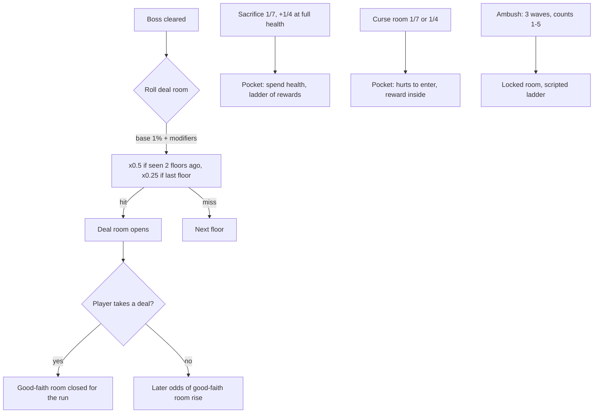

# Isaac pacing, trades and risk rooms, and Scrapkeep's opt-in layers

Evidence: the wiki's deal, level generation and timed-challenge pages through summarized fetches (level 1, numbers unchecked; the wiki refused a direct re-fetch); ambush, curse, challenge and pool files parsed with the official extractor (level 4). Where the two disagree or one number looks wrong, the note says so.

## What it does

**Trade rooms (the game's devil and angel deals).** On certain floors a door may appear to a room offering strong items in exchange for a price, usually permanent health (the item attribute `devilprice` is 1 or 2 and appears on 17 entries). The odds are a small base plus modifiers, with memory of what the player did before:

- Base chance of a deal room is 1%, plus modifiers; the displayed total caps at 100%.
- The chance is multiplied by 0.5 if a deal room was seen two floors ago and 0.25 if seen on the previous floor, so deals do not chain.
- A second kind of room (the good-faith counterpart) stops appearing for the rest of the run once the player takes any deal. Refusing raises its later odds.
- Deals can appear from the second floor of the first chapter through the fourth chapter.

**Sacrifice and curse rooms.** Sacrifice (spend health at a spiked pit for a reward ladder) is placed at 1 in 7, and the wiki lists an extra 1 in 4 at full health. The curse room (a door that hurts to enter, with a reward) is 1 in 7 in the original release and 1 in 4 later. The summarized fetch lists the sacrifice total as 5/14; one in seven plus one in four is 11/28, so the report's combined figure is unreliable. Treat only the two separate numbers as sourced.

**Timed challenge.** The timed boss-gauntlet door closes after a clock: 20 minutes in the original and two follow-ups, 25 in the latest expansion. A forum claim says the clock starts on entering the first floor. No page supports a "second final-boss under 30 minutes" figure. The room's content block has 15 waves of 2 spawns each, drawn from 50 candidate spawns; its item pool holds 17 entries.

**Curses as modifiers.** A closed set of 7 curse id/name pairs. Each curse's effect lives in code and a bitmask. Curses change counts or visibility on a floor: one adds four rooms, one multiplies the count by 1.8 (cap 45) and limits special rooms to the six farthest dead ends, hard mode adds two or three rooms.

**Ambush waves.** Some rooms lock and run a scripted ladder: 3 waves per stage in a regular ambush room, 2 in a boss ambush room (3 on one stage). Most waves hold one enemy entry with a count of 1 to 5; of 115 enemy entries, 70 have count 1. Each stage has a base script and an alternate script, and a room picks one. The challenge-type rooms in the room files are 13 rooms, 86% pickup spawns, very low density (0.02 per cell).

**Secrets and discovery.** The generator guarantees one hidden room and one second-tier hidden room per floor, plus extra optional rooms by chance. The room files hold 30 hidden-room layouts and 20 second-tier ones, and their item pool has 31 entries. The measured contents are low-density: 50 to 65% terrain. Discovery is paced by the placement rule (look where many rooms meet) and by the guarantee: the player knows one exists on every floor.

## Parameters

| Parameter | Value | Source |
| --- | --- | --- |
| Deal room base chance | 1% plus modifiers; display capped at 100% | wiki: https://bindingofisaacrebirth.wiki.gg/wiki/Devil_Room |
| Previous-deal penalty | x0.5 if two floors ago; x0.25 if the previous floor | wiki: https://bindingofisaacrebirth.wiki.gg/wiki/Devil_Room |
| Counterpart rule | taking any deal stops the good-faith room for the run; refusing raises later odds | wiki: https://bindingofisaacrebirth.wiki.gg/wiki/Devil_Room |
| Deal floors | chapter 1 floor 2 through chapter 4 | wiki: https://bindingofisaacrebirth.wiki.gg/wiki/Devil_Room |
| Sacrifice odds | 1 in 7; extra 1 in 4 at full health (the report's 5/14 combined is unverified) | wiki: https://bindingofisaacrebirth.wiki.gg/wiki/Level_Generation |
| Curse room odds | 1 in 7 original; 1 in 4 later | wiki: https://bindingofisaacrebirth.wiki.gg/wiki/Level_Generation |
| Timed gauntlet clock | 20 minutes (original, first two expansions), 25 (latest) | wiki: https://bindingofisaacrebirth.wiki.gg/wiki/Boss_Rush |
| Clock start | on entering the first floor (forum claim) | community: https://steamcommunity.com/app/250900/discussions/0/487877107138583176 |
| Gauntlet waves | 15 waves x 2 spawns, 50 candidate spawns | data: isaac-data.md |
| Gauntlet pool size | 17 item entries | data: isaac-data.md |
| Curse set | 7 curses (id, name); 8 single-bit curse flags in the enum | data: isaac-data.md |
| Count-changing curses | +4 rooms; x1.8 (cap 45); hard mode +2 to 3 | wiki: https://bindingofisaacrebirth.wiki.gg/wiki/Level_Generation |
| Price field | 1 or 2 (hearts); 17 entries (passive 11, active 3, familiar 3) | data: isaac-data.md |
| Ambush waves | regular: 3 per stage; boss ambush: 2 (3 on one stage) | data: isaac-data.md |
| Ambush entries | 115 enemy entries, 66 distinct types; counts 1: 70, 2: 6, 3: 23, 4: 10, 5: 6 | data: isaac-data.md |
| Ambush script sets | base and alternate per stage, plus secondary pairs | data: isaac-data.md |
| Curse-room item pool | 23 entries, min weight 0.2 | data: isaac-data.md |
| Deal-room item pool | 61 entries (weight min 0.2); good-faith pool 42 (min 0.4) | data: isaac-data.md |
| Hidden-room item pool | 31 entries | data: isaac-data.md |
| Hidden-room layouts | 30 hidden, 20 second-tier | data: isaac-data.md |
| Challenge recipe | 35 challenges; every one needs name, id and end stage; 29 add 1 to 6 starting items (median 3) | data: isaac-data.md |
| Clock claim "final boss under 30 minutes" | unsupported | wiki: https://bindingofisaacrebirth.wiki.gg/wiki/Hush |

## Why it works

- Risk is chosen, not imposed. Each pocket on this list is optional (inference: the sources describe none as mandatory). The reward is a strong item, so the choice is real.
- Memory in the odds. The multiplier after a recent deal and the shutting of the counterpart room make the deal a decision about the whole run, not one room.
- A curse costs something to enter (health or visibility), so the player pays at the door and learns the price before the reward.
- Ambush ladders are short and mostly single-enemy waves, so the pressure comes from lock-in and rising counts, not from complexity.
- A clock converts "optional detours" into a real tradeoff: a player who explores every pocket may miss the timed gauntlet. This is the one place Isaac makes the opt-in layer cost time.
- A guaranteed hidden room per floor teaches the player the pattern, so secrets are a skill and not a lottery. Complaints about useless secrets (see `rooms.md`) come from rooms that pay little for the search.

## What Scrapkeep borrows

The relationship: trades the player chooses to open, priced in a visible run resource, with odds that remember the player's earlier choices. It serves the "opt-in layers" principle and "momentum is sacred" (trades cost no time on the main route). It would amend BIBLE section 6, "Runs, regions, exits and saves" and "Themed loot, attunement and fixed secrets" (trade pockets, price rules), and TADR-010 (the event director may schedule ambush events in pockets but does not run a stage clock; the Isaac gauntlet clock is not borrowed, since TADR-010 rejects elapsed-time pricing as baseline).

Proposed pocket rules, to tune in the lab:

1. Two trade families with opposing memory: a risk trade (strong part for a run resource) and a safe trade (smaller part, no price). Taking a risk trade closes the safe family for the run; refusing raises the safe family's odds. This keeps the decision about the run.
2. Trade chance per stage: low base, a penalty if a trade appeared in the last stage, as in the x0.5 and x0.25 rule. Trade prices are shown on the pocket's door-equivalent before entry.
3. Curse pockets: a short, fair hazard to enter, readable on entry (see `rooms.md`), and a reward pool drawn at lower weight (0.2 floor, as in the data) for rarer parts.
4. Ambush pockets: a locked arena with three scripted waves, one enemy entry per wave, counts 1 to 5, an alternate script per stage. Exits open on clear. They sit on guaranteed-pocket anchors (see `floor-generation.md`).
5. Stage modifiers (the curse analog): one per stage at most, shown before the stage starts, changing pocket count or pocket visibility.
6. Hidden pockets: one guaranteed per stage with a visible tell, so the player learns where to look.

## What it must not copy

- Any clock that closes a door on the player. TADR-010 rejects a global elapsed-time baseline.
- Permanent loss of a main resource as the default price; the price is whatever Scrapkeep's economy chooses and is always shown first.
- Hidden odds the player cannot learn. Scrapkeep should show the chance modifiers in a results screen or codex.
- The exact odds, floors and room names. All numbers here are starting points.
- Rooms that lock the player in with unavoidable damage (the complaint list in `rooms.md`).

## Lab measure

Simulate 10,000 runs of 8 stages with a scripted player policy "always take risk trades" and another "never". Measure: (a) trade pockets per run (target mean between 1.5 and 3, and trade pockets in back-to-back stages in at most 30% of runs); (b) the safe family disappears after a risk trade in 100% of runs; (c) refusing raises the safe family's odds by a measurable amount (at least 1.2 times) in at least 80% of runs; (d) ambush pockets never place on the main route; (e) added time on the main route for a skip-all policy is zero.
