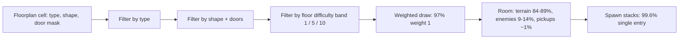

# Isaac room library, and an authored pocket library for Scrapkeep

Evidence: the room files parsed with the official extractor (level 4: 15,965 rooms in 26 files, every file consumed byte for byte), plus community complaints read from search snippets only (level 1). The library holds distributions, not names or layouts, and this note keeps it that way.

## What it does

The game ships a large hand-built library of rooms. The floorplan decides how many rooms of each kind a floor needs; the generator then draws one room per cell from the library, filtered in this order:

1. Room type (normal, boss, shop, item, secret and so on).
2. Shape and door mask. Each shape has exactly one stored size, and door count follows shape (4 doors for a single cell, 2 for the thin shapes, 6 or 8 for large ones). The floor plan's neighbor pattern picks the door mask.
3. A difficulty band for the floor. Difficulty is a hand-set tag with three working values: 1, 5 and 10.
4. A weight. 97% of rooms carry weight 1, so weight mostly breaks ties; the 2.4% at weight 0.1 are rare variants.

Inside a room, a spawn point is a grid position plus a stack of weighted alternatives. Stacks are almost never used (99.6% hold one entry), so variety comes from picking whole rooms rather than randomizing inside them. A normal room is mostly terrain with a few enemies on top: terrain is 84 to 89% of spawn points in the first three floor families and enemies 9 to 14%.

Difficulty tracks enemy health, not enemy count. In the first floor family the mean enemy health sum per normal room is 29, 41 and 57 for difficulty 1, 5 and 10, while mean enemy spawn points only rise from 2.8 to 4.8. The late floors break the pattern, which shows the tag is hand-set and not computed.

Community fairness complaints, paraphrased from forum snippets and never verified in the files: obstacles that trap the player in a corner while enemies hit them; hazards placed directly in front of a door, punishing the normal way of entering; two late floors described as unavoidable damage without high speed (replies split on whether that was intended); switch-and-spike rooms where the hazard sits beside the switch and moves when stepped on; hidden rooms that feel luck-based and useless. A later patch reworked a room to avoid a softlock and another hidden room for fairness.

Andrew's three ends, from his answers this session (the library itself is the means, not the reason): rooms you can solve on entry; enemy mixes that force movement; optional risk pockets (secret, curse, sacrifice, deal rooms).

## Parameters

| Parameter | Value | Source |
| --- | --- | --- |
| Total rooms | 15,965 in 26 files | data: isaac-data.md |
| Rooms per family | special 917; first family 3,111; second 2,981; third 3,013; fourth 2,798; late floors 1,167; greed mode 1,978 | data: isaac-data.md |
| Weight 1 | 15,485 rooms (97.0%) | data: isaac-data.md |
| Weight 0.1 / 0.5 / 0.75 / 0.25 / 0.01 | 379 / 50 / 32 / 18 / 1 rooms | data: isaac-data.md |
| Rooms with weight 0 | 0 | data: isaac-data.md |
| Shape lattice | base cell 13 by 7; doubles to 13x14, 26x7, 26x14; 12 shapes | data: isaac-data.md |
| Single-cell rooms | 8,785 of 15,965 (55%) | data: isaac-data.md |
| Door counts | 2, 4, 6 or 8 only | data: isaac-data.md |
| Doors flagged absent | 11,214 of 74,560 | data: isaac-data.md |
| Difficulty values | 1, 5, 10 on regular floors; a handful of 0, 2, 15; none above 15 | data: isaac-data.md |
| Difficulty 1 / 5 / 10 in first family | 951 / 1,125 / 1,003 normal rooms | data: isaac-data.md |
| Mean enemy health sum, first family, d=1/5/10 | 29.3 / 41.4 / 57.4 | data: isaac-data.md |
| Mean enemy health sum, fourth family, d=1/5/10 | 96.9 / 129.3 / 177.0 | data: isaac-data.md |
| Median spawn points per normal room | 19 (first family), 28 (second), 25-26 (third), 23 (fourth), 12 (fifth), 2-3 (last two) | data: isaac-data.md |
| Spawn-point mix, first family | terrain 83.9%, enemy 13.5%, pickup 1.2% | data: isaac-data.md |
| Spawn-point mix, second family | terrain 88.9%, enemy 9.4%, pickup 0.9% | data: isaac-data.md |
| Spawn-point mix, special rooms | boss 78% terrain / 18% enemy; challenge 86% pickups; arcade 38% slot machines | data: isaac-data.md |
| Single-entry stacks | 466,262 of 468,193 spawn points (99.6%) | data: isaac-data.md |
| First-chapter normal-room pool size | 174 normal rooms in the first chapter's pools | article: https://www.boristhebrave.com/2020/09/12/dungeon-generation-in-binding-of-isaac/ |
| Floor-stage difficulty draw | first stage draws easy and medium, second draws medium and hard | article: https://www.boristhebrave.com/2020/09/12/dungeon-generation-in-binding-of-isaac/ |
| Hazards at doors; unavoidable damage | community complaints | community: https://steamcommunity.com/app/250900/discussions/0/3093383255723687446 and https://steamcommunity.com/app/250900/discussions/0/620700961055137900 (search snippets only) |

Note on the pool-size row: the 174 figure is Boris's count for one chapter and does not match any single file in the extracted data (the first-family files hold about 1,000 each); the files likely include variants and shape duplicates. Treat 174 as unreconciled.

## Why it works

- Fast filtering by type, shape and door mask means the library can be huge and still always return a room that fits.
- A three-step difficulty dial is easy to author against and easy to reason about. Authors tune health sums by hand, then tag.
- Because terrain dominates, the room's shape of play is set by obstacles; a few enemies on top then ask a spatial question (where do I stand?). This is where "enemy mixes that force movement" comes from, and why a layout can be solved on entry: the obstacles are all visible when the door opens.
- Making variety come from room choice means every room can be tested as a fixed object by a person.
- Risk pockets are a separate type with its own content mix (curse-room terrain 52%, sacrifice-room terrain 93%, deal-room terrain 70%), so their feel is authored, not rolled.

## What Scrapkeep borrows

The relationship: an authored library where every entry carries a type, a size class, a difficulty tag and a weight, and where the generator only filters and draws. It serves the principle "readability first" and the pocket half of "natural jungle-gym landforms". It would amend BIBLE section 6, "Encounters, waves and enemies" (pocket encounters as authored, tagged units) and TADR-010 (the event director draws pockets from this library rather than composing them).

Pocket library design, proposed:

| Field | Meaning |
| --- | --- |
| kind | arena, reward, trade, hidden, hazard-challenge |
| footprint class | small, medium, large (volume, not cells) |
| entrances | count and marked positions, so the placer can match an anchor |
| difficulty | 1, 5 or 10 (copy the three-step dial) |
| weight | default 1; 0.1 for rare variants; never 0 |
| density budget | spawn points by category; see below |
| tell | the visual and audio cue visible from the open stage |
| solve-on-entry flag | set only after a reviewer checks the rule below |

Density budget per pocket (starting values to tune, not data): terrain pieces 60 to 70% of spawn points, enemies 20 to 30%, pickups 5 to 10%. This is looser on enemies than the first-family data, because 3D space and a rolling mech need more open floor, and tighter on terrain-as-clutter. Difficulty rises by enemy health sum first and enemy count second, as in the data.

"Readable on entry" rule: when the player crosses the threshold, from the entry spot alone they can see (1) every hazard, (2) every enemy start position and its first telegraph, (3) at least one safe path to the exit or to cover, and (4) no hazard within a set radius of the entrance. The entry radius and the minimum safe-path width are lab constants. Nothing the player can only discover by taking damage counts as readable.

Andrew's three ends map directly: readable-on-entry is the solve-on-entry end; the enemy mix field forces movement (each arena needs at least two enemy kinds with different threat zones); pockets of kind trade and hidden are the risk end.

## What it must not copy

- The fixed 13 by 7 cell lattice, door masks and room-by-room screen locks.
- Hazards in front of doors, traps in corners, switch-adjacent spikes and unavoidable entry damage (the fairness complaints above).
- Any room layout, name, text or art. This note and the data note deliberately contain no layouts.
- Hand-set difficulty with no check. Scrapkeep should score each pocket by lab simulation, not trust the tag.
- Grid entities as 84 to 89% of every room. In 3D that would read as clutter.

## Lab measure

For every pocket in the library, run 50 headless entries per pocket with an idle player and 50 with a scripted dodger. Pass criteria: the idle player takes no damage in the first 2 seconds in at least 95% of runs (no hazard at the door); the scripted dodger clears at least 80% of difficulty-1 pockets and fewer than 80% of difficulty-10 pockets (the tag separates); every pocket exposes a safe path of the minimum width from the entry spot. Report failing pocket ids.
