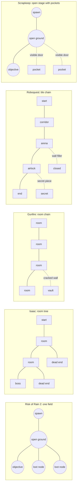

# Four-game map comparison (completed)

Evidence: synthesis of the Risk of Rain 2, Isaac, Gunfire Reborn and Roboquest stage notes in this folder (see [ror2](ror2/stage-anatomy.md), [isaac](isaac/floor-generation.md), [gunfire](gunfire/stage-anatomy.md), [roboquest](roboquest/stage-anatomy.md)); numbers keep their source note's evidence level. Roboquest numbers come from [roboquest](roboquest/stage-anatomy.md): shipped tables and 151 measured level pieces at level 4 at measurement, wiki at level 2. Units there are centimetres read as metres (inference). Units are stated in each cell; Gunfire units are engine units read as metres (inference), and a Gunfire chunk may be one room or one whole level (unknown).

## Comparison

| Row | Risk of Rain 2 | Isaac | Gunfire Reborn | Roboquest | Scrapkeep's chosen shape |
| --- | --- | --- | --- | --- | --- |
| Unit of play | Stage (5 ordinary, then a final stage) | Floor (rooms on a grid) | Level drawn into a fixed slot; 14 fight slots in the table, 12 regular stages on the wiki (the two disagree) | Level, 12 in 4 acts of 4, 4, 3, 1 in the level table; the wiki has 9 level pages and a run chain of about 6 levels (the two disagree) | Stage; a run visits four worlds through open stages (BIBLE.md section 3 "Reading the catalogue") |
| Spatial shape | Open field with a baked node graph | Room grid, a tree grown outward, one deliberate loop | Chain of fight rooms gated by clears (inference: connection shape and hand-made against generated layouts are not stated); acts 2 to 4 open out to larger areas | Acts 1 to 3: a fixed-order path of 0 to 11 grid tiles (median 3) between a start and an end piece, unused connectors closed by wall fillers; the last two levels are single open maps (wiki, level 2). Gating by clear is inference | One open stage with authored pockets |
| Optional content: placement | Chests and shrines spent from credits on random free nodes, no minimum distance | Special rooms fill dead ends, farthest first; one hidden room where three rooms meet | One vault per non-boss stage, hidden; trader and crafter at random in normal rooms | 0 to 3 special interiors per level from a pool of 59 (one on 8 of 9 early campaign levels); 4 secret pieces; 0 to 2 side paths to other levels; position inside the grid not decoded | Pockets at anchors ranked by detour, doors on nodes that pass a sightline test (pocket-placement.md) |
| Optional content: signal | Mostly none; the wiki lists secrets found by exploring | Not covered by the Isaac notes except the hidden room, whose blind search is a community complaint (isaac/rooms.md) | A cracked wall, seen before it is opened; opening notifies all players | A secret zone is a differently coloured region of the minimap (wiki, level 2); signals in the world are not decoded | A visible door in sight of the main route, always |
| Variety | One graph per stage plus a credit budget and price list | Room pool filtered by type, shape and difficulty, plus dead-end rules | Pool of 8 to 19 levels per slot (hand-made is inference) | 151 pieces in 13 kinds, a pool per slot (corridor 0 to 4, arena 0 to 2, airlock 0 to 1), 59 special interiors, 37 mutators | Slot and pool of authored pockets over a stage graph, spent by credits |
| Footprint | Ordinary stages 352 by 418 m to 603 by 611 m (bounding box); final stage 1832 by 1561 m | 9 by 8 cell grid, 7 to 8 rooms on floor 1, 2 to 3 more per floor (Boris the Brave); wiki cap 20 rooms; 8,785 of 15,965 library rooms are one cell | Chunk floor extent median 238 by 240 units, p90 602 by 585, max 2243 by 1541 | Cell of 120 to 158 m a side in acts 1 to 3 (component-origin boxes, understate); a level is start + median 3 + end, about 5 cells, roughly 8 ha (inference, understated) against 14.7 to 36.8 ha for Risk of Rain 2; act 4 pieces up to 642 by 599 m | Open stage; size to be set in the lab. Starting guess: inside the Risk of Rain 2 ordinary range, 352 to 611 m a side. Pocket size, starting value: a footprint of about 1% of stage floor area (about 50 m a side on a 500 m stage) |
| How difficulty changes the map | Credits rise with stage order (220 to 520 interactable, 100 to 230 monster); the map itself is the same | Room count and special-room rules shift with depth and curses; hand-set room difficulty tag | Higher tiers add traps and events to the same rooms; room count unchanged | Enemy level, act modifier (0, 30, 70, 140 percent), 9 difficulty steps (health -30 to +60 percent) and elite counts change what spawns; no tile-count field changes | Credit and event pressure rise; the route does not change (readable-capped scaling) |
| Objective and where it sits | One device on an eligible node in the open; charge and defend; players start in the far quarter | The boss takes the last dead end, away from the start | The boss stage closes each act; objective vaults and seal events inside | Acts 1 to 3: the end piece closes the tile chain, bosses sit on the act row; penultimate level: hunt 4 mini-bosses at the extremities; final: 2 secret rooms open the boss door (wiki, level 2) | Main objective in the open stage; spawn far by path distance; never at the end of a corridor |
| Relationship Scrapkeep takes | One graph that every placer reads | Optional content ranked by detour from dead ends | The vault's visible trigger and four-kind ladder, plus slot-and-pool variety | Closable entrances with fillers, content roles by piece kind, a world pool of special interiors, and a map tell on secrets (roboquest/stage-anatomy.md) | This row is the result, not a source |

## Open questions for CS-03, answered

1. **Roboquest objective and optional-room signal.** Answered. In acts 1 to 3 the objective is the end of a chain of tiles (generator report, item 1; level 4) and the path is a chain of tiles bending across a grid (inference: connections are undecoded and four entries carry four-tile layouts, so the chain shape is a reading of counts, which are level 4). The last two levels are open maps where the player hunts 4 mini-bosses or finds 2 secret rooms (wiki Levels.txt:51 and 57, level 2). Optional rooms: 0 to 3 special interiors from a pool, shown only by a minimap tint for secrets (Unlockables.txt:38); signals in the world are not decoded.
2. **A measured detour cost in any of the four games.** Still open. None measures optional detours. The closest figure is Roboquest's par-time curve, where the slowest scoring time is 2.8 to 3.6 times the fastest, which bounds the exploring a level tolerates (inference) and gives the lab a full-visit ratio of at most 3.0 to test.
3. **Total size of a Gunfire level.** Still open. Chunks still map to no level, and Roboquest cannot supply it. Roboquest's own level is about 5 cells of 120 to 158 m, roughly 8 ha (inference, understated), which is a second bound, not an answer.
4. **Roboquest difficulty: map or fill.** Answered at level 4 for the fields reported: it changes what fills the map (enemy level, act modifier, difficulty step, elite count), and no tile-count field moves (absence not exhaustively checked). Mutators change rules, not routes.
5. **Fraction of a stage that is optional, as walking time.** Still open. No game has a walking-time measure. Partly answered by count only: on the three levels where wiki and table both cover the level, one optional room (a secret in the wiki, a special layout in the table) sits against 4 to 9 required rooms (wiki, level 2; table, level 4), and airlocks are 13 of 145 table entries (9%). That is a count, not walking time, and connections are undecoded. The walking-time share stays open; the stage note's lab measure asks for the full-visit ratio.

Roboquest wiki and tables disagree on level count (9 pages against 12 table levels), on routes (two against three) and on keys (one against two second levels); the tables are the more direct source. Neither source states a connection rule or a spawn count per anchor.

This comparison is completed under CS-03.
