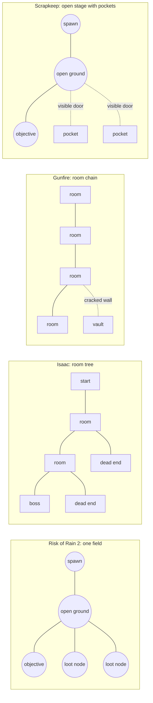

# Three-game map comparison (started)

Evidence: synthesis of the Risk of Rain 2, Isaac and Gunfire Reborn stage notes in this folder (see [ror2](ror2/stage-anatomy.md), [isaac](isaac/floor-generation.md), [gunfire](gunfire/stage-anatomy.md)); numbers keep their source note's evidence level. Roboquest is not studied yet. This table is started under CS-02 and completed under CS-03. Units are stated in each cell; Gunfire units are engine units read as metres (inference), and a Gunfire chunk may be one room or one whole level (unknown).

## Comparison

| Row | Risk of Rain 2 | Isaac | Gunfire Reborn | Roboquest | Scrapkeep's chosen shape |
| --- | --- | --- | --- | --- | --- |
| Unit of play | Stage (5 ordinary, then a final stage) | Floor (rooms on a grid) | Level drawn into a fixed slot; 14 fight slots in the table, 12 regular stages on the wiki (the two disagree) | not studied | Stage; a run visits four worlds through open stages (BIBLE.md section 3 "Reading the catalogue") |
| Spatial shape | Open field with a baked node graph | Room grid, a tree grown outward, one deliberate loop | Chain of hand-made fight rooms gated by clears; connection shape not stated | not studied | One open stage with authored pockets |
| Optional content: placement | Chests and shrines spent from credits on random free nodes, no minimum distance | Special rooms fill dead ends, farthest first; one hidden room where three rooms meet | One vault per non-boss stage, hidden; trader and crafter at random in normal rooms | not studied | Pockets at anchors ranked by detour, doors on nodes that pass a sightline test (pocket-placement.md) |
| Optional content: signal | Mostly none; the wiki lists secrets found by exploring | Not covered by the Isaac notes except the hidden room, whose blind search is a community complaint (isaac/rooms.md) | A cracked wall, seen before it is opened; opening notifies all players | not studied | A visible door in sight of the main route, always |
| Variety | One graph per stage plus a credit budget and price list | Room pool filtered by type, shape and difficulty, plus dead-end rules | Pool of 8 to 19 hand-made levels per slot | not studied | Slot and pool of authored pockets over a stage graph, spent by credits |
| Footprint | Ordinary stages 352 by 418 m to 603 by 611 m (bounding box); final stage 1832 by 1561 m | 9 by 8 cell grid, 7 to 8 rooms on floor 1, 2 to 3 more per floor (Boris the Brave); wiki cap 20 rooms; 8,785 of 15,965 library rooms are one cell | Chunk floor extent median 238 by 240 units, p90 602 by 585, max 2243 by 1541 | not studied | Open stage; size to be set in the lab. Starting guess: inside the Risk of Rain 2 ordinary range, 352 to 611 m a side |
| How difficulty changes the map | Credits rise with stage order (220 to 520 interactable, 100 to 230 monster); the map itself is the same | Room count and special-room rules shift with depth and curses; hand-set room difficulty tag | Higher tiers add traps and events to the same rooms; room count unchanged | not studied | Credit and event pressure rise; the route does not change (readable-capped scaling) |
| Objective and where it sits | One device on an eligible node in the open; charge and defend; players start in the far quarter | The boss takes the last dead end, away from the start | The boss stage closes each act; objective vaults and seal events inside | not studied | Main objective in the open stage; spawn far by path distance; never at the end of a corridor |
| Relationship Scrapkeep takes | One graph that every placer reads | Optional content ranked by detour from dead ends | The vault's visible trigger and four-kind ladder, plus slot-and-pool variety | not studied | This row is the result, not a source |

## Open questions for CS-03

1. Does Roboquest put its objective in an open arena or at the end of a room sequence, and how does it signal optional rooms?
2. Does any of the four games show a measured detour cost for optional content, so the 3 to 8 pockets and the detour spread in the lab measures can be checked against it?
3. How large is a Gunfire level in total? The chunk files are not mapped to levels, so the footprint comparison above can only bound it.
4. Does Roboquest scale difficulty by changing the map or by changing what fills it, as Gunfire and Risk of Rain 2 do?
5. What fraction of a stage does each game's optional content take, as walking time? None of the notes measure it.

This comparison is started under CS-02 and completed under CS-03.
