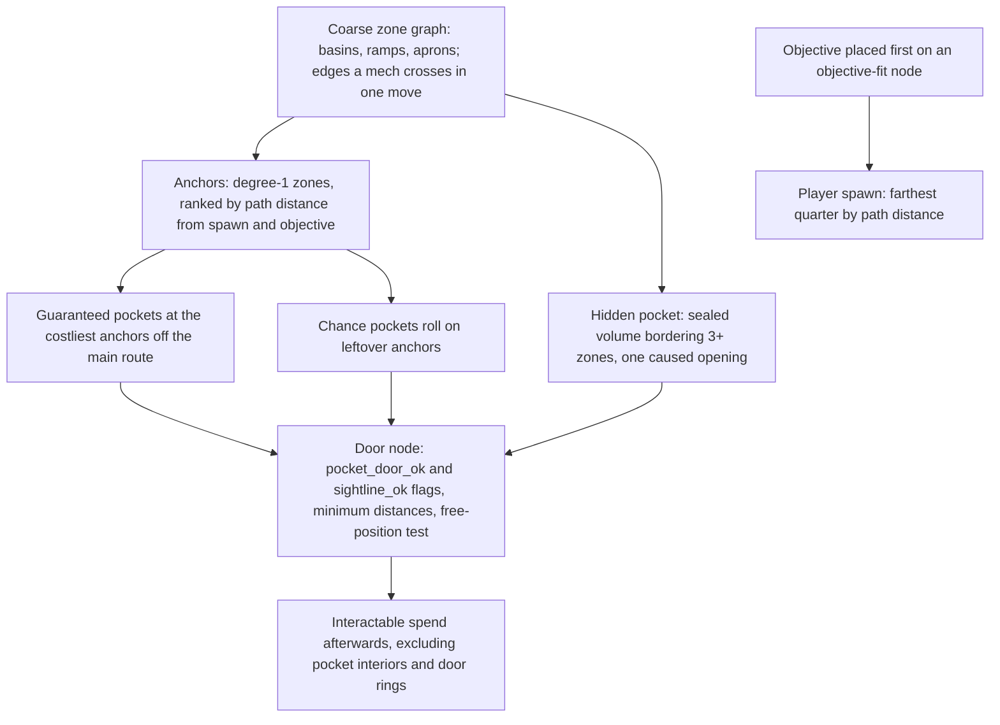

# Pocket placement: one spec from two games

Evidence: this note is design synthesis. Its inputs are the Risk of Rain 2 stage model (static code read, levels 2 to 3, and measured node graphs, level 4) in [ror2/stage-anatomy.md](ror2/stage-anatomy.md) and the Isaac floor algorithm (public article and wiki, with stated conflicts) in [isaac/floor-generation.md](isaac/floor-generation.md). Every number below is a starting value for the lab, not a tuned one. Andrew's decision it serves: one open stage carrying the main objective, with authored pockets embedded as optional content visible from the open space.

## What it does

The two source games answer different halves of one question. Isaac decides **where optional content goes** on a floor: dead ends ranked by distance, one guaranteed reward at the farthest, a hidden room where several rooms meet, chance rooms elsewhere. Risk of Rain 2 decides **where anything may physically stand** on an open stage: one baked node graph with flags, hull sizes and a free-position test, read by every placer. Scrapkeep uses Isaac's rule on a coarse zone graph to pick anchors, then Risk of Rain 2's rule on the fine node graph to pick the exact door. The objective stays in the open stage; Scrapkeep does not put the boss at the end of a corridor.

## Parameters

| Parameter | Starting value | Source |
| --- | --- | --- |
| Zone graph | authored per stage; a zone is a landform region; an edge means a rolling mech crosses in one move | design, from the Isaac floor grid replaced by landforms |
| Anchor | a zone with one entrance | Isaac dead-end rule, [floor generation](isaac/floor-generation.md) |
| Objective placement | first, on an objective-fit node; rejected if its anchor is adjacent to spawn | RoR2 objective-fit test; Isaac "boss not adjacent to start" |
| Player spawn | farthest quarter of walkable nodes from the objective, by path distance | RoR2: SceneDirector.PopulateScene, path distance is Scrapkeep's change |
| Pocket count | 3 to 5 on the first stage, plus one per stage, cap 8 | design |
| Guaranteed pockets | one reward, one trade, at the two costliest anchors not on the shortest spawn-to-objective route | Isaac special-room order |
| Hidden pocket | 1 per stage; a sealed volume bordering 3 or more zones with one opening the player causes (pull plate, breakable wall), always with a visible tell | Isaac secret-room adjacency rule; community complaint about blind bombing |
| Chance pockets | 25% per leftover anchor; odds may read player state (full health raises a sacrifice-style pocket) | Isaac sacrifice odds |
| Large pockets | tried first; take an anchor only if the footprint fits without cutting a route | Isaac large-room placement |
| Door node flags | `pocket_door_ok`, `sightline_ok` (unobstructed ray to a main-route node within 60 m), `main_route` | RoR2 NodeFlags pattern, three new flags |
| Minimum door distance to spawn | 60 m | design |
| Minimum door distance to objective | 80 m | design |
| Minimum distance between doors | 50 m | design |
| Pocket credit pool | 150 credits per stage against a 400-credit interactable budget on a mid stage (about 0.4 x); whether it should rise with stage order is a lab question | design, tied to the RoR2 credit pair; same values as the stage anatomy note |
| Pocket card price | proportional to reward, footprint and detour from the main route | design |
| Failed placement | refund the credit and try the next anchor | reverses RoR2's lost-credit behavior |
| Interactable spend | after pockets, excluding pocket interiors and a 10 m ring round each door | RoR2 spend loop with an exclusion |
| Stage modifier | may scale pocket count and restrict anchors to the farthest few | Isaac curse analog |

## Why it works

- **Detour is the price.** A pocket far from the main route costs more credits and holds more, so the same credit logic that prices a chest prices a pocket. The player reads distance as reward.
- **Visible before entered.** Every door passes a sightline test to the main route, so the optional layer is seen from the open space and chosen, never stumbled on. This is the opt-in layer made literal.
- **One graph, two grains.** Zones decide the story of the stage (where the far reward is); nodes decide the physics (where a door can stand). Designers edit landforms; the placer handles the rest.
- **Momentum survives.** Pockets never sit on the shortest route and never crowd the objective, so a player who skips them loses nothing but the detour.

## What Scrapkeep borrows

The relationship, in one line: Isaac's rank-by-detour special-room rule on top of Risk of Rain 2's single placement graph. Principles served: opt-in layers, momentum is sacred, readability first (Andrew's principles, playtest log entry 6, carried into the Bible by DF-05). It would amend TADR-010 (open stages and event director) with a placement section, and BIBLE.md § 3 Maps & Areas, "Reading the catalogue" (line 167), with the pocket vocabulary.

## What it must not copy

Isaac's grid, door-in-the-middle rule and room screens; Risk of Rain 2's exact flag bits and raycast constants; any stage or room from either game. The numbers above are Scrapkeep's starting guesses, not either game's tuning.

## Lab measure

Generate 1,000 seeded stages. Pass when, on at least 95% of seeds: no guaranteed pocket sits on the shortest spawn-to-objective route; every door passes the sightline test; zero doors violate a minimum distance; every hidden pocket borders three or more zones; the median path distance from spawn to the reward pocket is at least 1.5 times the median to the objective; and the spawn-to-objective path is at least 0.6 of the graph's longest path. Report the re-roll rate; above 20% means the anchor rules are too tight for the authored stages.
