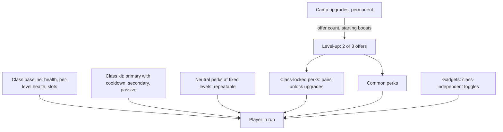

# Roboquest classes and perks (comps note)

Evidence: public wiki pages for the class roster, seven class pages and the perk pages, read by a scout at file:line and a sample re-read by the coordinator (level 2, "wiki (public)"); shipped data tables for baselines and row counts (level 4 at measurement, scripts outside the repo). The wiki's common-perk page is an empty template, so category counts and rarity tiers of perks are not stated, and the perk table's split by class is an inference from header rows. Nothing was run in the game.

## What it does

**A class is three layers.** First a baseline: health, health gained per level, weapon slots, and shared slots for cores and one artefact slot. The shipped data holds only two baseline rows for seven classes, one for the default class and one for the newest unlockable class (the other five baselines were not found; that they share the default row is an inference). Second a kit: a primary ability with a cooldown, a secondary ability, and a passive that charges or stacks. Third a perk pool, locked to the class. Movement difference is only an ability inside the kit (see the movement note).

**The seven kits, by role.** A tank-like class with a duration-capped shield and a close swing. A dash class whose primary is a short teleport-dash with an arrival blast and whose passive is a combo counter. A drone-partner class that deploys a drone, with scrap shortening the cooldown. An explosives class with a rocket and a conditional blast. A stealth class with invisibility, a speed bonus and a decoy, plus a javelin and a passive that builds a focus meter feeding crit damage. An elemental class that cycles three spells and rotates a boosted element every ten seconds. A weapon-eating class that trades starting health for a short overdrive and heals by consuming weapons. Cooldowns on primaries run 7 to 15 seconds in the pages read.

**Perks.** On each level-up the player picks one of two or three random offers drawn from the class-locked pool and a shared common pool; the number of offers depends on camp upgrades. A separate neutral pool, available to every class, appears at fixed levels, can be taken repeatedly, and never unlocks anything further. Class-locked perks come in pairs: taking one at the listed levels opens two upgrade perks. Experience, levels and perks reset when the run ends. Permanent growth is in the camp (spent on a currency earned per run) and in gadgets, which are class-independent toggles.

## Parameters

| Parameter | Value | Source |
|---|---|---|
| Classes | 7; the first is the default, the rest unlock by goals, one by a hidden pickup | wiki (public): Classes page, line 9; Unlockables page, line 60 |
| Baseline health, default class / newest class | 200 / 100 | shipped data tables (level 4 at measurement, scripts outside the repo), player table |
| Health gained per level | 30 / 20 | same |
| Weapon slots / core slots / artefact slots | 2 / 3 / 1 for the default class; 1 / 3 / 1 for the newest | same |
| Max upgrade level in the baseline row | 25 for both (the wiki's perk-unlock levels stop at 15, so this is likely a different counter; unreconciled) | same; wiki (public): Ranger page, line 37 |
| Skill and bash damage per level | +25% each, both rows | same |
| Baseline rows for the other five classes | not found | gap |
| Perk offers per level-up | 2 or 3 | wiki (public): Classes page, line 6 |
| Class-locked upgrade levels | 3, 5, 6, 8, 9, 11, 12, 13, 14, 15 (two upgrades each) | wiki (public): stealth-class page, line 37 (same on two other class pages) |
| Neutral perk levels | 3, 5, 7, 8, 10, 11, 12, 13; level 1 with a starter camp upgrade | wiki (public): Neutral Perks page, lines 4 and 7 |
| Neutral perk behavior | repeatable, unlocks nothing | wiki (public): Neutral Perks page, line 10 |
| Neutral perk examples | several at +10% per step; reload +12% with move +6%; health +10%; crit damage +10% | wiki (public): Neutral Perks page, lines 30, 38, 46, 54, 62, 78 |
| Perk table rows | 390 data rows (the perk table, the shipped item table); header rows split them into seven class sections of 54 / 58 / 76 / 37 / 46 / 45 / 59, which sum to 375; the other 15 rows are unexplained | shipped data tables (level 4 for counts); the class split is an inference from the header rows |
| Perk rarity in data | unset on 231 rows, set on 159 in two tiers (158 and 1); most costs 1, maximum 12 | shipped data tables (level 4 at measurement) |
| Primary cooldowns | dash class 8 s, stealth class 15 s, weapon-eating class 8 s, explosives class 8 s, elemental class 7 s; tank-like class has a 3 s shield limit; drone class has scrap-based reduction of 1 s each | wiki (public): class pages, lines cited in the movement note and Commando line 19, Elementalist line 15, Guardian lines 12 to 20, Engineer lines 17 to 19 |
| Passive numbers (examples) | combo counter of 5; focus up to 16 at 1.5% crit damage each; element rotation every 10 s with +15% damage; start at 50% health, heal 15% per weapon eaten | wiki (public): class pages, lines cited per class in the scout report |
| Crit rule | weak points deal 1.25x by default; a separate roll adds auto-crit | wiki (public): Criticals page, line 6 |
| Gadgets | up to 11, no slot limit | wiki (public): Gadgets page, lines 1 to 3 |
| Starting boost / offer count upgrades | camp purchases; cost tables not read in full | gap |

Source check: the default-class baseline row and the perk header-row split were re-read in the shipped-table summary by the coordinator; they match the worker report.

## Why it works

- **A class reads as a cooldown, a passive and a pool.** Three things to learn, each visible on the hud (the three-part reading is stated; its learnability is inference).
- **Pairs make a perk a doorway.** A class perk opens two follow-ups at set levels, so an offer is also a promise about the next level. Stated for the unlock levels, the effect is inference.
- **A neutral pool that can repeat and unlocks nothing** gives a bad draw a safe fallback of flat percentages. Inference from the stated repeat rule.
- **Combat refunds feed the kit.** Many perks shorten the primary's cooldown on taking damage or landing hits, so the ability is part of the fight, not a timer beside it.
- **Reset per run, permanent growth elsewhere.** Levels and perks vanish at run end while the camp and gadgets persist, which keeps the in-run choice about this build and not about account power. Stated; the effect is inference.

## What Scrapkeep borrows

Principles: **class identities** and **three characters with their own movement** (Andrew's, `docs/playtests/PLAYTEST-LOG.md` line 83). Bible anchors, each checked with `grep -n` on BIBLE.md: "5.1 Shared baseline and class roles" (`BIBLE.md:398`), "Four slots and milestone progression" (`BIBLE.md:527`), "Abilities, ultimates and combat rhythm" (`BIBLE.md:499`) and "Movement, camera and active aim" (`BIBLE.md:479`). TADR-008 is the ability contract a kit would be bound to, and TADR-013 the crew amendment that adds a drone-partner-like role to the crew rather than to a class. Everything below is proposal.

- **Describe a character as baseline plus kit plus pool.** Scrapkeep already has the kit as four slots, each a binary tree of eight endpoints; the pool is where the Roboquest relationship lands. Scrapkeep's three characters differ in baseline (health and per-level growth ratios such as the 2:1 and 1.5:1 seen here), the mobility slot, and which tree nodes lean toward which ability.
- **Level-up offers of two or three drawn from a class-weighted pool, with a shared pool beside it.** For Scrapkeep this is a candidate for the choice between the tree's fork nodes and found items, not a replacement for the tree (a binary tree is already settled in the Bible at line 527). Propose offer counts of 2 or 3 and a declared class-weighted share of 60% to 80% so characters meet different shelves.
- **A repeatable neutral pool that unlocks nothing.** A fallback shelf of flat, small percentages (the sources show 6% to 12%) keeps a poor draw from stalling a build; Scrapkeep would cap the number of repeats, in line with readable-capped scaling.
- **Perk pairs: pick one, unlock two.** Fits the tree shape naturally: an unlocked node offers its two children.
- **Cooldown refunds from combat events** on the mobility and skill slots, one to two seconds, capped.
- **Baseline asymmetry stated as ratios**, for example one character at double the health of another with the lighter one growing more slowly per level, to be tuned from the lab.

## What it must not copy

- Class names, kit text, ability names and the seven-class roster as content.
- Perk names, text, the counts 54 / 58 / 76 / 37 / 46 / 45 / 59 and their category structure as a list.
- Baseline numbers (200 and 100 health, 30 and 20 per level, slot counts) as Scrapkeep values.
- Hidden or unfilled fields: Scrapkeep states what the player needs to compare offers.
- A drone-partner class as a class: crew roles come from TADR-013, which is not a class feature.
- Camp currency names and upgrade lists.

## Lab measure

Headless draw test: for each of the three Scrapkeep characters, simulate 200 runs of level-up offers (2 or 3 choices) from the proposed pools, once with a greedy build bot and once with a random one. Log the share of offers from the character-weighted pool, the share from the neutral pool, and the repeated-offer rate. Pass when (a) each character's weighted share falls in the declared band (propose 60% to 80%), (b) the overlap between any two characters' top-10 most-offered perks is under 50%, (c) a neutral perk is never offered more than the declared repeat cap, and (d) every character's tree reaches an endpoint in each of the four slots by the last milestone with both bots, matching the Bible's pacing target at line 527.
