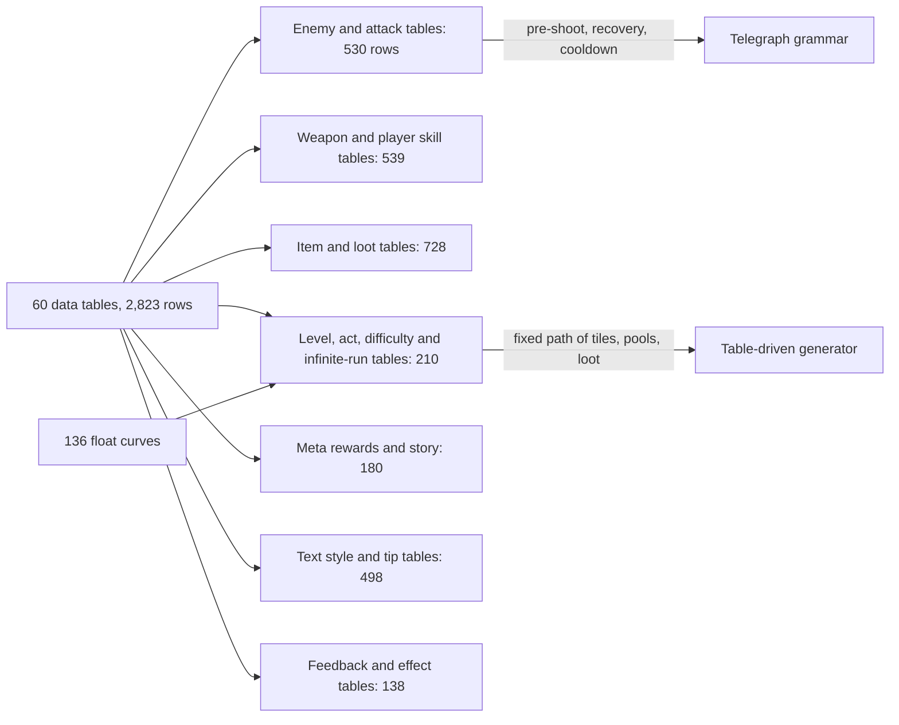

# Roboquest data tables worth keeping

Evidence: parsed from the game's own data tables with scripts that read every table, curve and string table to the last byte, in the study's data tables report, summary, schema and level-generator notes (level 4 for counts and statistics: zero row errors). Only counts, numeric ranges and plain-word paraphrases of what each field holds are kept here. This note holds no table, field, enum, class or asset identifiers, no row keys, no names and no text. It is a data note, so it does not use the six-heading design-note shape. Statements marked inference are readings of structure, not decoded behavior.

## Method

All 60 data tables (2,823 rows including 186 designer header rows, so 2,637 data rows, 136 float curves, 4 vector curves and 12 string tables of 662 rows) sit in one data folder of the container. A tagged-property reader parsed each row; designer header rows (keys that start with a separator mark) were excluded from every statistic and carry only a section label. Statistics are minimum / median / 90th percentile / maximum over data rows. String values were counted in characters and never reproduced. Fields are paraphrased below. The two level-generator maps hold one actor each with no overrides, so level generation is table-driven (level 4 for that count). Source for every figure: the data tables report and the summary and generator notes in the study tree. The report's first-pass enemy figures counted header rows; this note uses the summary's header-excluded figures (see Gaps).

## Tables by family

**Row counts per family** (derived by grouping the 60 tables by purpose; reading: gameplay data is under half the rows, and the largest single table is the item table).

| family | tables | file rows | data rows |
|---|---|---|---|
| Enemies, attacks, allies | 8 | 530 | 489 |
| Weapons, affixes, player skills and classes | 8 | 539 | 478 |
| Items, bazaar items, loot | 8 | 728 | 710 |
| Levels, acts, difficulty, infinite run | 10 | 210 | 195 |
| Meta rewards, story, cinematics | 4 | 180 | 139 |
| Text styles, keywords, tips | 17 | 498 | 493 |
| Feedback and effect tables | 5 | 138 | 133 |

Data rows exclude the designer header rows (186 in all); the family sums are derived from the per-table counts and total 2,637. The largest tables: items 400 rows, player skills 183, enemy skills 180, weapon affixes 161, bazaar items 137, enemy attacks 126, keywords 110, weapons 106.

**Enemies** (139 data rows; min / median / p90 / max).

| field in plain words | min / med / p90 / max |
|---|---|
| Health | 10 / 120 / 5,000 / 13,000 |
| Move speed (cm per second) | 60 / 650 / 1,250 / 1,600 |
| Impact resistance | 5 / 70 / 1,100 / 4,600 |
| Stagger duration (s) | 0.2 / 1.25 / 1.25 / 1.25 |
| Experience | 0 / 2 / 5 / 12 |
| Cell reward | 0 / 1 / 5 / 12 |
| Wrench reward | 0 on every row |

Reading: stagger is one constant in practice (the median equals the maximum). Six enemy types: untyped 39, flying 36, turret 34, bot 14, pawn 10, worker 6; three movement kinds: static 58, walking 45, flying 36. Flags without overlap: boss 32, elite 7, big 7, and 93 plain minions. Minions have median health 90 (p90 160, max 320); the 7 elites share one health value of 300, one impact resistance of 180 and experience 5; bigs have median health 1,050 and experience 12; bosses have median health 5,000. Skills per enemy: 0 for 28, 1 for 54, 2 for 31, 3 for 15, 4 for 4, 5 for 6, 6 for 1; the skill slots are primary fire 111, secondary fire 55, bash 21, reload 12, sprint 8, and a handful of others. A threat rating is 1.0 on 131 of 139 rows (a coarse director weight, inference). Reading for Scrapkeep: a flat enemy roster is three flags (boss, elite, big) over one base stat block, not per-enemy bespoke fields.

**Telegraph grammar** (169 enemy skill rows joined to the attack table; seconds; reading: the wind-up before a shot is short and nearly uniform, which is the readability pattern worth keeping).

| attack kind | skills | pre-shoot min / med / p90 / max | recovery median | cooldown p90 | damage median, area radius median |
|---|---|---|---|---|---|
| Projectile | 80 | 0 / 0.75 / 0.75 / 1.75 | 0.75 | 0 | 18, none |
| Projectile with area | 55 | 0 / 0.75 / 1 / 2.5 | 0.75 (p90 2) | 6 | 26, 240 cm (max 850) |
| Area without projectile | 25 | 0 / 0.25 / 0.5 / 0.75 | 0.75 | 5 | 24, 480 cm |
| Instant line | 6 | 1 / 1.25 / 2.5 / 2.5 | 0.75 | 6 | 0 median, none |
| Other | 3 | 0.375 median | 1 | 5 | 10, none |

A token rule on each skill has three values (none 71, simple 66, priority 32); inference: a shared budget limiting how many enemies attack at once. Attack table (112 rows): damage 0 / 20 / 26 / 32; area radius 120 / 300 / 480 / 850 cm; projectile speed median 2,200 and p90 5,000; lifetime median 10 s. Area attacks have a fixed delay median of 2 s before they land (reading: drawn warning time). Status effects applied: slow 13, burn 9, stun 9, confusion 4, mark 2; 75 of 112 attacks apply none. Flags true of 112: area 58, friendly fire 19, homing 13, bounce 14, arcing 21, destructible 20.

**Weapons** (92 data rows; five loot categories of 16 to 20 weapons each).

| category (paraphrased) | n | median clip size | median reload (s) | median spread limit | median affix slots |
|---|---|---|---|---|---|
| Rifles | 20 | 35 | 1.5 | 20 | 1 |
| Tech weapons | 20 | 25 | 1.35 | 10 | 2 |
| Close combat | 19 | 10 | 1.4 | 30 | 1 |
| Precision | 17 | 7 | 1.55 | 10 | 1 |
| Demolition | 16 | 8 | 1.55 | 15 | 2 |

Reading: reload time is nearly constant across categories (median 1.5 s overall, range 0.8 to 3); clip size is what separates them (7 to 35). Three generations of weapon (46, 27, 19). Affix slots per weapon: 0 for 12, 1 for 35, 2 for 36, 3 for 9; the random affix bundles are empty on every row, so affixes are authored, not random (inference from structure). Affix table: 151 rows, common 92, rare 58, elite 1; effect sizes live in 77 named float properties; the most common is a damage bonus on 36 rows (10 / 20 / 50 / 100) and a luck value on 21 (0 / 17 / 33 / 50). Player skill table (168 rows): damage 0 / 28 / 72 / 180, damage per second 0 / 117 / 175 / 1,000, fire rate 0 / 0.32 / 0.68 / 2.5 per second, area radius median 100 (p90 420), charge time nonzero on 96 rows with median 1 s, and a damage type mix of bullet 51, explosion 48, laser 35, physical 23, and a few burn, ice and shock rows.

**Items and loot.** The item table (390 data rows) is the in-run upgrade pool (inference: its shape and the per-class bundles); rarity is unset on 231 rows, common on 158, epic on 1; cost is mostly 1 (max 12). The bazaar item table (130 rows) has an explicit rarity ladder with prices.

| bazaar rarity | n | cost median / p90 / max |
|---|---|---|
| Common | 44 | 5 / 5 / 9 |
| Rare | 37 | 1 / 9 / 16 |
| Corrupted | 29 | 1 / 9 / 9 |
| Legendary | 19 | 1 / 16 / 18 |
| Epic | 1 | 1 |

Reading: price does not rise cleanly with rarity (medians of 1 for rare and legendary), so the stated rarity ladder is not a price ladder (inference). Item effect sizes sit in named float properties: 167 distinct names in the item table, 83 in the bazaar table; the commonest is a damage bonus on 101 item rows (1 / 30 / 80 / 350). The loot table (66 rows) has no weight or chance field, only flags: spawns on another slot 21, allows mirroring 26, allowed in the infinite run 39. The loot bundle table (37 rows) lists, per spawn spot, solo and multiplayer lists of 1 to 4 loot references. Reading for Scrapkeep: loot weight is not in these tables; it lives in the level rows (ranges per level) and the bundles.

**Levels and acts.** 51 level data rows, 12 campaign levels in four acts (4, 4, 3, 1 levels) and 12 corrupted variants. A level row names a theme (nine themes; the largest holds 16 rows), a tile size (median 12,000 cm, max 23,800), a fixed ordered list of 0 to 11 tiles (median 3; 145 entries in all: corridor 96, arena 36, safe-room 13), pools of prefabs per tile kind (0 to 4 corridor classes, 0 to 2 arena, 0 to 1 safe-room, 0 to 4 common wall, up to 3 specific wall, 0 to 2 special), 0 to 3 special rooms, 0 to 2 side paths, a loot range for weapons, tickets and wrenches, an experience value (0 to 1,020), an enemy level, and the next level. Of 145 tile entries, 22 raise the enemy level by one for that tile. A path may not run more than two tiles in one direction (inference from a field with median and max of 2). Enemy encounters come from a per-level board of 31 rows: regular encounters 0 to 7 entries of 4 to 10 enemies, specific encounters up to 10, arena encounters up to 2, big enemies up to 4 classes, plus wall turrets and hole spawners (at most 1 each). Elite counts per level are a seven-step range (for example 0-0 rising to 2-3 in the first level) and the last level is 12 at every step.

**Difficulty, curves and time.** The difficulty table has 9 rows: enemy health modifier -30, -20, 0, 15, 25, 35, 42, 50, 60 percent; enemy damage -50, -25, 0, 10, 15, 20, 30, 40, 45 percent; replacement of regular enemies by stronger variants nonzero from the fifth row (inference). Act rows add flat health modifiers of 0 / 30 / 70 / 140 percent; multiplayer adds 0 / 45 / 105 / 210; boss health bonus in multiplayer 90 / 110 / 150 / 110; boss levels 4, 9, 13, 15; boss experience 80 / 160 / 320 / 0. Enemy level curves are linear with few keys: health bonus keys at levels 0, 1, 2, 11 with values 0, 0, 20, 200 (a percent bonus, inference); damage bonus from level 1 at 0 to level 30 at 580. Curve statistics: 140 curves (136 float, 4 vector); 51 have 2 keys, 24 have 3, 20 have 1, 18 have 5, 15 have 4, 10 have 6 (derived from the curve listing). Medal timing curves have 5 keys running from 100 down to 20: the first level 200 s = 100 and 600 s = 20; the city levels run 460 to 1,650 s. Level time limits are 120 s on nearly all campaign levels (25 to 150 on corrupted race levels). The infinite run has 9 steps of health bonus (0 to 2,400 percent) and 12 layout rows.

**Mutators.** 37 data rows: secondary 18, main 11, linked 8; 32 active. Magnitudes sit in 33 named float properties, for example a damage bonus of 10 to 100 on 11 rows. Reading: a run modifier is a row with one main effect and one stat, which is the same shape as the elite affix idea.

**Remaining small families** (reading: closed sets, none with combat numbers): 7 player classes (each with 8 bundle items and a pool of 3 upgrades), 2 player rows with 244 fields each, 68 meta reward rows, 54 story capsule rows, 46 elemental particle rows, 34 hit-surface effect rows, 25 damage feedback rows, 19 colour scheme rows, 9 cinematics, nine rich-text style tables (87 style fields each). String tables hold 662 rows and 16,898 characters of text, not read here.

## Gaps

- Native struct arrays (spawn offsets, merchant luck, colour schemes) and one map keyed by a struct (a merchant spawn chance) were counted, not decoded.
- The string tables parse stops four bytes short of the end (padding, inference).
- Family groupings are this note's own, by purpose, and are an inference from table names. Enemy first-pass figures in the study's data tables report count header rows (for example 52 untyped enemies against 39 here) and differ at the minimum and median; the header-excluded figures are used.
- Mode, tier and index meanings (the seven-step elite range, the nine difficulty rows) are inferred from field widths, not tested against play.
- Combat feel, enemy behavior trees and spawn timing are not in these tables; a behavior-tree field points to files not parsed here.
- All design readings are structural; none was tested against play.
