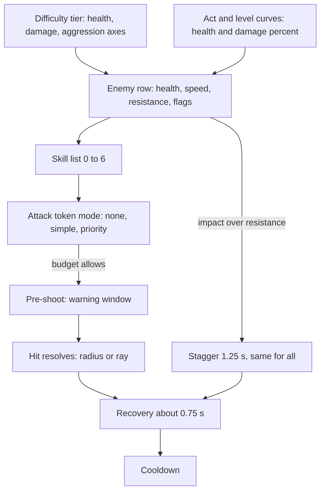

# Roboquest enemies and telegraph grammar (comps note)

Evidence: shipped data tables parsed to the last byte (level 4 at measurement, scripts outside the repo; level 2 from the repo alone) for enemy statistics and the join of enemy skills to attack definitions; wiki (public), read by a scout at file:line (level 2) for bosses, difficulty tiers, patch notes and respawn rules. The wiki holds no enemy stat values; the tables hold no text. Wave counts per squad anchor are not decoded. Counts below are over data rows after designer header rows are excluded, so a few minimums differ by a small amount between the two statistics outputs (stated in the table).

## What it does

**Roster by chassis.** The enemy table has 139 data rows. By chassis class: flying 36, turret 34, bot 14, pawn 10, worker 6, and 39 rows with no class label (bosses and big units sit there, inference). Movement is static on 58 rows, walking on 45 and flying on 36. Health runs 1 (or 10 after header exclusion) to 13,000 with a median of 120 and a 90th percentile of 5,000. Median move speed is 600 to 650 cm/s, 90th percentile 1,250. The roster is small-bodied: the 106 unmarked minions have a median health of 80.

**Three flag tiers, no overlap.** 32 rows are bosses, 7 are elites and 7 are "big" units. The seven elites all share one health value (300) and one impact resistance (180). An elite is therefore a flat stat tier, not a stack of affixes. The wiki adds that elite variants come from one pawn family, that their count per level scales with difficulty, and that none appear on Standard difficulty or below (Updates.txt:816-819).

**One interrupt window for everyone.** Stagger duration is 1.25 s on nearly every row (median and 90th percentile both 1.25 s), so a staggered enemy is open for the same beat whatever its chassis. Impact resistance, not stagger length, decides whether a hit staggers: median 65 to 70, 90th percentile 1,100, maximum 4,600.

**The telegraph grammar.** Every enemy skill (169 rows, 0 to 6 skills per enemy; 41 enemies have none, 54 have one) joins to an attack definition (112 rows). The same four numbers describe every attack: pre-shoot time (the wind-up before the hit resolves), recovery time (the vulnerable tail), cooldown, and for area attacks a radius.

- Pure projectiles: pre-shoot median 0.75 s, 90th percentile 0.75 s, maximum 1.75 s; recovery median 0.75 s; cooldown median 0.
- Projectile with an area on impact: pre-shoot median 0.75 s, 90th percentile 1 s, maximum 2.5 s; cooldown 90th percentile 6 s; radius median 2.4 m, maximum 8.5 m.
- Area attacks with no projectile: pre-shoot median 0.25 s, 90th percentile 0.5 s; radius median 4.8 m; cooldown 90th percentile 5 s.
- Rays (6 skills): pre-shoot 1 to 2.5 s, median 1.25 s, the longest warning in the table; recovery median 0.75 s.

The pattern is that the larger and less avoidable the effect, the longer or cheaper-to-read the warning: rays warn longest, close-in area bursts warn shortest but are the smallest threats per target, and projectiles sit at a three-quarter-second default. Recovery is the same 0.75 s median for every type, so "after the hit, the enemy is open for 0.75 s" is a single rule rather than a per-enemy number (inference from medians).

**Attack tokens.** Each skill carries a shared-budget rule in one of three modes: none (71), simple (66), priority (32). This reads as a limit on how many enemies may attack at once, with priority enemies taking the budget first (inference from the mode names; the budget size is not decoded). Applied status effects are few: slowed 13, burn 9, stun 9, confused 4, marked 2.

**Scaling.** Health and damage each follow a level curve. Health is a percent bonus by level (inference): flat at the first levels, then 20 at level 2 and 200 at level 11. Damage runs from 0 at level 1 to 580 at level 30. Each act adds a flat health modifier: 0, 30, 70 and 140 percent for acts 1 to 4. Nine difficulty tiers (8 named on the wiki) set health modifiers of -30, -20, 0, +15, +25, +35, +42, +50 and +60 percent in the table, and the wiki lists damage modifiers from -50 to +40 percent plus an aggression axis from -150 to +40 percent (Difficulty.txt:14-76). Enemy count is not in the difficulty table.

**Respawns.** In arenas, a respawn is less likely to replace the type just killed (Updates.txt:1180-1181), so players cannot clear one type by farming its replacement.

## Parameters

| Parameter | Value | Source |
|---|---|---|
| Enemy rows | 139; by class: flying 36, turret 34, bot 14, pawn 10, worker 6, unlabelled 39 | tables (level 4 at measurement), enemy statistics |
| Health, all enemies | min 1 (10 after header exclusion), median 120, 90th percentile 5,000, max 13,000 | tables, enemy statistics and summary |
| Health by class, median | bot 60, flying 120, pawn 135, turret 120, worker 80 | tables, per-class summary |
| Move speed, all | median 600 to 650 cm/s, 90th percentile 1,250, max 1,600 | tables (two outputs differ slightly) |
| Move speed, turret and worker | 400 cm/s each (turret to 450) | tables, per-class summary |
| Stagger duration | 1.25 s median and 90th percentile, 0.1 to 0.2 s minimum | tables |
| Impact resistance | median 65 to 70, 90th percentile 1,100, max 4,600 | tables |
| Flags | boss 32, elite 7, big 7, no overlap | tables |
| Elite stat tier | 7 of 7 elites at health 300, impact resistance 180 | tables |
| Minion health | median 80 over 106 unmarked rows | tables |
| Skills per enemy | 0:41, 1:54, 2:31, 3:15, 4:4, 5:6, 6:1 | tables |
| Pre-shoot, projectile | median 0.75 s, 90th percentile 0.75 s, max 1.75 s (80 skills) | tables, skill-to-attack join |
| Pre-shoot, projectile with area | median 0.75 s, 90th percentile 1 s, max 2.5 s (55 skills) | tables, join |
| Pre-shoot, area only | median 0.25 s, 90th percentile 0.5 s, max 0.75 s (25 skills) | tables, join |
| Pre-shoot, ray | 1 / 1.25 / 2.5 / 2.5 s min / median / 90th / max (6 skills) | tables, join |
| Recovery, all types | median 0.75 s | tables, join |
| Cooldown | median 0 to 1 s, 90th percentile 5 to 6 s, max 8 s | tables, join |
| Area radius | median 2.4 m (projectile with area), 4.8 m (area only), max 8.5 m | tables, join |
| Attack damage | median 18 to 26 by type, max 32 | tables, join |
| Attack-token mode | none 71, simple 66, priority 32 | tables; reading as a budget is inference |
| Applied statuses | slowed 13, burn 9, stun 9, confused 4, marked 2 | tables |
| Health level curve | 0 at levels 0 and 1, 20 at level 2, 200 at level 11 | tables, curves (percent reading is inference) |
| Damage level curve | 0 at level 1 to 580 at level 30 | tables, curves |
| Act health modifier | 0, 30, 70, 140 percent for acts 1 to 4 | tables, act rows |
| Difficulty health modifier | -30 to +60 percent over nine rows | tables, difficulty rows; wiki Difficulty.txt:14-76 |
| Elite gate | none on Standard or below; count per level scales | wiki (public), Updates.txt:816-819 |
| Resistance shield | 50 percent less damage from the resisted element, shown near the health bar | wiki (public), Updates.txt:1170-1171 |
| Boss ray warning | 1 s charge before a tracking beam; 5 s burst | wiki (public), Bosses.txt:103-104 |
| Respawn rule | respawn lowers the chance of the type just killed | wiki (public), Updates.txt:1180-1181 |
| Boss health tuned for similar time-to-kill | stated, no numbers | wiki (public), Updates.txt:1190 |
| Wave counts per squad anchor; token budget size; boss phase counts | not decoded or not stated | gap |
| Wiki values | level 2; pre-shoot and radius are from tables, not play | gap |

## Why it works

- **One grammar for every attack.** Pre-shoot, recovery, cooldown and radius are the same four fields for a swarmer and a boss, so a player learns the language once and reads any new enemy in it.
- **Warning scales with unavoidability.** The ray with the least room to dodge gets the longest warning in the table.
- **A shared interrupt window.** A uniform 1.25 s stagger turns "hit it hard enough" into a known reward, with impact resistance as the single dial for who can be interrupted.
- **Elites as a stat tier** stay readable: the player learns one health bracket, not a list of affixes. The difficulty gate means early runs never see them.
- **A budget on simultaneous attackers** (inference) keeps layered chaos answerable: not every enemy that can attack does so at once.
- **Respawn variety** spreads types across an arena so crowds stay mixed and no type is farmed away.
- **Curves and act steps raise numbers while the grammar stays fixed,** which is the shape of readable-capped scaling.

## What Scrapkeep borrows

- **A four-field telegraph record per attack: pre-shoot, recovery, cooldown, radius** (principle: readability first). Refines BIBLE.md "A committed attack means what it shows" (line 489), which requires readable preparation and visible recovery but names no numbers. The study supplies a starting band to test, not values to ship.
- **A single recovery rule rather than a per-enemy number** (principle: harmonize apparent contradictions). Same Bible section; the lab tunes Scrapkeep's own value.
- **A cap on simultaneous attackers owned by the event director** (principle: readable-capped scaling). Refines BIBLE.md "Encounters, waves and enemies" (line 517), "layered chaos never relaxes readability", and TADR-010 line 39 (overlap does not relax readability, counts and budgets stay with the tested encounter). The mode count (three) is a shape to study. Note: TADR-010 contains no telegraph text, so the telegraph contract lives in the Bible section alone.
- **Stagger as a universal interrupt window** (principle: quick restart and momentum are sacred; an interrupt rewards skill without stalling flow). Refines BIBLE.md line 489, "recovery or vulnerability".
- **Elite as a flat stat tier gated by difficulty** (principle: opt-in layers). Refines line 517; this is the opposite of the affix model in the Gunfire note and the two can coexist as separate options.
- **Level curve plus act step plus difficulty axes as three separate multipliers, with aggression as its own axis** (principle: readable-capped scaling; "insane scaling bounded by visual clarity" in Andrew's playtest entry 6, lines 98 to 105 of the playtest log, not Bible text). The cap on simultaneous attackers is what keeps scaled numbers readable.
- **Respawns that avoid the type just killed** (principle: readability first). Refines line 517 and TADR-010's director.
- **A telegraph shape matched to the damage shape for a ray, circle and burst** (principle: readability first). Anchor: line 489; marker vocabulary only.

## What it must not copy

- Enemy and boss names, attack names, descriptions and the text of any wiki page.
- Enemy and boss models, silhouettes, animations and arena layouts; no mesh, texture or sound from the game.
- The numbers as a table: pre-shoot, recovery, radius, health, level-curve and difficulty values are study bands; Scrapkeep tunes its own in the lab.
- The exact flag trio (boss, elite, big) or the three-mode token scheme as a data layout; the idea is a cap and a tier, not the schema.
- Proper names of areas, acts and difficulty tiers.

## Lab measure

In the headless lab, run each Scrapkeep enemy attack 50 times against a stationary dummy and log pre-shoot time, recovery time, damage-area radius and the count of simultaneous attackers during a director-composed encounter at the highest threat step. Pass: for every attack, pre-shoot is at least the lab's reaction floor (config, target 0.4 s) and recovery is within a stated band across all archetypes; telegraph and damage areas overlap by at least 95 percent; and the simultaneous-attacker count never exceeds the director's cap in any of 20 seeded encounters, with zero violations.
