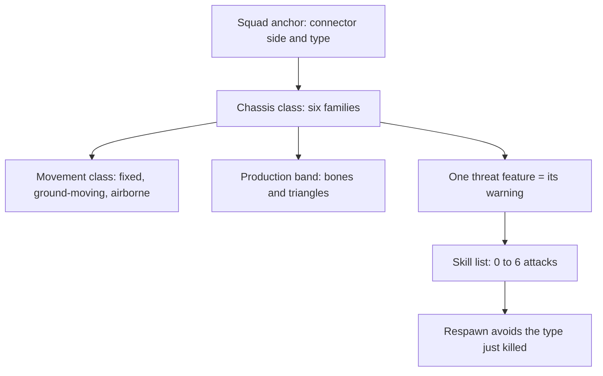

# Roboquest enemy design grammar (comps note, separable extra for the asset forge)

Evidence: shipped data tables (level 4 at measurement, scripts outside the repo; level 2 from the repo alone) for enemy classes and flags; asset metadata measured by the production-budget report (counts and dimensions only, triangle counts are LOD0 whole assets, bones are per whole rig); wiki (public) read at file:line (level 2) for boss mechanics and respawn rules. The wiki does not state why a silhouette reads, so those lines are labeled inference. Squad-anchor wave counts are not decoded. This note feeds the asset forge's enemy kit and is separate from the telegraph note; it carries no geometry, only relationships and counts.

## What it does

**Families by chassis and movement.** The wiki groups enemies in six categories by chassis, and the asset folders use six family tokens that do not map one to one onto the wiki's six or onto the table's classes. This note names the seven asset-folder families in its own words: ground walker, airborne, fixed emplacement, small walker, rail labourer, pod and heavy. Movement class is a separate axis in the tables: 58 rows fixed, 45 ground-moving, 36 airborne. Read as one rule per family (inference from table classes and wiki one-line attacks):

- **Ground walker:** walks, shoots a blaster, throws a grenade; the stable infantry read. Health median 135.
- **Airborne:** hovers or dives; its attacks are a charge-up then a dive, a slow-tracking ray, or a flash. Health median 120, speed up to 1,600 cm/s.
- **Fixed emplacement:** fixed, health median 120, speed 400 cm/s where it moves at all; the read is "it stays where it is", and the anchor placement decides the threat.
- **Small walker:** short-range, health median 60, the smallest body; chase-and-explode.
- **Rail labourer:** rail-bound, health median 80, speed 400 cm/s; the rail is the read, and some spawn a fixed child type so the spawner is the target.
- **Heavy:** seven flagged rows, median health 1,050; fewer, slower to kill, longer to read.

**Production bands per family.** From the asset report (whole-asset LOD0 triangles; bones per whole rig):

| Family (own words) | Bones median | Triangles median | Clips (median seconds) |
|---|---|---|---|
| Pod | 16 | 12,331 | 288 (0.04) |
| Airborne | 16 | 9,691 | 304 (0.46) |
| Small walker | 37 | 11,442 | 283 (0.71) |
| Ground walker | 54 | 19,767 | 211 (0.62) |
| Rail labourer | 24 | 15,038 | 57 (0.46) |
| Heavy | 46 | 24,320 | 127 (0.62) |

Across all enemies, bones have a median of 27 and a 90th percentile of 55; bosses run a median of 59 and up to 143.

**What makes a silhouette read (inference).** The wiki and tables do not say; the pattern across the one-line attack texts is that each enemy has one threat feature and that feature is also its warning: a lens or light that charges before a flash or beam, a body that hides then strikes, a rail that declares its path. Each boss is described by one signature mechanic that changes its arena or rules: proximity detonation, burrowing, rail-bound movement, a forcefield, floor collapse (Bosses.txt:11, 25, 54, 68, 86). Boss time-to-kill was tuned to be similar across bosses (Updates.txt:1190).

**Squad anchors.** The 151 pieces carry 5,979 enemy anchors in all, most of them in corridor connectors and arena pieces. Each records the connector side it sits on, not a facing, and a type. The tallies of non-default values are 1,892 airborne and 1,091 fixed, and the tally skips default values, so about 3,000 anchors carry the default type (PIECES-MEASURED.md:16, 81, 102). The anchor fixes the chassis class, and the spawner picks the specific enemy (inference). Wave counts per anchor are not decoded.

**Respawn rule.** Arena respawns lower the chance of the type just killed (Updates.txt:1180-1181), spreading families across the arena.

## Parameters

| Parameter | Value | Source |
|---|---|---|
| Enemy rows by class | airborne 36, fixed 34, small walker 14, ground walker 10, rail labourer 6, unlabelled 39 (14 boss, 7 elite, 5 heavy, 13 minion) | tables (level 4 at measurement), enemy statistics |
| Movement class | fixed 58, ground-moving 45, airborne 36 | tables, summary |
| Wiki categories | six, with 14, 5, 12, 3, 18 and 2 entries (54 rows) | wiki (public), Enemies.txt:7-323 |
| Health median by class | small walker 60, labourer 80, airborne 120, fixed 120, ground walker 135 | tables, per-class summary |
| Heavy units | 7 rows, median health 1,050 | tables |
| Bones median per family | pod 16, airborne 16, small walker 37, ground walker 54, labourer 24, heavy 46 | asset report (whole rigs) |
| Bones, all enemies / bosses | median 27, 90th 55 / median 59, 90th 99, max 143 | asset report |
| LOD0 triangles median per family | pod 12,331, airborne 9,691, small walker 11,442, ground walker 19,767, labourer 15,038, heavy 24,320 | asset report (whole assets) |
| Triangles 90th percentile per family | pod 17,877, airborne 14,508, small walker 15,272, ground walker 31,912, labourer 19,051, heavy 40,593 | asset report |
| Clips per family | pod 288, airborne 304, small walker 283, ground walker 211, labourer 57, heavy 127 | asset report |
| Clip median seconds | 0.04 to 0.71 by family | asset report |
| Squad anchors | 5,979 total; non-default type tallies 1,892 and 1,091, so about 3,000 at the default type; direction values are connector sides | pieces report (PIECES-MEASURED.md:16, 81, 102) |
| Skills per enemy | 0 to 6; 28 none, 54 one | tables |
| Boss signature mechanics | five described, one each | wiki (public), Bosses.txt:11, 25, 54, 68, 86 |
| Summoner spawns a fixed child type | stated | wiki (public), Enemies.txt:259, 299 |
| Respawn rule | lowers chance of the type just killed | wiki (public), Updates.txt:1180-1181 |
| Why a silhouette reads | not stated | gap |
| Wave counts per anchor | not decoded | gap |

## Why it works

- **One read per family.** A player sorts any enemy into a handful of classes by movement before learning its attacks.
- **Threat feature equals warning feature** (inference). The part that hurts is the part the player watches.
- **One signature mechanic per boss** makes each fight a single new question.
- **Production bands stay narrow:** every family median sits between 9,691 and 24,320 triangles and 16 to 54 bones, so a family is a size class, not a bespoke asset.
- **Respawn variety** keeps classes mixed in a fight.

## What Scrapkeep borrows

- **A family is a chassis class plus a movement class plus one read** (principle: readability first). Refines BIBLE.md "A silhouette has a job" (line 719), which asks for behavior-driven construction; this supplies a way to sort a roster.
- **Threat feature equals warning feature** (principle: readability first). Refines BIBLE.md "A committed attack means what it shows" (line 489).
- **One signature mechanic per boss and miniboss** (principle: harmonize apparent contradictions). Refines BIBLE.md "Encounters, waves and enemies" (line 517) and TADR-010 (the director places minibosses).
- **Family budget bands for the forge:** bones and triangles per class as ranges to test, with the ratios below. The forge authors from a free base, so the bands only size the work.
- **Proportion ratios, numbers only.** Relative to the airborne family's median triangles (1.00): pod 1.27, small walker 1.18, labourer 1.55, ground walker 2.04, heavy 2.51. Relative to the pod and airborne bone median (1.00): labourer 1.5, heavy 2.9, small walker 2.3, ground walker 3.4. Health relative to the ground walker median (1.00): small walker 0.44, labourer 0.59, airborne and fixed 0.89, heavy 7.8.
- **A forge recipe, as a relationship:** pick a free base, assign it a chassis class, give it one lens or light as its threat feature, set budget and rig size from the family band, and let the telegraph note's four fields describe its attacks.
- **Anchors that fix class and the spawner that picks the member** (principle: opt-in layers). Anchor: TADR-010's director.
- **Respawns that avoid the type just killed.** Anchor: line 517.

### Base mesh sources

Andrew asked whether a shipped enemy mesh could be ripped and resculpted. No: a resculpt of a copyrighted model stays a derivative, and one such file would break the forge's provenance guarantee for every asset downstream. The clean version of the same workflow starts from a public-domain or attribution-licensed base and reshapes it to the grammar above. A web scout checked the sources on 11 October 2026 without downloading anything (study report, outside the repo); rows marked snippet rest on search-result text because the page did not load.

| Rank | Source | License (as read) | What it offers | Format |
| --- | --- | --- | --- | --- |
| 1 | Quaternius on Poly Pizza, a flying robot enemy | CC0, verified on the page | one drone-like robot | FBX, glTF |
| 2 | Quaternius, an animated low-poly robot on OpenGameArt | CC0, verified | one robot with about 14 clips (snippet) | zip; check for glTF inside |
| 3 | Quaternius, the same robot and the animated monsters and animals packs on itch | CC0 per snippet; pages returned errors, verify first | robots; simple creatures | not verified |
| 4 | Daniel Darko, a low-poly robot on Sketchfab (found on a mirror site; admission must fetch from the original Sketchfab page, ASSETS.md:23, and re-read the license there) | CC BY 4.0 as read on the mirror; attribution text given | one stylized robot, about 3,250 faces | GLB, glTF |
| 5 | Cough-E, a low-poly robot on OpenGameArt | CC0, verified | one untextured robot, shape reference | Blender file only |
| For blockouts | Kay Lousberg, prototype bits | free commercial use, no attribution, no resale of unmodified copies (snippet) | 64 or more blockout pieces, no robots | not verified |

Not usable as bases: Kenney ships no 3D robots (its robot pack is 2D); Mixamo is humanoid-only and not a Creative Commons license; Blender Studio's security-bot rig is a finished CC-BY character, a reference rather than a base. Not checked: Polyhaven, ambientCG, the Unity Asset Store.

Provenance recipe for the forge (TADR-003 admission): one sidecar per fetched base with the source URL and exact title, the license name and version as printed plus the saved license line, the download URL, the access date, the saved HTML of the page's license line, the file list with sizes and a SHA-256 per archive, the creator and any attribution text, and the commercial-use statement; re-check the license line before a build ships and keep the sidecar beside the asset.

## What it must not copy

- Any enemy or boss mesh, texture, rig or animation, including resculpted or retopologized versions: a derivative stays a derivative and would taint forge provenance.
- Enemy, boss, family and attack names, wiki text and descriptions.
- Silhouettes, colors and arena layouts, or a one-to-one map of the six classes onto Scrapkeep creatures; the class idea is borrowed, not the roster.
- The per-family numbers as targets; they size the study, Scrapkeep sets its own from the lab.

## Lab measure

Run the forge's first family from a CC0 base and record bones, triangles, authored clips and threat-feature visibility. Pass: bones and triangles within the band for its chassis class (set in the lab config, starting from the ratios above), and in a blind silhouette test of 20 stills at game camera distance, three reviewers name the chassis class and the threat feature correctly for at least 18 of 20, with zero stills where the threat feature is hidden.
