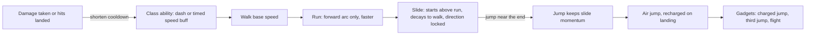

# Roboquest movement and feel (comps note)

Evidence: public wiki pages read by a scout at file:line and a sample re-read by the coordinator (level 2, "wiki (public)"); shipped data tables for enemy speeds (level 4 at measurement, scripts outside the repo). Gap that decides this note: no frame-counted values exist. The game was not run, headless capture cannot establish feel, and the wiki states speeds in centimetres per second and times in seconds. Every number below is a level-2 wiki value, and the capture method is in Lab measure.

## What it does

**Ground verbs.** Walking goes in eight directions at a base speed. Running is faster but only forward and forward-diagonal. Crouching, from standing still, is slower and lowers the profile. Sliding starts from movement, goes in eight directions, begins slightly faster than a run and decays quickly to the walking speed. The direction is locked during the slide, a jump or releasing crouch cancels it, and slope does not change its length. The wiki's feel tip is to jump near the end of a slide to keep the momentum, so the slide is a speed bank with a spend window.

**Air verbs.** One jump and one air jump, the air jump recharged by landing. Air strafing can steer or brake and "can give some momentum"; its speed is an unfilled placeholder. Jumping on an enemy's head is a bounce with a damage value that is also unfilled. Grind rails capture the player in the direction of momentum at mounting; sprint speeds the rail; jump leaves it; the speed is unfilled.

**Gadget movement.** Optional toggles add a very high charged jump, a third jump and a fuel-limited flight that refuels when grounded. These sit in the shared gadget layer, not in a class.

**Class movement is an ability, not a rule.** The wiki states no per-class movement rules (the same base for all seven is an inference). Class difference is a timed ability: a six-metre forward dash with an arrival explosion on an eight-second cooldown; an invisibility window with a short speed bonus on a fifteen-second cooldown; an overdrive window with a larger speed bonus on an eight-second cooldown; a stacking tiny speed bonus on an explosives class. Taking damage or hitting enemies shortens some of these cooldowns, so combat feeds mobility.

**Not stated at all:** wall-running, climbing, mantling, air-control values, fall damage, speed caps, slide invulnerability, dash invulnerability, and any frame count.

## Parameters

| Parameter | Value | Source |
|---|---|---|
| Walk speed | 1000 cm/s, 8 directions | wiki (public): Movement page, line 6 |
| Run speed | 1525 cm/s, forward and forward-diagonal only | wiki (public): Movement page, line 10 |
| Crouch speed | 825 cm/s | wiki (public): Movement page, line 14 |
| Slide | starts 1925 cm/s, decays to 1000 cm/s, 8 directions, direction locked | wiki (public): Movement page, lines 16 to 20 |
| Derived ratios | run 1.53x walk; slide start 1.93x walk and 1.26x run; crouch 0.83x walk | arithmetic on the three rows above (inference only as to feel) |
| Jump / air jump / charged jump height | about 4.5 m / about 5 m / about 12 m | wiki (public): Movement page, lines 31, 35, 47 |
| Height unit note | 1000 units is about 4.25 m; jump about 1060, air jump about 1175, charged jump about 2800 | wiki (public): Movement page, lines 54 to 60; the two scales agree to within 0.1 m (coordinator arithmetic) |
| Slide length, slide decay time | not stated | gap |
| Air strafe, grind and headbonk values | placeholders, unfilled | wiki (public): Movement page, lines 24, 26, 39, 41 |
| Dash class: distance / cooldown | 6 m / 8 s, arrival explosion | wiki (public): dash-class page, lines 17 and 20 |
| Stealth class: speed bonus / duration / cooldown | +15% / 4 s / 15 s | wiki (public): stealth-class page, lines 18 and 24 |
| Overdrive class: speed bonus / duration / cooldown | +22% / 6 s / 8 s (also +30% fire, reload and attack speed) | wiki (public): weapon-eater-class page, lines 16 and 18 |
| Explosives class speed | +0.5% per stack of its passive | wiki (public): explosives-class page, line 27 |
| Cooldown shortening from combat | damage taken shortens the dash cooldown by 2 s (a perk); damage taken shortens the stealth cooldown by 2 s (a perk); a javelin hit shortens it by 1 s | wiki (public): dash-class page, line 45; stealth-class page, lines 61 and 79 |
| Derived buff uptime | stealth about 27% (4 of 15 s); overdrive about 75% (6 of 8 s) if the cooldown starts at activation, about 43% if it starts at expiry; the wiki does not say which | arithmetic on the rows above (inference) |
| Enemy move speed (min / median / p90 / max) | 0 / 600 / 1250 / 1600 cm/s | shipped data tables (level 4 at measurement, scripts outside the repo), enemy table |
| Player run versus enemy speeds | run is 2.5x the median enemy and 1.2x the p90 enemy | arithmetic on the rows above |
| Frame counts for dash, slide, jump arc, any wall-run | not available | gap: no capture |

Source check: the speeds and heights were re-read from the page at the cited lines and match the scout's report.

## Why it works

- **Slide as a stored-speed trade.** Starting well above running and decaying to walking makes the slide a short, committed burst. The jump near its end converts that burst into air time, so the skill is timing, not a new button (the timing claim is stated on the wiki, the effect on feel is inference).
- **Run is gated by direction.** Running only forward keeps strafing slow, so aiming at a target while retreating costs speed. Inference from the stated restriction.
- **Player outruns most enemies by a wide margin.** At 2.5x the median enemy, positioning is mostly the player's choice; only the fastest enemies approach run speed. Inference from two datasets read separately.
- **Class difference sits in an ability with a cooldown.** The base verbs are learned once, and each class adds one timed spike. Combat events that shorten the cooldown reward fighting while moving. Stated for the perks above; the reading is inference.

## What Scrapkeep borrows

Principles: **momentum is sacred** and **three characters with their own movement** (Andrew's, `docs/playtests/PLAYTEST-LOG.md` entry 6, lines 98 to 105). Bible anchors, each checked with `grep -n` on BIBLE.md: "Movement, camera and active aim" (`BIBLE.md:479`), "A committed attack means what it shows" (`BIBLE.md:489`), "Abilities, ultimates and combat rhythm" (`BIBLE.md:499`) and "Four slots and milestone progression" (`BIBLE.md:527`, its mobility row). TADR-008 puts any such ability through the one ability contract. Everything below is proposal.

- **A speed bank with a spend window.** A roll or slide that starts above cruising speed and decays to it, with a jump or release inside the last part of the decay keeping the speed, so slowing down is the player's choice and momentum is never taken away unseen. Starting ratios to test: 1.2x to 1.3x the cruise speed for the burst, with the window inside the final 25% of the decay (both proposals).
- **Shared base verbs, a distinct mobility slot per character.** Roboquest gives all classes the same ground rules and puts difference in one timed movement ability. Scrapkeep's principle is stronger (each of three characters moves differently), so borrow only the structure: a shared floor of verbs plus the mobility slot of the four-slot table carrying the character-specific verb, with its own cooldown and a visible state.
- **Cooldown refunds from combat events** (damage taken, hits landed) of one to two seconds on cooldowns of eight to fifteen seconds, so the mobility verb is fed by fighting. This is the same stated range as the sources; the cap and the event list are Scrapkeep's own design.
- **A timed buff with a derived uptime budget.** Pick the buff's duration and cooldown so uptime lands in a declared band (propose 25% to 75%), and show the state on the character so the buff is read, not guessed (Bible line 489: preparation and effect must be readable).
- **Enemy speed set against player speed in ratios** (the player's cruise as a declared multiple of the median enemy), so fast threats are the exception the player sees coming.

## What it must not copy

- Any of the speeds, heights or buff percentages as Scrapkeep values; they belong to a different body and camera.
- Class names, ability names and the dash arrival explosion as content.
- Run restricted to the forward arc. Scrapkeep's camera-relative movement and active aim (Bible line 479) would fight it.
- Unfilled or hidden values: Scrapkeep shows the speeds and cooldowns the player needs.
- Movement identical across characters; that contradicts Andrew's principle.
- Slide and jump arc shapes as animation or geometry.

## Lab measure

The comparison card asked for frame counts and none exist. Capture method: a 60 fps recording of one dash, one slide, one full jump arc with its air jump and one wall-run if the game has one, shot on flat ground with a distance marker, read frame by frame, by Andrew or in a play session. From it, record frames from input to full speed, frames of the slide decay, the width of the jump-near-the-end window in frames, air-jump apex height, and dash start-up and recovery frames. Until then the figures here are wiki seconds and centimetres per second and are not feel evidence.

In the headless lab for Scrapkeep's own prototype, run a scripted roll-slide-jump from a fixed start for each of the three characters and log speed per tick. Pass when (a) the burst-to-cruise ratio falls inside the declared band, (b) a jump inside the declared window keeps at least 90% of the burst speed and a jump outside it does not, (c) no character's mobility buff uptime leaves the declared 25% to 75% band, and (d) the three characters' speed traces differ in shape, not only in scale.
