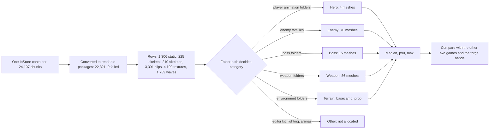

# Production budgets: what a shipped stylized first-person roguelite spends when it keeps whole characters at tens of thousands of triangles

Evidence: measured data (level 4 at measurement; level 2 from this repo, because the scripts and logs live outside it). One conversion run turned the whole container into readable packages (22,321 packages, 0 failed) and a parser wrote one row per export for seven classes: 1,306 static meshes, 225 skeletal meshes, 210 skeletons, 3,391 animation sequences, 1,392 montages, 4,190 textures and 1,789 sound waves. Counts and dimensions only; nothing was exported, copied or viewed. The source is the production budgets report in the study tree's Roboquest reports folder; the container facts come from its container listing report. The Risk of Rain 2 and Gunfire Reborn columns are copied from the accepted notes `ror2/production-budgets.md` and `gunfire/production-budgets.md`, not re-measured. Forge bands are as those notes cite them from the asset forge's pack file on the branch `claude/reverse-engineer-asset-pipeline-a5025f`.

Read the tables with three caveats. Triangle rows for skeletal meshes are **whole assets** (one character body or one weapon, all sections summed at the first level of detail), while the other two games' triangle rows are **per mesh piece**. Part of every gap between this game and the other two is therefore a unit difference, not a style difference, and this note cannot size that part. Bone counts are per skeleton (whole rig), the others per skinned renderer, and a rig counts every bone any of its meshes or clips use. Categories come from folder paths only.

## What it does

The study sorted each exported object by folder into hero, enemy (with a family token), boss, weapon, terrain by act, basecamp, prop and a few smaller groups, then reported median, 90th percentile and maximum per category. It is the third data point after the third-person Risk of Rain 2 and the stylized Gunfire Reborn, and the first of the three with high-polygon characters and 4,096-pixel textures.

## Parameters

Static mesh triangles (first level of detail; n = rows; static meshes are per piece, like the other games):

| Category | n | Median | p90 | Max | Source |
|---|---|---|---|---|---|
| Prop (vegetation, rocks, doors, tileables, random meshes) | 171 | 844 | 12,080 | 148,204 | measured: production budgets report, meshes section |
| Terrain (acts one to four) | 516 | 696 | 4,976 | 86,467 | measured: same |
| Basecamp | 244 | 1,224 | 13,200 | 115,962 | measured: same |
| Interactive (buttons, chests, doors, traps) | 50 | 1,597 | 10,121 | 73,061 | measured: same |
| Effects | 210 | 240 | 1,165 | 12,288 | measured: same |
| Weapon-folder static pieces | 22 | 417 | 5,221 | 23,668 | measured: same |
| All game | 1,283 | 695 | 6,124 | 148,204 | measured: same |

Reading: 438 of 1,283 static meshes (34%) carry more than one level of detail, and only the first is counted. Terrain act widths run 5.7 to 16.4 m at the median, so a typical terrain piece is a set piece of a few metres, not a tile of a hundred. Vertices are present for all rows (unlike Gunfire's).

Skeletal mesh triangles, whole assets, first level of detail only:

| Category | n | Median | p90 | Max | Source |
|---|---|---|---|---|---|
| Hero (4 of 5 parsed) | 4 | 34,098 | 35,479 | 35,479 | measured: production budgets report, skeletal section |
| Enemy | 70 | 14,152 | 24,357 | 43,057 | measured: same |
| Boss (boss folders; inference that these are the bosses) | 15 | 29,384 | 53,687 | 65,276 | measured: same |
| Weapon | 86 | 18,642 | 27,953 | 40,974 | measured: same |
| Non-player characters | 18 | 25,306 | 51,903 | 55,434 | measured: same |
| Skill pieces | 8 | 3,359 | 11,656 | 12,547 | measured: same |
| Basecamp | 7 | 2,984 | 12,194 | 21,861 | measured: same |
| Interactive | 17 | 10,054 | 15,749 | 18,176 | measured: same |
| All skeletal | 225 | 15,987 | 33,502 | 65,276 | measured: same |

Reading: enemy families differ by size class. Medians by family run 9,691 to 24,320 triangles, with the largest family heaviest and the flying family lightest. The maximum bone influences per vertex reach 4 for 60 meshes, 3 for 46, 2 for 37, 1 for 77, 5 for 3 and 8 for 2: a typical skinned vertex uses up to four bones, with a short tail to eight.

Bones per skeleton (whole rig):

| Category | Skeletons | Median | p90 | Max | Over 64 | Source |
|---|---|---|---|---|---|---|
| Hero | 4 | 47 | 62 | 68 | 1 (25%) | measured: production budgets report, rigs section |
| Enemy | 55 | 27 | 55 | 73 | 3 (5%) | measured: same |
| Boss | 16 | 59 | 99 | 143 | 6 (38%) | measured: same |
| Weapon | 86 | 12 | 23 | 39 | 0 | measured: same |
| Non-player character | 17 | 63 | 89 | 124 | 8 (47%) | measured: same |
| All game | 210 | 16 | 63 | 143 | 18 (9%) | measured: same |

Textures (larger side of the top level; DXT block formats dominate):

| Category | Textures | 256 or less | 512 | 1,024 | 2,048 | Over 2,048 | Max side | Source |
|---|---|---|---|---|---|---|---|---|
| Hero | 31 | 2 | 1 | 0 | 7 | 21 | 4,096 | measured: production budgets report, textures section |
| Enemy | 223 | 18 | 1 | 23 | 173 | 8 | 4,096 | measured: same |
| Boss | 99 | 8 | 1 | 12 | 42 | 36 | 4,096 | measured: same |
| Weapon | 313 | 4 | 4 | 42 | 251 | 12 | 4,096 | measured: same |
| Terrain, basecamp, prop | 619 | 17 | 110 | 127 | 228 | 137 | 4,096 | derived: sum of the three rows in the same table |
| User interface | 2,167 | 980 | 829 | 131 | 116 | 111 | 7,680 | measured: same |
| All game | 4,094 | 1,137 | 1,081 | 541 | 922 | 413 | 7,680 | measured: same |

Reading: character textures cluster at 2,048 for enemies and weapons, but the hero set is mostly above that (21 of 31, which means 4,096 given the maximum; n is small). Formats across all 4,094: block-compressed colour with alpha 1,715, colour 1,411, uncompressed 611 (mostly interface), normal-map format 336, single-channel 15, other 6 (3 modern block format, 2 floating-point, 1 single-channel block). 2,320 textures have a single level and 1,736 have nine or more.

Animation clips (seconds):

| Category | Clips | Median | p90 | Max | Total min | Source |
|---|---|---|---|---|---|---|
| Hero | 359 | 0.48 | 1.72 | 4.96 | 4.1 | measured: production budgets report, clips section |
| Enemy | 1,485 | 0.71 | 1.62 | 12.46 | 16.8 | measured: same |
| Boss | 375 | 0.46 | 1.54 | 17.67 | 4.1 | measured: same |
| Weapon | 692 | 0.62 | 1.72 | 4.96 | 9.5 | measured: same |
| All game | 3,391 | 0.57 | 1.62 | 17.67 | 39.2 | measured: same |

Reading: the median clip runs about 26 frames per second (hero 30, weapon 61). The hero clips split across four rig folders (first-person and third-person sets for two player rigs) with 138, 135, 41 and 45 clips; weapons average about eight clips each over 83 weapon folders. The 1,392 montages wrap clips and add no animation data.

Audio, containers and movies:

| Source | Count or size | Reading |
|---|---|---|
| Engine sound waves | 1,789 waves, 81.6 min; median 1.20 s, p90 3.75 s, max 235.7 s; all stereo; 48 kHz 1,405, 44.1 kHz 384 | Weapon waves 809 (18.2 min), enemy 370, player 339; the four act music waves run 77 to 96 s each |
| Audio middleware master bank | 209.3 MB (sized from the file listing, not opened) | Event count and duration unmeasured |
| Movies | 19 files, 1.40 GB, in 1080 and 4K pairs | Outside the container |
| Container | 24,107 chunks, Zlib, 65,536-byte blocks; 11.19 GB uncompressed, 3.40 GB on disk (ratio about 3.3 to 1) | Bulk data is 7.37 GB, 66% of bytes (inference: mostly texture levels) |
| Top folders, uncompressed | Graphics 6.72 GB; animation 3.99 GB; audio 67.5 MB; generated level blueprints 280 MB; blueprints 56.1 MB; data 9.0 MB | Animation is large for 39 min of clips because rig and mesh data sits there too (inference) |

Parse failures: 3 skeletal meshes of 228 and 1 static mesh of 1,307. Every asset ships once, so there are no per-bundle duplicates (unlike Gunfire, where about 36% of texture rows repeat a name).

## Why it works

Detail follows importance, as in the other two games, but the scale is a different one. The player-facing characters and weapons carry the triangles and 2,048 to 4,096 textures. Environment pieces are the numerous cheap thing: a median static terrain piece is 696 triangles. Gameplay clips stay short (p90 under 1.8 s for hero, enemy and boss, the shortest of the three games), which suits a fast shooter. Inference: the readable silhouette in a stylized look comes from shape and colour, not polygon count, and this game could pay for density because it ships a narrow cast (4 player meshes, 70 enemy meshes, 15 boss meshes) with a large per-asset budget. A small cast with a high budget per asset is the opposite trade from Gunfire's thousands of small pieces.

## What Scrapkeep borrows

Principle: **readability first** and **three characters with their own movement**, from Andrew's design principles. One structural observation, not a rule: a small cast can carry heavy assets, and the budget is a choice made per category.

Three-way comparison. Triangle rows differ in unit (Roboquest skeletal rows are whole assets, the others per piece); bone rows differ in unit (per rig against per renderer). Bands are whole-asset.

| Measure | Roboquest | Gunfire Reborn (copied) | Risk of Rain 2 (copied) | Asset forge band | Reading |
|---|---|---|---|---|---|
| Hero triangles, median / p90 | 34,098 / 35,479 (whole, n = 4) | 1,430 / 4,773 | 1,928 / 11,278 | 3,000 to 6,500 | About 18 to 24 times the other medians and about 5 times the band top; part is unit |
| Enemy triangles, median / p90 | 14,152 / 24,357 (whole, n = 70) | 192 / 3,460 (monster and boss) | 528 / 4,814 (monster) | 800 to 1,500 kit; proposed 500 to 5,000 | About 27 to 74 times the medians; 9 to 18 times the kit band; above the proposed range |
| Boss triangles, median / p90 | 29,384 / 53,687 (whole, n = 15) | 90 / 2,488 (boss folder) | 480 / 10,608 (without the giant) | proposed up to 10,000 | Above the proposed class by 3 to 5 times |
| Weapon triangles, median / p90 | 18,642 / 27,953 (whole, n = 86) | 420 / 3,753 | 668 / 2,168 (item) | 150 to 1,500 (as a prop) | About 28 to 44 times the medians |
| Prop triangles, median / p90 | 844 / 12,080 (static, n = 171) | 232 / 1,261 | 188 / 3,503 | 150 to 1,500 | Median inside the band, p90 far above; same unit as the others, about 3.6 to 4.5 times |
| Terrain triangles, median / p90 | 696 / 4,976 (static, n = 516) | 212 / 913 | 188 / 3,503 (prop or stage) | 150 to 1,500 | Median inside; p90 above; about 3.3 to 3.7 times |
| Hero bones, median / p90 | 47 / 62 (max 68, n = 4 rigs) | 17 / 20 (renderer) | 77 / 136 (renderer) | no cap; proposed 80 | Max 68 sits under the proposed 80 |
| Enemy bones, median / p90 | 27 / 55 (n = 55 rigs) | 6 / 49 | 35 / 155 | no cap; proposed 40 | Median under 40, p90 over, as in both other games |
| Weapon bones, median / p90 | 12 / 23 (n = 86 rigs) | 4 / 14 | 7 / 19 (item) | no cap; proposed pickup 8 | Rigs run higher than renderers; a held weapon is not a pickup |
| Texture max side, hero | 4,096 (21 of 31 above 2,048) | 2,048 | at most 2,048 | no hero band | First game over 2,048 on characters |
| Texture max side, enemy and boss | 4,096 (most at 2,048: enemy 173 of 223) | 1,024 | at most 2,048 | no enemy band | Above both |
| Texture max side, terrain, basecamp, prop | 4,096 (137 of 619 above 2,048) | 8,192 (one texture) | 3 above 2,048 | 256 to 1,024 | Above the 1,024 ceiling in many rows |
| Clip seconds, hero, median / p90 | 0.48 / 1.72 | 0.80 / 2.66 | 0.67 / 1.83 | proposed at most 3.5 | Inside |
| Clip seconds, enemy, median / p90 | 0.71 / 1.62 | monster 1.07 / 3.00 | 0.95 / 2.85 | proposed at most 3.5 | Inside |
| Clip seconds, boss, median / p90 | 0.46 / 1.54 | 1.73 / 5.20 | 1.00 / 3.33 | proposed at most 3.5 | Inside; the boss folder maximum is 17.67 s |
| Clips per hero rig folder | 41 to 138 | about 20 | 38 to 143 | proposed at most 50 | Two of four rig folders exceed 50 |

### What this supports and what it does not

- It does not support lowering any band. At p90 every Roboquest triangle category sits above the forge's ceiling and the static prop and terrain medians sit inside the band, so the third game gives no reason to tighten. Only clip length and median bone counts sit under the proposed caps.
- It shows a stylized game can ship characters at roughly 18 to 74 times the other two games' per-piece medians for hero, enemy and weapon (inference: the unit difference accounts for an unknown share of that, and whether it still reads was not measured). Bosses have their own ratio: 29,384 against 480 (Risk of Rain 2, without the giant) is about 61 times, and against 90 (Gunfire boss folder) about 326 times, both with the unit caveat. Inference only: the band top may be a cost choice rather than a readability limit; no playtest tested it.
- It supports the proposed 80-bone hero cap as a ceiling: the heaviest hero rig has 68. It supports delta 1's ceiling side and its 5,000 and 10,000 limits only as lower bounds. It cannot test the 500 floor.
- It supports the proposed 3.5 s clip cap for gameplay clips (p90 under 1.8 s in every character category) and repeats the boss exception need (a 17.67 s maximum).
- It cannot say what a summed per-character total looks like in the other two games, so the whole-asset comparison stays one-sided: their figures are lower bounds on their assets.

Proposed forge delta (proposed, for the forge owner, not applied): add a hero, enemy and boss texture ceiling of 2,048 pixels on the larger side, with 4,096 allowed by exception per asset. Reason: the forge has no character texture band; two of the three games top out at 2,048 and the third puts most hero textures at 4,096 with n = 31. Rests on one game for the exception and is therefore weak.

## What it must not copy

- The absolute numbers as targets. A rolling-ball mech cast and a small team do not need 34,000-triangle heroes, 11.19 GB of uncompressed container data or a 209 MB audio bank.
- The 4,096 hero textures as a default; they are a cost the studio chose for four meshes.
- Any model, texture, clip, sound, level piece or table row. Only counts and dimensions appear here, and nothing is quoted.
- The outliers: a 7,680-pixel interface texture, a 148,204-triangle prop and a 17.67 s boss clip are accidents of the shipped game, not budgets.

## Gaps

- Levels of detail above the first are not read for either mesh class. For skeletal meshes even the count is unknown. Triangle figures are the first level only.
- Skeletal triangles come from a section scan, not a full mesh parser. A cross-check that vertex chains close passed on all 225 parsed meshes.
- Categories are inferred from folder paths. Boss folders (10 of them) are not tied to in-game bosses and hold mixed items such as arena pieces and projectiles. Enemy family names are folder names.
- The hero row holds 4 of 5 hero meshes; one failed to parse, so n = 4 is the weakest figure above.
- The audio middleware banks were sized, not opened; the bank's event count and duration are unmeasured. Cube, volume and render-target textures were not measured.
- The comparison columns for the other two games were not re-measured.
- Automated measurement does not establish how the game feels or whether a Scrapkeep asset inside these bands will read well.

## Lab measure

Pass when every forge pack's summed per-character triangles, bones and clip lengths sit inside the band the README names, and the count of assets checked is recorded and nonzero. Method: add the headless budget audit proposed in the other two notes: load every promoted asset, count triangles, bones, clips, longest clip and texture size, group by category, compare to the caps, print a nonzero count per category (an empty selection fails) and print median and p90 per category beside this three-way table. Add a second column that sums triangles per whole character, since this game's rows are whole assets and ours are checked per asset.
