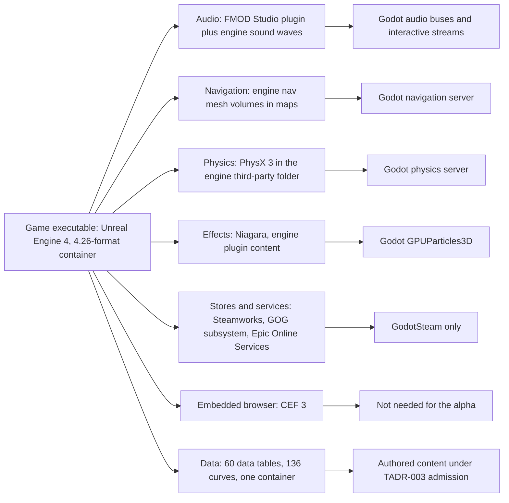

# Provenance: what Roboquest is built on, and what is free upstream

Evidence: inventory of folder, plugin and library file names in the install clone, the container listing and the parse probe, names and sizes only (level 2), plus engine format facts read from the container header (level 4 for those counts). License labels marked "known" come from general knowledge of the named project, not from a license file read in the game; no license text was read in this study, so every other license cell says "not checked". Nothing was executed. Nothing from the game is fetched or copied; a "yes" below means the original project can be obtained from its own source under its own license, through the admission rule in `docs/project/ASSETS.md` and `adr/TADR-003-content-pipeline.md`.

The install clone is retained by Andrew's decision as a private modding archive, outside the Scrapkeep study folder, as a private archive. This is Andrew's recorded exception outside the Scrapkeep pipeline (see `docs/project/ASSETS.md`, "Comps study posture", line 23, which says study copies live outside the repository). The archive sits at ~/Projects/roboquest-mod/archive/. Nothing in the Scrapkeep pipeline reads it, and no note, script or build in this repository points to it.

## What it does

The game is an Unreal Engine 4 title. The container format (an IoStore table of contents with a data file, Zlib blocks, no encryption key) and the successful conversion to legacy packages at engine version 4.26 place it on that engine line; the version of the executable itself was not read, so "4.26" is the format version the tools accepted (inference for the engine release). The studio bought or used engine plugins for audio middleware, store and online services, physics, an embedded browser and texture decoding; navigation and effects come from the engine's own modules. The game logic is readable as data (the data tables note) rather than hidden in a packed native library, which is the opposite of the Gunfire finding.

## Parameters

| Role | Product in the game | License | Free upstream usable for Scrapkeep | Godot equivalent of the role | Source |
|---|---|---|---|---|---|
| Engine | Unreal Engine 4 (container format 4.26; executable 93.3 MB) | known: Epic's engine license; license not checked in the game | no | Godot (`adr/TADR-001-engine-language-platforms.md`) | observed: container header; executable version string not read |
| Container | One IoStore container: 24,107 chunks, Zlib, 11.19 GB uncompressed, 3.40 GB on disk, plus a 64 MB pak and a 1.5 MB global container | engine format; license not checked | the open converter tool used in the study is open source (known), but unneeded | Godot resource packs | observed: listing report |
| Audio middleware | FMOD Studio plugin (plugin folder with binaries; 32 wrapper assets in the content folder; a 209.3 MB master bank) | known: proprietary, free tier with terms; license not checked for this game | no | audio buses, `AudioStreamInteractive`, `AudioStreamSynchronized` | observed: plugin folder, listing; bank sized not opened |
| Audio, engine | Engine sound waves (1,789, 81.6 min); XAudio2 redistributable; Ogg and Vorbis libraries in the engine third-party folder | known: Ogg and Vorbis are BSD-style; XAudio2 is a Microsoft redistributable; license not checked | yes for Ogg and Vorbis (Godot ships them) | `AudioStreamOggVorbis` | observed: folder names |
| Navigation | The engine's own navigation (21 nav mesh bounds volumes in the maps); no separate navigation plugin found | part of the engine license; not checked | not applicable | `NavigationServer3D`, `NavigationRegion3D` | observed: parse probe; plugin absence is a name search only |
| Physics | PhysX 3 (engine third-party folder) | known: BSD-3 licensed upstream; license not checked in the game | yes, but unneeded | Godot physics | observed: folder name |
| Effects | Niagara (engine plugin content: 144 files in the listing) | part of the engine; license not checked | no | `GPUParticles3D` | observed: listing report |
| Store, online | Steamworks SDK folder (version 157), a GOG online subsystem plugin, Epic Online Services SDK library (19.3 MB) | Steamworks and EOS SDK terms (known); GOG plugin license not checked | Steamworks through its terms only | GodotSteam (MIT, known) | observed: folder and file names |
| Embedded browser | Chromium Embedded Framework 3 (the 98 MB library in the engine third-party folder) | known: BSD-style upstream; license not checked | no | not needed for the alpha; its use in the game was not checked | observed: file names |
| Texture decode and input | A JPEG decode library (726 KB) and a PlayStation pad library (218 KB) in the game binaries | JPEG library license not checked (known family: BSD or IJG); pad library proprietary, not checked | no | Godot image loaders and `InputMap` | observed: file names |
| Crash diagnostics | NVIDIA crash-diagnostics library, debug-symbol helper | vendor terms, not checked | no | not needed | observed: folder names |
| Fonts | Not inventoried in this study | not checked | not applicable | not applicable | gap |

## Why it works

Roboquest bought audio middleware and online services and used the engine's navigation, effects and physics, which let a small studio spend its hours on content volume: 60 tables, 12 campaign levels built from a fixed tile ladder, 70 enemy meshes and 86 weapon meshes. It is the third data point for the same role list as Gunfire and Risk of Rain 2: audio middleware, navigation, input and store SDKs are bought; rules and content are the studio's own. Unlike Gunfire, the rules here are readable data, so a study can describe them; the data tables note records that.

## What Scrapkeep borrows

- **The role list as a checklist for the native build.** Each Godot cell is the thing to confirm exists in `native/` before alpha. Bible section: production conventions (`docs/tech/sections/HF-01-production-conventions.md`).
- **Rules as inspectable data.** The game keeps combat, loot and level generation in tables a tool can read. Scrapkeep's authored-content rule in `adr/TADR-003-content-pipeline.md` already points the same way; this is one more shipped example, not a new decision.
- **Layered music through the engine, not middleware.** The audio middleware bank is 209.3 MB; Godot's interactive audio streams carry the state machine in `progression-and-music.md` without it.

## What it must not copy

No library, plugin, executable, container, bank, movie, texture, mesh, clip or table row from the install. No store or online-service plugin: Scrapkeep takes GodotSteam under its own admission only. No embedded browser. Nothing in the repository copies any file from the install, and the study scripts and CSVs stay outside the repository; only counts and dimensions appear in the notes.

**Gaps.**

- The executable version string, the engine's bundled license files and any third-party notices were not read, so the engine release and every license cell are inferences or "not checked".
- Plugin roles come from folder and file names. The listing covers the container only; the install clone's binary folders were listed by name and size.
- The audio middleware bank was sized, not opened.
- Whether the embedded browser, the pad library or the crash library is used at run time was not checked.
- Fonts were not inventoried.

## Lab measure

Not a lab item. The check is the admission record: every font and library in `native/` has a source URL, license evidence and the actual use recorded, per `docs/project/ASSETS.md`.
