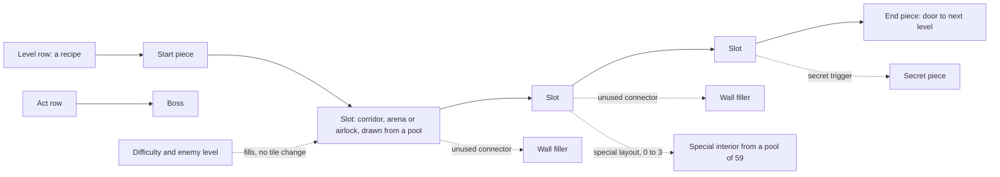

# Roboquest stage anatomy (comps note, lead)

Evidence: shipped data tables, counts and distributions at level 4 at measurement (read from the repo alone, level 2); 151 generated level pieces measured from converted packages, counts at level 4 and footprints as component-origin boxes (they understate true size, inference); public wiki read by a scout at level 2 (page and line cited per row, three lines re-read for this note). No game logic was read. How tiles connect, where pieces sit relative to each other, and how many enemies each squad anchor spawns are not decoded; the wiki's branching-exit and secret claims are level 2 and the wiki contradicts itself on routes and keys. Units: centimetres read as metres (inference). Sources are scratch reports outside the repo; "pieces report" is the piece-measurement report, "families report" the piece-library count report, "data report" the table-statistics report, "generator report" the level-generation prose report and "scout report" the wiki stage report, all dated 2026-10-11.

## What it does

Roboquest does not store maps. The engine is Unreal 4.26 (container report, line 5) and the container holds 7 map files, none per area (container report, line 7), so levels are built at run time from authored pieces. A level is one row of the level table, and the row is a recipe:

1. **A path of tile slots.** The row lists a start piece, an end piece and between them a fixed-order list of 0 to 11 tile entries (median 3). Each entry is one of three kinds: corridor, arena or airlock (safe room, inference from the piece name and from the loot it holds). Across the 51 data rows the entries are 96 corridors, 36 arenas and 13 airlocks (generator report, items 1 and 2). The path may not run more than 2 tiles in the same direction (generator report, item 2, inference from a field name), so it bends across a grid.
2. **A pool per slot.** Each slot draws a piece from a pool: 0 to 4 corridor pieces, 0 to 2 arena pieces, 0 to 1 airlock pieces per level (generator report, item 3). The piece library has 151 pieces in 13 kinds (families report, lines 8 to 19).
3. **Closed connectors and wall fillers.** Corridor, arena and airlock pieces each have four connectors (up, down, left, right), and each connector exists in a closed and an open variant (pieces report, line 6). The level row also names common and specific wall tiles that fill unused openings, with 2 specific wall tiles to place on 48 of 51 rows (generator report, item 3). Reading: the generator lays a chain of cells, opens the connectors the chain uses and closes the rest (inference: the connection rules are not decoded).
4. **Special interiors.** Each level has 0 to 3 special layouts drawn from a pool of 59 special interiors (generator report, item 4; pieces report, line 28). Eight of the nine act 1 and act 2 campaign levels have exactly one, with a loot tier of 1. Each act also names a pool of 17 to 20 special pieces for its first and second level (generator report, item 12, inference on how the pool is used).
5. **Side paths and secrets.** A level may list 0 to 2 side paths, each a full tile recipe pointing at another level (generator report, item 4). That may be the table behind the wiki's route doors (inference: the connections themselves are undecoded). Four secret pieces carry trigger boxes and a code button (pieces report, lines 18 and 25).
6. **Content by piece kind.** Arena pieces carry the enemy spawners. Airlock pieces carry trap and puzzle markers. Corridor pieces are light and carry their fights in squad anchors attached to the connectors (pieces report, lines 23 and 25). The loot a slot gives depends on its kind: an airlock gives a healing item, a large chest and a merchant, an arena gives healing and a chest, a boss slot gives healing and a merchant, and a special room gives one special chest (generator report, item 10).
7. **Acts and bosses.** 12 levels in 4 acts of 4, 4, 3 and 1 (data report, line 35). The boss sits on the act row. Act 4 breaks the cell: its start piece is 345 by 208 m, its bosses reach 642 by 599 m and its two arenas about 214 by 223 and 313 by 306 m (pieces report, line 20 gives the median 264 by 265 of the two; single pieces from the piece table).
8. **Difficulty fills, it does not rebuild.** Enemy strength per level, the act modifier, the difficulty step and elite counts per tier change what spawns. No field reported in these tables changes a tile count (generator report, items 6 to 8; absence of a structure field is not exhaustively checked).

**Basecamp (wiki, level 2; scout report lines 6 and 46).** Between runs the player returns to a camp hub. Wrenches earned in a run buy permanent upgrades at a workshop (Basecamp.txt:26), gadgets toggle there, and a higher difficulty adds a wrench bonus per level. A key found in a secret zone opens a locked level on a later run (scout report lines 6 and 44), so optional content pays across runs. The camp has 10 loose files and no piece folders (families report, line 20), so it is a made map and not a generated one (inference). For Scrapkeep it is the between-run layer behind the Bible's line that permanent discoveries and unlocks broaden future options (BIBLE.md line 46, under "Game identity" line 40); the secret-unlock borrow below is parked against it.

**Optional against required rooms, three levels where both sources cover the level** (joined by level name, inference; the other levels do not join because the wiki names second-level routes the report does not map to table rows). Wiki counts are combat, safe and survival rooms from each level page (scout report lines 30, 34 and 36; level 2). Table counts are corridor, arena and airlock entries (generator report, item 5; level 4). The one secret room (wiki) and one special layout (table) are the optional rooms.

| Level | Wiki: combat + survival | Wiki: safe rooms | Table: corridor + arena | Table: airlock | Optional to required rooms, wiki / table |
| --- | --- | --- | --- | --- | --- |
| First | 2 + 0 | 2 | 3 + 0 | 1 | 1 to 4 / 1 to 4 |
| Third, route A | 3 + 1 | 2 | 3 + 1 | 1 | 1 to 6 / 1 to 5 |
| Fourth | 4 + 2 | 3 | 3 + 2 | 1 | 1 to 9 / 1 to 6 |

Required here means every room counted on the level's path (wiki: all three kinds; table: all tile entries). The sources agree on the first level's total (4 rooms) and differ by 1 and 3 on the other two. The wiki counts one or two more safe rooms than the table has airlocks, plausibly the entry safe level, which the table treats as the start piece (inference). "Third, route A" is the scout's label; the wiki itself calls that level a second level on one page (Levels.txt:20), and the join to the table by name is inference. Optional rooms are about one per four to nine required ones, against Scrapkeep's 3 to 8 pockets per open stage, so Scrapkeep's optional layer is denser per stage by design. Connections between rooms are undecoded in either source, so this is a count and not a route share.

Wiki shape for comparison (level 2). A level is combat stretches joined by safe rooms, with survival rooms (a wave fight that ends when a bar drains and the door opens, Levels.txt:13) and a secret room along the route. The last two levels are single open maps: the penultimate asks the player to hunt 4 mini-bosses scattered at the extremities of the map and not close to each other (Levels.txt:51); the final one needs 2 secret rooms to open the boss door (Levels.txt:57). A secret zone is shown by a differently coloured region of the minimap (Unlockables.txt:38).

## Parameters

| Parameter | Value | Source |
| --- | --- | --- |
| Engine and storage | Unreal 4.26; 7 map files, none per area | container report, lines 5 and 7 |
| Levels and acts | 12 levels in 4 acts of 4, 4, 3, 1 | data report, line 35 |
| Level pages on the wiki | 9; a run chain of 6 levels (inference) | scout report, lines 11 and 14 |
| Tile entries per level | 0 to 11, median 3; totals 96 corridor, 36 arena, 13 airlock over 51 rows | generator report, item 2 |
| Tiles in the same direction | at most 2 (inference from a field name) | generator report, item 2 |
| Pool per slot kind | corridor 0 to 4, arena 0 to 2, airlock 0 to 1 | generator report, item 3 |
| Wall fillers | common 0 to 4; specific up to 3 entries, 2 to place on 48 rows | generator report, item 3 |
| Special layouts per level | 0 to 3; 1 on 8 of 9 early campaign levels | generator report, item 4 |
| Special interior pool | 59 packages of 127 to 200 exports each | pieces report, line 28 |
| Act pool of special pieces | 17 to 19 (first level), 18 to 20 (second level) | generator report, item 12 |
| Side paths per level | 0 to 2 | generator report, item 4 |
| Level tile size field | median 12,000 (about 120 m), max 23,800 | generator report, item 1 |
| Pieces by kind | start 33, end 26, boss 26, corridor 23, special 11, arena 10, airlock 7, wall 7, secret 4, 4 singletons; 151 total | families report, lines 8 to 19 |
| Pieces per act | 66, 50, 29, 6 | families report, line 19 |
| Connector structure | 4 connectors x closed and open on 42 pieces (9 packages); 1 connector on 109 pieces | pieces report, line 6 |
| Cell size, acts 1 to 3 | corridor, arena and airlock each 120 to 158 m a side (inference: a tile grid) | pieces report, lines 14 to 16 and 20 |
| Median footprint, corridor | 141 by 141 m, 19.8k m2 (p90 23.8k) | pieces report, line 14 |
| Median footprint, arena | 141 by 142 m, 20.0k m2 (p90 65.6k) | pieces report, line 15 |
| Median footprint, airlock | 130 by 132 m, 17.1k m2 | pieces report, line 16 |
| Median footprint, special piece | 105 by 32 m, 3.5k m2; 6 of 11 have no meshes (a locator for the separate interiors, inference) | pieces report, lines 17 and 25 |
| Median footprint, secret piece | 122 by 135 m, 15.1k m2 | pieces report, line 18 |
| Act 4 piece sizes | start 345 by 208 m; bosses up to 642 by 599 m | pieces report, line 20 |
| Squad anchors | 5,979 over all pieces, 2,775 of them in 23 corridors' connectors; spawn counts per anchor not decoded | pieces report, lines 23 and 25 |
| Arena spawners | 323 child actors; 86 in arena tiles and 222 more in arena connectors | pieces report, lines 23 and 25 |
| Trap slots | 423 child actors; airlock tiles hold trap and puzzle markers | pieces report, lines 23 and 25 |
| Secret and time triggers | 22 secret trigger boxes, 7 time trigger boxes | pieces report, line 23 |
| Loot by slot kind | airlock: heal, large chest, merchant; arena: heal, large chest; boss: heal, merchant; special: one chest | generator report, item 10 |
| Mutators | 37 rows split 18, 11, 8 over three kinds; magnitudes such as bonus damage 10 to 100 percent | generator report, item 11 |
| Enemy level per level | 1 on the first level up to 13 on the last; health bonus 20 percent at level 2 rising to 200 percent at level 11; damage bonus up to 580 percent at level 30 | generator report, item 6; data report, line 9 |
| Act enemy health modifier | 0, 30, 70, 140 percent | generator report, item 6 |
| Difficulty steps | 9; enemy health -30 to +60 percent, damage -50 to +45 percent | generator report, item 8 |
| Elites per level over tiers | first level 0 up to 3 across the seven tiers; the last level fixed at 12 | generator report, item 7 |
| Par-time curve | 5 keys from score 100 down to 20; first level 200 s to 600 s, ratio 3.0; oasis-type level 480 to 1,350 s; city 460 to 1,650 s; last level 320 to 1,000 s | generator report, item 9 |
| Time limitation | 120 s on nearly every campaign level; meaning not decoded | generator report, item 9 |
| Secret signal | different minimap colour on the secret zone | scout report, line 43; Unlockables.txt:38 |
| Secret reward | a key that opens a locked level on a later run | scout report, line 44; Unlockables.txt:39 |
| Survival room | wave fight, ends when a bar drains and the door opens; no clock | scout report, line 42; Levels.txt:13 |
| Open-map levels | penultimate: 4 mini-bosses at the extremities; final: 2 secret rooms | Levels.txt:51 and 57 |
| Unused connector rules, spawn counts per anchor, piece positions | not decoded | gap in every source read |

## Why it works

- **Variety from recombination.** 151 authored pieces, a pool per slot and a path of about five slots per level make a different level on each visit, and authors still control every cell. The variety lives in the library breadth and the recipe, not in the algorithm.
- **Roles are legible.** A piece kind says what it is for: arenas fight, airlocks heal, trade and puzzle, corridors carry the fights in between. The player learns the roles once and reads every level.
- **Closing a connector is cheap.** The same piece serves as a dead end or as a through cell, because each connector has an open and a closed variant and a filler tile fits the rest. That is probably how a fixed library gives both branching and dead ends (inference: the connection rules are undecoded).
- **A short list of optional rooms.** Zero to three special interiors a level, drawn from a large pool, keeps each one a find and the pool keeps it fresh.
- **Difficulty rides on top of the map.** Enemy level, act modifier, difficulty step and elite count change what spawns; the route stays, so map knowledge keeps its value.
- **Par curves bound the detour.** The slowest scoring time is about three times the fastest on the curves measured (2.8 to 3.6), which is a designer's statement of how much exploring a level tolerates (inference; the curve is a medal score, not a measure of optional content).

## What Scrapkeep borrows

Principles are Andrew's (playtest log entry 6, lines 98 to 105), never Bible text. Each row refines a step of ror2/stage-anatomy.md (lines 103 to 109) or a guarantee in pocket-placement.md. Values are starting values for the lab, not Roboquest's tuning. Bible anchors: BIBLE.md line 165 "3. Maps & Areas", line 167 "Reading the catalogue", line 517 "Encounters, waves and enemies".

| Relationship | Refines | Principle | Would amend |
| --- | --- | --- | --- |
| **Closable entrances on the zone graph.** The tile grid is not borrowed. The idea that survives is that a piece has several openings and a filler closes the unused ones. Give each authored zone 2 to 4 entrance sockets (Roboquest's cells have 4) and let the stage builder close any unused socket with a filler landform (a rockfall or scrap wall). A zone chosen as a pocket anchor keeps exactly 1 open socket. Starting value: the builder may close sockets only off the shortest spawn-to-objective route. | pocket-placement.md Parameters row "Anchor" (a zone with one entrance) and the guarantee that no pocket sits on the shortest route; ror2 step 1 (one baked graph) | Opt-in layers; momentum is sacred | TADR-010; BIBLE.md "Reading the catalogue" (line 167) |
| **Content roles by pocket kind.** Tag each pocket card with one role, as Roboquest tags a piece kind, and give each role a fixed content bundle. Arena pocket: spawners, and on clear a heal and a chest. Trade pocket: a merchant, a heal and a chest, plus trap and puzzle markers (the airlock's blend), and a slot for TADR-013's pocket workbench, where a bot is assembled from banked scrap (TADR-013 line 31; proposal there, not adopted here). Secret pocket: a trigger and one special chest. The route between pockets stays light and carries only anchored fights from the event director, as Roboquest's corridors do. Starting bundles; the crew repair point is TADR-013's open question and is not decided here. | pocket-placement.md guarantee "one reward, one trade" at the two costliest anchors; ror2 step 3 (card kinds priced by reward, footprint and detour) | Readability first; opt-in layers | TADR-010; TADR-013; BIBLE.md "Encounters, waves and enemies" (line 517) |
| **A world pool of special interiors.** Share one pool of authored interiors across a world's stages, as Roboquest appears to share a pool of 17 to 20 across an act's first two levels (inference, generator report item 12), and draw each stage's pockets from it. The stage draws 3 to 8 pockets (pocket-placement.md range), not Roboquest's 0 to 3, because Scrapkeep's whole optional layer lives in pockets while Roboquest also spreads it over safe rooms and secrets. Starting value: a pool of 24 authored interiors per world at launch scale, 8 for each of the three pocket kinds (arena, trade, secret), the Gunfire variety floor per kind. | ror2 step 4 (draw cards by weight among affordable ones); pocket-placement.md "Pocket count" row | Opt-in layers | TADR-010 |
| **Secret pocket: a tell on the map.** Roboquest shows a secret zone as a differently coloured minimap region. Scrapkeep keeps its rule of a visible door in sight of the main route and adds the map tell: once the door is seen, its zone tints on the map. Starting value: the tint appears when the door passes the sightline test and the player is within 60 m, the existing sightline range. | pocket-placement.md "Hidden pocket" row (one opening the player causes, always with a visible tell); ror2 step 7 (mark each door) | Readability first | BIBLE.md "Reading the catalogue" (line 167) |
| **Secret reward that opens something later.** A secret's key opens a locked level on a later run. Parked, not proposed for the first build: a hidden pocket may hold a permanent unlock. It matches the Bible's line that permanent discoveries and unlocks broaden future options (BIBLE.md line 46, "Game identity"). | pocket-placement.md "Hidden pocket" reward | Opt-in layers | BIBLE.md "Game identity" (line 40) |
| **Scattered objective, as an optional variant.** The penultimate level asks for 4 mini-bosses at the map's extremities, far from each other. If Scrapkeep wants an objective that is not one device, place 3 to 4 marks on objective-fit nodes, each at least 80 m from the others and in the far half by path distance, found in any order, with the exit open from the first. The exit must never wait on all of them (momentum). What the exit requires is open question Q-P38 (TADR-010 line 31), which owns it; this row only offers a candidate. Starting values. | ror2 step 2 (objective first, spawn in the far quarter by path distance) | Momentum is sacred; opt-in layers | TADR-010; BIBLE.md "Runs, regions, exits and saves" (line 578) |
| **Difficulty fills the same map.** Roboquest scales enemy level, act modifier, difficulty step and elite count, and its tables show no tile-count change. Same as Risk of Rain 2 and Gunfire. Starting cap: elites per stage in the 0-to-3 band Roboquest uses on its early levels, lifted only by a stage modifier. | Gunfire note, "Difficulty adds to the same map" row | Readable-capped scaling | TADR-010; BIBLE.md "Encounters, waves and enemies" (line 517) |

**Where Roboquest is the opposite of Scrapkeep.** Acts 1 to 3 are a chain of cells ending in an end door, and the open maps appear only in the last two levels. Scrapkeep's decision is the reverse: the open stage carries the main objective from the start and the pockets branch off it. So Roboquest answers "what does an optional room look like inside a generator" and not "what does the main route look like".

## What it must not copy

- **Required-clear room gating.** A survival room holds the door shut until a bar drains (Levels.txt:13), and arena pieces carry the spawners; forced entering and exiting directions sit mostly on airlock tiles plus two arenas of the last act and the tutorial (piece table, PIECES-MEASURED line 213), not on arenas generally. That arenas must be cleared to advance is inference. A gate the player must clear to leave is an anti-pattern in an open stage where momentum is sacred. Scrapkeep pockets are optional and never gate the route.
- **The fixed-cell corridor structure.** A level as a chain of same-size cells of about 120 to 158 m with a corridor between fights makes the stage a sequence. The cell grid, the 2-tiles-in-a-direction limit and the fixed-order tile list are the opposite of landform-shaped zones and a free route.
- **Piece, level, act, biome and boss names, art and layouts.** They appear above as evidence labels only. No geometry, placement of any piece, or connector layout is recorded here, and the footprints are measured boxes, not shapes.
- **Spawn and trap markers as authored.** Counts of anchors and slots are reported; where each sits is not, and must not be rebuilt.
- **Code, table schemas, identifiers, text, audio and art.**
- **Door-and-key between levels as designed.** The key in a secret opening a later level is a meta choice, parked above, not copied.

## Lab measure

In the headless Godot lab, generate 1,000 seeded stages twice from the open-stage-with-pockets shape: once with authored zones that have fixed entrances, once with closable entrance sockets. Log per stage the pocket count, the placement re-roll rate (pocket-placement.md lab measure) and a full-visit time, the walking time to enter every pocket and reach the objective, divided by the walking time of the shortest spawn-to-objective route. Pass when, on at least 95% of seeds with closable sockets: the pocket count is 3 to 8; no guaranteed pocket sits on the shortest route; the re-roll rate is under 10% and at most half the fixed-entrance rate (the ceiling in pocket-placement.md is 20%); the full-visit ratio is at most 3.0, the spread Roboquest's par curves tolerate (2.8 to 3.6); and a pool of 24 interiors (8 per kind) gives at least 8 distinct pocket sets per stage template, where a pocket set is the unordered list of interiors one stage draws, and every interior is drawn at least once across the 1,000 seeds. Starting values; tune in the lab. A full-visit ratio above 3 means the pockets cost more walking than players will pay, and that is the first answer the study owes to open question 5 in maps-compared.md.
