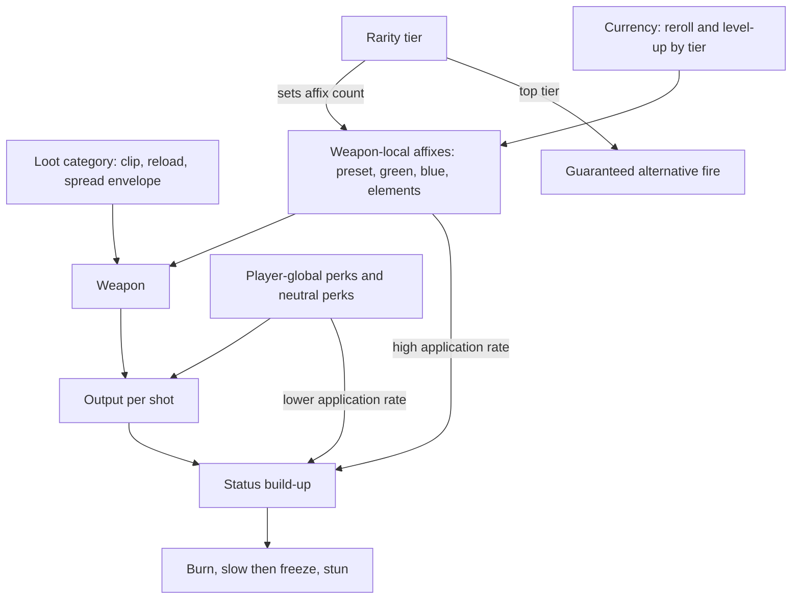

# Roboquest weapons and affixes (comps note)

Evidence: shipped data tables parsed to the last byte (level 4 at measurement, scripts outside the repo) for weapon, affix and player-attack statistics; public wiki pages read by a scout at file:line, a sample re-read by the coordinator (level 2, "wiki (public)") for rarity rules, prices and status rules. The wiki's weapon table is noisy and says its stats are being revised. Calculator constants on one wiki page disagree with the page's base damage. Nothing was run in the game.

## What it does

**Five loot categories, each a clip-reload-spread envelope.** A weapon belongs to one of five categories. Reload time barely moves between them; the clip size and the spread cap do the separating. A rapid category has a large clip and a middling spread cap. A technology category has a medium clip, the tightest spread and the shortest reload. A close-combat category has a small clip and the widest spread. A precision category has the smallest clip and a tight spread. A demolition category has a small clip and a medium spread. Weapons vary inside the envelope.

**Two layers of build.** The first layer is weapon-local: affixes sit on the weapon and leave with it. A weapon rolls a number of affixes set by its rarity tier. The preset affixes are fixed to a weapon type, the green and blue ones come from one shared pool (the tier sets only how many), and elements are counted as affixes. Many affixes are limited to a few weapons: the median affix applies to about three weapons, a few apply to nearly all. The top tier always carries an alternative fire mode, so rarity gates a mechanic, not only stats. Rerolling affixes and leveling the weapon cost currency by tier.

The second layer is player-global: perks chosen at level-up and neutral perks apply to whatever weapon is in hand (see the classes note). Perks multiply or add to a weapon's output without touching its affixes. The two layers meet at statuses: burn, cold and shock build up on an enemy at a rate that depends on the source, a weapon's own element applying more strongly than the same status from a perk or converted ability.

## Parameters

| Parameter | Value | Source |
|---|---|---|
| Weapon rows | 92 data rows, 80 lootable, five loot categories 20 / 20 / 19 / 17 / 16 | shipped data tables (level 4 at measurement, scripts outside the repo), weapon table |
| Wiki weapon rows | 82, of which 44 come from the starting chest | wiki (public): Weapons page, lines 24 to 1008 and 1010 to 1068 |
| Clip size, all weapons (min / median / p90 / max) | 0 / 12 / 60 / 200 | shipped data tables, weapon table |
| Reload seconds, all weapons | 0.8 / 1.5 / 2 / 3 | same |
| Spread cap, vertical, all weapons | 0 / 18 / 30 / 100 | same |
| Rapid category: median clip / reload / spread cap / affixes | 35 / 1.5 / 20 / 1 | same |
| Technology category | 25 / 1.35 / 10 / 2 | same |
| Close-combat category | 10 / 1.4 / 30 / 1 | same |
| Precision category | 7 / 1.55 / 10 / 1 | same |
| Demolition category | 8 / 1.55 / 15 / 2 | same |
| Spread of category medians | clip 5x (7 to 35), spread cap 3x (10 to 30), reload 1.15x (1.35 to 1.55) | arithmetic on the five rows above |
| Affixes per weapon | 0 on 12, 1 on 35, 2 on 36, 3 on 9 weapons | shipped data tables |
| Affix rows by rarity | 92 common, 58 rare, 1 elite (151 rows) | same |
| Weapons an affix can appear on (min / median / p90 / max) | 0 / 3 / 49 / 87 (quantile order read from the report's convention, inference) | same |
| Affix bonus-damage values | 10 / 20 / 50 / 100, on 36 rows; a luck value 0 to 50 on 21 rows | same |
| Affix categories | preset, green, blue, alternative fire; elements count as affixes | wiki (public): Affixes page, line 1 |
| Green and blue pool | one pool; tier changes only the count | wiki (public): Affixes page, line 3 |
| Wiki affix counts | about 11 exclusive, 10 base, 22 green, 23 blue, 13 generic alternative fires (approximate) | wiki (public): Affixes page, lines 10 to 470; does not reconcile with 151 data rows |
| Tier to blue / green affix count | tier 1: 0 / 0; tier 2: 0 / 1 to 3; tier 3: 1 to 2 / 1 to 3; tier 4: 2 / 1 to 3; tier 5: 3 / 3 | wiki (public): Rarity page, lines 12 to 42 |
| Top tier | always carries an alternative fire | wiki (public): Rarity page, line 39 |
| Reroll cost by tier | 1, 1, 2, 3 currency units (tiers 2 to 5) | wiki (public): Rarity page, lines 20, 28, 34, 42 |
| Level-up cost by tier | 2, 3, 4, 5 | same |
| Purchase price, top three tiers | 5, 8, 12 | wiki (public): Rarity page, lines 26, 33, 40 |
| Weapon level scaling | +10% damage per level above 1 | wiki (public): Calculators page, lines 1676 to 1690; constants unreconciled with page base damage |
| Critical rule | 1.25x by default on weak points; highest listed weapon multiplier 3.75x | wiki (public): Criticals page, line 6; Weapons page, lines 276 to 281 |
| Player attack profiles | damage median 28, max 180; fire interval median 0.32 s; charge time nonzero on 96 of 168 | shipped data tables, player-skill table (weapons and abilities probably share it, inference) |
| Damage types in that table | bullet 51, explosion 48, laser 35, physical 23, burn 5, cold 3, shock 3 | same |
| Status rules | burn lasts 3.5 s; cold slow 60% before freeze, freeze 6 s, boss slow after freeze 14%; shock stun 3.5 s; cold and shock decay after 1 s | wiki (public): Elements page, lines 5 to 21 |
| Status application rate by source | burn: own element 0.7x, non-elemental weapon with the affix 0.3x, perk 0.35x, converted ability 0.7x; cold and shock 0.9x | wiki (public): Elements page, lines 7, 9, 16, 21 |
| Item tiers and prices | four colour tiers plus a corrupted tier with a bonus and a penalty; prices 6 / 8 / 12 / 6 | wiki (public): Buyable Items page, lines 6, 226, 404, 504 |
| Rarity damage scaling, level cap, drop odds, elemental damage formula | not stated | gap |

Source disagreements: the data holds 92 weapon rows against the wiki's 82, and five loot categories where the wiki's partial class counts show three; the wiki's affix counts do not match the 151 data rows; calculator constants do not match page damage. The data table is preferred for counts, the wiki for rules.

## Why it works

- **The envelope is carried by clip and spread, not reload.** Players learn a category by how many shots they get and how wide they land, while reload stays nearly constant, so the reload rhythm is shared across the arsenal. Numbers stated above; the learnability reading is inference.
- **One tier label drives count and a mechanic.** The player reads a color and knows how many modifiers to expect and, at the top, that the weapon has a second mode. Stated rule; effect is inference.
- **Local and global layers do different jobs.** A weapon swap changes the affixes but not the perks, so finding a weapon changes this weapon's role while the build identity stays with the player. Inference from the structure.
- **Source-weighted status rates.** The same status is strong from a weapon built for it and weak from a stray perk, so specialising pays and incidental coverage does not break encounters. Stated rates; the balance reading is inference.
- **Prices rise one step per tier**, so spending choices stay comparable (stated).

## What Scrapkeep borrows

Principles: **opt-in layers**, **class identities** and **readable-capped scaling** (Andrew's, `docs/playtests/PLAYTEST-LOG.md` entry 6, lines 98 to 105). Bible anchors, each checked with `grep -n` on BIBLE.md: "5.1 Shared baseline and class roles" (`BIBLE.md:398`), "5.2 The mech builds its advances" (`BIBLE.md:418`), "Four slots and milestone progression" (`BIBLE.md:527`) and "Inventory, equipment and transformations" (`BIBLE.md:546`). TADR-008 is where any weapon-local modifier would plug into the one ability contract, and the inventory section's rule that effects rebuild from current selections is what makes the two layers safe to swap. Everything below is proposal.

- **A weapon-local layer and a character-global layer, kept separate.** Scrapkeep's four trees are the global layer; scrap-built attachments on a weapon are the local layer, lost or kept with the weapon and rebuilt from current selections (Bible line 546). The Gunfire notes in this pack use the same two-layer model; this adds the clip-reload-spread envelope for the base.
- **A category as a declared envelope of three numbers** (clip, reload, spread), with the reload nearly constant across categories (propose within 1.2x between the shortest and longest category median) and the other two spread by 3x to 5x so categories feel distinct.
- **Tier sets modifier count, and the top tier unlocks a mechanic.** Count from zero to three, top tier a second mode, shown on the build screen before it is equipped.
- **Elements as modifiers in the same slot system**, with a status build-up rate that depends on source, so the weapon that is built for a status applies it at about twice the rate of an incidental source (the observed ratio is 0.7 to 0.3 and 0.35).
- **A flat price step per tier for reroll and level-up**, with a hard cap, consistent with the scrap spending of section 5.2.

## What it must not copy

- Weapon, affix, perk and status names; the five category names; alternative-fire text.
- The numbers in the Parameters table as Scrapkeep values, including the 10 / 20 / 50 / 100 bonus ladder and the prices.
- The hidden or unlabeled stats of the source; Scrapkeep shows clip, reload, spread and range.
- Weapon silhouettes and hand poses, colors and effects tied to tiers.
- A tier color scale as UI; Scrapkeep's tiers need their own readable language.
- The idea that a modifier's application rate is invisible; Scrapkeep would show the source weighting.

## Lab measure

Headless envelope and layer test for Scrapkeep's weapon categories: for each category, sample 1,000 weapons with the tier-to-count rule and, against a fixed dummy, log damage per second with and without a representative global perk. Pass when (a) the category medians of reload stay within 1.2x of each other while clip and spread medians each span at least 3x, (b) no tier changes modifier count outside its declared range, (c) the top tier always carries its second mode, (d) a global perk changes damage per second by a similar share on every category (propose within 15% of one another, so global layers do not secretly favour a category), and (e) a status from the built-for source builds up at least twice as fast as the same status from an incidental source.
