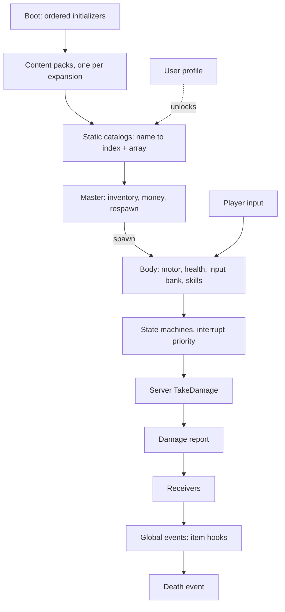

# Architecture: catalogs, body versus master, state machines and the damage pipeline

Evidence: static code read of a decompiled study copy (level 2; the damage order was walked from filtered lines, not the full body). Nothing was built or run. The Godot 4 column is inference and was not checked against Godot docs.

## What it does

- **Catalogs and content packs.** Every kind of content (items, bodies, masters, equipment, scenes, buffs) has a static catalog: a name-to-index dictionary plus a static array. Content packs fill the catalogs at boot. Each expansion registers its own pack before packs load. The game boots through an ordered list of initializers.
- **Body versus master.** A master object holds what survives death (inventory, money, respawn logic). A body is the disposable instance in the world that holds the motor, health, input bank and skills. The player's input writes into the body's input bank.
- **Entity state machines.** A body runs several named state machines (one called "Body"). A state is a class referenced by type; states are serialized as a type index through a catalog. A machine accepts a new state only if the requested priority beats the current state's minimum interrupt priority.
- **Damage pipeline.** One server-side entry point processes parry, invincibility, armor and buffs, builds a damage report, notifies receivers, then raises global events that items subscribe to. About 32 files subscribe to the damage-dealt event and about 55 to the death event.
- **Networking authority.** The server owns damage and spawns. Clients send commands and receive synced variables and effects.
- **Pooling.** Effects use one pool per prefab, growable, with an opt-out flag.
- **Saves.** A user profile holds coins, stats, unlocks, viewed items and input maps. An achievement grants an unlock token, which the profile records and announces.

## Parameters

| Parameter | Value | Source |
|---|---|---|
| Catalog pattern | static name-to-index dictionary + array | RoR2: ItemCatalog.itemNameToIndex, BodyCatalog, EquipmentCatalog, MasterCatalog, SceneCatalog, BuffCatalog |
| Pack interface | one async generate call | RoR2: IContentPackProvider.GenerateContentPackAsync |
| Expansion packs registered at boot | 4 (DLC1 through DLC4) | RoR2: RoR2Application (content pack provider registration) |
| Boot steps | platform systems, input, game content, initializers, achievements, logbook, state catalog, profiles, content packs, scene catalog | RoR2: RoR2Application.OnLoad |
| Master fields | inventory, money, body link, respawn | RoR2: CharacterMaster |
| Body fields | motor, health component, input bank, skill locator, timed buffs | RoR2: CharacterBody |
| State machine fields | custom name, initial state, main state, network index | RoR2: EntityStateMachine |
| Interrupt rule | requested priority must beat current minimum | RoR2: EntityStateMachine.CanInterruptState |
| State serialization | by type index through a catalog | RoR2: SerializableEntityStateType, EntityStateCatalog |
| Machines per body | not in source | prefab data |
| Damage entry | server only; warns if called on client | RoR2: HealthComponent.TakeDamage |
| Damage steps | process, report, receivers, send, item hooks, global event, death | RoR2: HealthComponent.TakeDamageProcess |
| Proc event subscribers | about 32 files (damage dealt), about 55 (death proc) | RoR2: GlobalEventManager.onServerDamageDealt, onDeathProcServer |
| Early-out | zero proc coefficient, rejected damage or non-server call | RoR2: GlobalEventManager.OnHitEnemy |
| Buff stacks | timed buff with a timer; refresh-or-add; capped extend | RoR2: CharacterBody.AddTimedBuff, BuffDef.canStack |
| Source files | 5,086 | measured: file count of the study tree (scout report) |
| `[Server]` attribute lines | 1,384 | measured: grep line count across 5,086 files (not unique sites) |
| `[SyncVar]` lines | 392 | measured: same grep |
| `[ClientRpc]` lines | 168 | measured: same grep |
| `[Command]` lines | 110 | measured: same grep |
| `[Client]` lines | 38 | measured: same grep |
| `[TargetRpc]` lines | 1 | measured: same grep |
| Effect pooling | one pool per prefab, growable, opt-out flag | RoR2: EffectManager (pool map, ShouldUsePooledEffect) |
| Profile fields | coins, collected coins, version, input maps, stat sheet, viewed list | RoR2: UserProfile |
| Unlock path | achievement token, profile grant, stat sheet, event | RoR2: BaseAchievement.AddUnlockToken, UserProfile.GrantUnlockable |

## Why it works

- **Content is data behind a name.** A catalog turns every asset into an index, so networking, saves and mods exchange small ids and not objects.
- **Master survives, body dies.** Death, respawn and extra lives become body replacement, with inventory untouched. This is inference; the code shows the split, not the intent.
- **One damage door.** Every hit goes through one server function, so every item and every event sees the same sequence. Nothing late can quietly skip armor.
- **Priority-gated states.** A skill cannot be interrupted by weaker input, so combat does not flicker.

## What Scrapkeep borrows

Principle: **quick restart** (a master that survives and a body that respawns makes restart cheap) with **readability first** (one damage door, so effects order is knowable). Decision records it would amend: TADR-002 (runtime model) and TADR-003 (content pipeline). Godot 4 equivalents (design inference, none verified in Godot docs) with a small-team fit:

| # | RoR2 pattern | Godot 4 equivalent | Small-team fit |
|---|---|---|---|
| 1 | Catalogs and content packs | `Resource` subclasses in folders; an autoload registry with a name-to-resource dictionary; extra resource directories for packs | Yes; skip async pack loading |
| 2 | Body versus master | Persistent `Node` for run data (inventory, scrap, crew); a respawned body scene for physics and state | Yes; it is also the node the crew needs (TADR-013; see companions) |
| 3 | Entity state machines | State nodes under a machine node; `@export` state reference for data-driven prefabs; priority integer on each state | Yes |
| 4 | Damage pipeline | A `RefCounted` damage-info object; one `deal_damage()` function; signals for dealt and death; buff timers in `_physics_process` | Yes; start with one signal chain |
| 5 | Networking authority | `MultiplayerSynchronizer` and `@rpc`, server authority | Costly; single-player first (TADR-005 scopes networking) |
| 6 | Pooling | Node pool with free-list dictionary; reuse `GPUParticles3D` and projectile nodes | Yes, for effects and projectiles |
| 7 | Saves and unlocks | `ConfigFile` or JSON profile; unlock ids in a dictionary; achievements emit signals | Yes (TADR-004 owns persistence) |
| 8 | Logbook | Read-only pass over the registry resources | Yes |

Counts to size the effort: RoR2's authority surface is 1,384 server-only attribute lines and 392 synced fields across 5,086 files. A small team targeting single-player does not need any of it, which is why row 5 stays last.

## What it must not copy

- The decompiled class layouts, names and boot order as Scrapkeep structure.
- Networking as a default. Authority counts show cost, not a requirement.
- Dozens of global subscribers. About 32 and 55 subscriber files is a hazard for a small team to debug; Scrapkeep should cap item hooks to a short list per event.
- Async content packs and expansion registration before there is an expansion.

## Lab measure

Run a headless "one door" test: send 1,000 scripted hits through the single damage function with every item hook enabled, and log the order of calls. Pass when the order matches the declared sequence on every hit (armor, plates, caps, crit, health, execute, then events), no item hook runs before damage is applied, and a respawn test (kill body, respawn) leaves the master's inventory and crew unchanged across 100 cycles.
