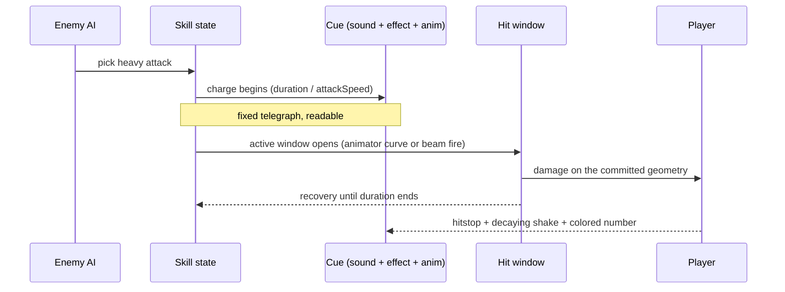

# Characters and feel: stats, skills, telegraphs and feedback

Evidence: static code read of a decompiled study copy (level 2). Kit cooldowns and stocks, hitstop lengths, shake strengths, per-character FOV and the damage-number merge window are not in code and were not established; they are marked prefab data. The source report's own verdict was INCONCLUSIVE for those values.

## What it does

A character body holds base stats (health, move speed, acceleration, jump power, damage, attack speed, crit, armor) and per-level growth. The motor adds sprint, air control, gravity and jump. A skill definition says how a skill behaves (priority, stocks, recharge, whether sprint cancels). A skill runs as a state whose duration is a base time divided by attack speed. Enemy heavy attacks have a long, fixed charge with a sound, an effect and an animation cue, then an active window set by either a named hitbox on the animation or one aimed blast. Feedback is bounded: hitstop on melee only, a camera shake that fades linearly, and damage numbers colored by damage type and team.

## Parameters

| Parameter | Value | Source |
|---|---|---|
| Base stats (health, move speed, acceleration, jump power, damage, attack speed, crit, armor) | fields with no code default | prefab data |
| Base jump count | 1 | RoR2: CharacterBody.baseJumpCount |
| Sprint speed multiplier | x1.45 | RoR2: CharacterBody.sprintingSpeedMultiplier |
| Level growth, health | round(base health x 0.3) | RoR2: CharacterBody.levelMaxHealth |
| Level growth, damage | base damage x 0.2 | RoR2: CharacterBody.levelDamage |
| Other level growth fields | 0 in the auto-calc | RoR2: CharacterBody (level fields) |
| Air control | 0.25, only when airborne | RoR2: CharacterMotor.airControl |
| Gravity | engine gravity x scale x multiplier (1) | RoR2: CharacterMotor.gravityScale |
| Jump | vertical velocity = jump power | RoR2: CharacterMotor (jump) |
| Base move speed, jump power, acceleration | not in code | prefab data |
| Skill interrupt priority, cancel sprint (default true), begin cooldown on end, max stock, recharge (default 1 s), stock to consume, attack-speed buffs restock | fields | RoR2: SkillDef |
| Kit cooldowns and stocks | not in code | prefab data |
| State duration | base duration / attack speed | RoR2: BaseState.attackSpeedStat, FireLaser.duration, Bite.baseDuration |
| Commando dodge | 0.9 s | RoR2: Commando.DodgeState.duration |
| Huntress blink | 0.3 s, speed coefficient 25 | RoR2: Huntress.BlinkState.duration, speedCoefficient |
| MUL-T nailgun | damage coefficient 0.1, range 50 | RoR2: Toolbot.BaseNailgunState |
| Golem laser charge | 3.0 s / attack speed | RoR2: ChargeLaser.baseDuration |
| Golem laser fire | 2.0 s / attack speed, blast along aim ray, no hitbox | RoR2: FireLaser.baseDuration |
| Lemurian bite | 3.5 s / attack speed, named hitbox, window when animator float > 0.1 | RoR2: Bite.baseDuration |
| Beetle guard slam | 3.5 s / attack speed, named hitbox, window when animator float > 0.5 | RoR2: GroundSlam.baseDuration |
| Lemurian fireball | charge 1.0 s, fire 2.0 s | RoR2: ChargeFireball.baseDuration, FireFireball.baseDuration |
| Active-window curves and recovery length | not in code | prefab data |
| Melee hitstop | freezes motion for a pause time, restores velocity on exit | RoR2: BasicMeleeAttack.hitPauseDuration |
| Hitstop length | not in code | prefab data |
| Shake defaults | amplitude 1, frequency 1, duration 1 s, radius 10 | RoR2: ShakeEmitter |
| Shake decay | linear over duration; falls off with distance | RoR2: ShakeEmitter (update) |
| Per-event shake strength | not in code | prefab data |
| Player shake scale | multiplied by a user setting | RoR2: CameraRigController.screenShakeScale |
| Default camera FOV | 60; no sprint FOV change found; dodge lerps back to 60 | RoR2: CameraRigController, CharacterCameraParamsData |
| Damage number color | by damage color index; team tint: none gray, monster purple, else white | RoR2: DamageNumberManager.SpawnDamageNumber |
| Damage number crit | a flag in custom data | RoR2: DamageNumberManager.SpawnDamageNumber |
| Damage number merge window | not found in code searched | prefab data |

## Why it works

- **A telegraph is a promise.** Each heavy attack has a long fixed charge (1.0 to 3.5 seconds) with its own sound, effect and animation, so the moment of danger is known before it arrives. Tying duration to attack speed means a buffed enemy telegraphs faster, but the cue stays proportional.
- **Damage geometry has one source.** The hit lands in either a named hitbox on the animation or a single aimed blast, so what the player sees is what hurts them. This matches the project rule that damage and telegraphs consume the same committed geometry (`AGENTS.md`).
- **Feedback is short and bounded.** Hitstop only on melee, shake that decays by time and distance, numbers colored by type and team. No feedback is unbounded, so a crowded fight does not drown the telegraphs.

The three readability rules (inference from the code above, not a design document):

1. Each heavy attack has a long, fixed charge tied to attack speed, with sound and a visible effect.
2. Damage geometry is a named hitbox on the animation or one aimed blast, so the hit lands at a visible moment.
3. Feedback is short and bounded: melee hitstop, decaying shake, colored numbers.

## What Scrapkeep borrows

Principle: **readability first**, with **momentum is sacred** protecting the player. Bible sections it would amend: "A committed attack means what it shows" (`BIBLE.md:489`) and "Movement, impacts and combat rhythm" (`BIBLE.md:782`), by adding a measurable telegraph rule and a feedback budget.

Relationships (design inference):
- Heavy enemy attacks get a fixed charge window, a cue in three layers (sound, effect, animation) and one geometry source. Timing is set per enemy class; the lab measures that the cue starts at the declared time.
- Hitstop applies to the attacker's own melee, never freezes the player's movement (momentum). Only tiny pauses, and none on ball rolling.
- Shake decays linearly, is scaled by an accessibility setting and is capped per frame, so many hits cannot stack into unreadable motion.
- Damage numbers are colored by one shared source that also colors the hit effect, so type and team read the same across layers.
- Each of the three characters needs its own movement: RoR2's dodge (0.9 s), blink (0.3 s) and dash show kits that differ by one move verb, which is the shape Scrapkeep wants.

## What it must not copy

- Any survivor, enemy or skill name, the sprint multiplier or air control numbers as Scrapkeep numbers.
- A damage-number system with no merge. RoR2's code showed no merge window; a ball mech that hits often will need one.
- Fixed charges of up to 3.5 s on small enemies. Momentum is sacred: a long wait for a heavy attack is fine for bosses, not for a pack.
- A hitstop that holds the player. Scrapkeep's fantasy is joyful physical mastery (`BIBLE.md:50`).

## Lab measure

In the headless lab, instrument each enemy heavy attack with timestamps for charge start, cue start (sound, effect and animation), active-window open and damage applied. Pass when, for 20 runs of each attack class, the cue starts within one physics tick of charge start, the charge duration matches the declared value within one tick at every attack-speed multiplier tested (0.5, 1, 2), and no damage is applied outside the window. Also measure that camera shake never exceeds the declared amplitude cap in a 30-hit stress test.
