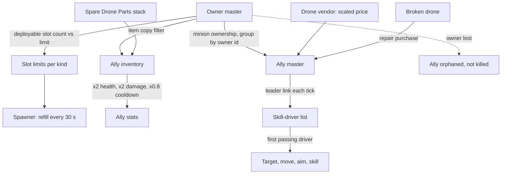

# Companions: ownership, skill drivers and the Spare Drone Parts curve

Evidence: static code read of a decompiled study copy (level 2, parts walked to level 3); drone costs and community complaints are wiki and Steam threads (public). Nothing was run in-game, so every behaviour claim here is code-observed or labelled inference.

Risk of Rain 2 (RoR2) is a comp, not a template. The Bible (AD-10, `BIBLE.md:673`) says to borrow relationships and create original characters, places and machinery. Andrew found RoR2's drones half-baked, so this note is built to show the architecture and then the gaps, and to propose a Scrapkeep crew that fills them.

## What it does

An RoR2 ally is a second character the owner holds a link to. The mechanism, in plain terms:

- **Ownership.** Each ally has a master object that records its owner. All allies of one owner sit in a group keyed by the owner's network id. Allies count against per-kind deployable slots on the owner (for example 2 turrets, 2 supply drops, 3 mini robo-balls).
- **Leash.** A minion further than about 400 units from its owner waits 10 seconds, then teleports to a spot 10 to 40 units from the owner. This is an item behavior, not a base rule of every ally.
- **Skill-driver AI.** Each ally carries an ordered list of "skill drivers". Every tick the AI walks the list and runs the first driver whose conditions pass. A driver says: which target (current enemy, nearest friendly in skill range, the leader, or custom), how to move (stop, chase, strafe, flee, follow, circle either way), where to aim, and which skill to press. Its conditions are required or forbidden skill, skill ready, stock, health window, damage window, a min and max distance, line of sight, and a cap on times selected.
- **Leader link.** The owner is set as the ally's leader every fixed update. The ally can copy the leader's latest attacker as its own target, with a 3 second cooldown.
- **Item inheritance.** When an ally is summoned, a filter copies some of the owner's items onto it. Which items pass is not in the code I read.
- **Deployable respawn.** One spawner refills a slot every 30 seconds, 3 to 40 units from the owner, only while the slot is under its limit.
- **Drone purchase and repair.** Drones are bought from a vendor at a difficulty-scaled price or found broken. A broken drone is repaired with gold or equipment; a repair queue heals it over time.
- **Spare Drone Parts.** A hidden item stack on the ally. Per stack the drone's health doubles, damage doubles, cooldowns multiply by 0.8, the number of drones doubles, and its visual size grows by 1 + log base 4 of the stack. Stacks come from combining drones and from summons.

## Parameters

| Parameter | Value | Source |
|---|---|---|
| Leash distance squared | 160000 (about 400 units) | RoR2: MinionLeashBodyBehavior.leashDistSq |
| Leash teleport delay | 10 s | RoR2: MinionLeashBodyBehavior.teleportDelayTime |
| Leash teleport distance | 10 to 40 | RoR2: MinionLeashBodyBehavior.minTeleportDistance, maxTeleportDistance |
| Leader target copy cooldown | 3 s | RoR2: BaseAI.leaderTargetCooldown |
| Deployable respawn interval | 30 s | RoR2: DeployableMinionSpawner.respawnInterval |
| Deployable spawn distance | 3 to 40 | RoR2: DeployableMinionSpawner.minSpawnDistance, maxSpawnDistance |
| Slot limit, engineer turret | 2 (3 with one Void item) | RoR2: CharacterMaster.GetDeployableSameSlotLimit |
| Slot limit, drone-tech drones | 2 | RoR2: CharacterMaster.GetDeployableSameSlotLimit |
| Slot limit, supply drop | 2 | RoR2: CharacterMaster.GetDeployableSameSlotLimit |
| Slot limit, mini robo-ball | 3 | RoR2: CharacterMaster.GetDeployableSameSlotLimit |
| Slot limit, engineer mine | secondary max stock, else 4 | RoR2: CharacterMaster.GetDeployableSameSlotLimit |
| Swarms artifact slot effect | doubles several slots | RoR2: CharacterMaster.GetDeployableSameSlotLimit |
| Driver target types | 4 (CurrentEnemy, NearestFriendlyInSkillRange, CurrentLeader, Custom) | RoR2: AISkillDriver.TargetType |
| Driver movement types | 7 (Stop, Chase, Strafe, Flee, Follow, CircleCW, CircleCCW) | RoR2: AISkillDriver.MovementType |
| Driver aim types | 5 | RoR2: AISkillDriver.AimType |
| Driver min distance default | 0 | RoR2: AISkillDriver.minDistance |
| Driver max distance default | infinity | RoR2: AISkillDriver.maxDistance |
| Driver max times selected default | -1 (unlimited) | RoR2: AISkillDriver.maxTimesSelected |
| Spare Drone Parts health factor | x2 per stack | RoR2: DroneUpgradeUtils.allDronesHealthMultiplierPerStack |
| Spare Drone Parts damage factor | x2 per stack | RoR2: DroneUpgradeUtils.allDronesDamageMultiplierPerStack |
| Spare Drone Parts cooldown factor | x0.8 per stack | RoR2: DroneUpgradeUtils.allDronesCooldownMultiplierPerStack |
| Drone count | 2^stacks | RoR2: DroneUpgradeUtils.GetDroneCountFromUpgradeCount |
| Drone visual scale | 1 + log4(stacks), 1 at zero | RoR2: DroneUpgradeUtils.GetScaleFromUpgradeCount |
| Vendor price | base tier price scaled by run difficulty | RoR2: DroneVendorMultiShopController (price via Run.GetDifficultyScaledCost) |
| Vendor base price per tier | not in code | prefab data |
| Repair heal rate | not in code | prefab data |
| Per-prefab driver lists, follow distances | not in code | prefab data |
| Drone base health (Gunner/Healing 150, Junk/Bombardment 300, TC-280 1200) | health +30% of base per level | wiki: https://riskofrain2.wiki.gg/wiki/Drones |
| Drone price (Gunner/Healing 40, Missile 60, Incinerator 100, TC-280 350) | gold | wiki: https://riskofrain2.wiki.gg/wiki/Drones |
| Orphan on owner loss | ally kept, owner reference cleared | RoR2: MinionOwnership.HandleOwnerDiscovery |

Reading the curve: with n Spare Drone Parts the drone's health and damage are 2^n times base and the drone count is 2^n, so total team health and total team damage each grow about 4^n (inference from the factors) while the model grows only 1 + log4(n) in size. A growth path this steep is also hard to read (see the items note).

## Why it works

Three parts of the design are sound and worth keeping as relationships:

- **A data-driven behavior list.** The driver list is per-prefab data read in order. Designers get new behavior by reordering rows, not by writing a state machine. A driver names its own conditions, so behavior stays legible to a reader of the data.
- **A leader link that borrows the player's attention.** Copying the leader's attacker gives allies a reason to be near the action without any command input. Inference: this is why allies feel like part of the build rather than a separate game.
- **A multiplier that is felt.** The drone-parts stack changes what a drone does (more shots, bigger body, more drones), so a player sees the investment.

### Design-gap table (why Andrew found it half-baked)

| Gap | Code evidence | Hook that could have supported a fix |
|---|---|---|
| Orphaned on owner death | Owner group disposal clears each member's owner and kills none (`MinionOwnership.cs:20-25`, `:142-149`); owner body death only destroys its own master (`CharacterMaster.cs:1780-1784`) | An owner-lost event exists (`MinionOwnership.cs:101`) |
| No stage carry-over | Only stage hook read resets one respawn flag (`CharacterMaster.cs:2198-2204`); no carry code found (inference: allies do not persist) | A stage-begin event is already subscribed elsewhere |
| Growth only by item stacks | The drone-parts file is the whole curve (`DroneUpgradeUtils.cs`) | The stack count is read in many states, so a level or role count could be read the same way |
| No personality or voice | No persona field on a driver; a custom-name field exists (`AISkillDriver.cs:49`) | The custom-name field |
| Purchase-and-forget | Price is set once when the vendor is built (`DroneVendorMultiShopController.cs:103`) | The price setter (`:81-90`) |
| Revive only by purchase | Repair is one purchase (`DronePurchaseRepair.cs:15-19`) | The heal tick (`DroneRepairMaster.cs:174`) |
| No direct command input | A command receiver exists but was not read (`DroneCommandReceiver.cs`) | Drivers already accept leader and custom targets |

Community evidence matches the table. A 2019 thread says equipment drones stopped using items after an update ("It is broken right now"). The same threads miss items that work when a drone holds them, and drones that act only near enemies (https://steamcommunity.com/app/632360/discussions/0/1626286205688978945 and https://steamcommunity.com/app/632360/discussions/0/1639789306556567560). "Half-baked" is a reading of the code and these threads, not a measured result.

## What Scrapkeep borrows

Principle: **opt-in layers** (a crew the player may ignore but is rewarded for building) with **readability first** (every crew action has its own sound and silhouette).

**Bible decision, closed.** `BIBLE.md:566-575`, section "Devices and one main companion", said one main companion anchors the run's support build and that temporary helpers "do not establish a second companion management roster". Andrew chose the crew on 10 October 2026; the section is amended in place and `adr/TADR-013-scrap-bot-crew.md` records the decision. The crew proposal below is the direction that ADR carries; its numbers stay proposals.

**Two mappings of the RoR2 code onto that section.**
- **Devices.** The Bible leaves Devices' capacity, lifetime, recall and persistence open. RoR2's deployable slots answer those: capacity is the per-kind slot limit (2, 2, 3 and 4 in the table above), lifetime and refill are the 30 s spawner, recall is the leash teleport, and persistence is the deployable removed from the owner's list on destruction. Devices can take these as quick, autonomous, capped deployables without becoming a roster.
- **The companion.** Ownership, the leash, item inheritance, the skill-driver list and repair (the whole architecture above) map onto the main companion, and onto the crew, which TADR-013 adopted.

Everything below is a proposal. Evidence supports the architecture (ownership, leash, driver list, stacking curve). The crew itself, the repair cost, the bark system and the growth curve are design inference.

### The crew, answering Andrew's three requirements

Requirement 1: **grow with the run.**
- Each bot has a level, shared items and upgrade paths. Level rises from the run's own tally (stage cleared, objective done), not from a global timer, so growth follows the player's progress.
- Item sharing uses RoR2's inheritance relationship with an explicit allow-list per role, so the player knows which finds their bots receive. This fixes the "which items pass" opacity found in the code.
- Upgrade paths are bot-specific trees of the same binary shape as the character trees (`BIBLE.md:527`), kept small (two forks deep).
- Do not copy the drone-parts curve (health x2, damage x2, count x2 per stack). Cap per-bot growth at a readable level; add breadth (a new driver unlocks) before depth.

Requirement 2: **persist, repair, revive.**
- The crew lives under one persistent node that outlives stage scenes. RoR2's orphan path shows what to avoid: a bot whose owner dies should enter a "stalled" state and wait at the last safe pocket, not wander without a leader.
- A downed bot becomes a salvage pile. Repair is a scrap cost paid at the pile; a revive costs more than a repair and needs a pocket-sized wait. Losing a bot hurts because its upgrades only return when repaired.
- A bot that stays dead past a stage boundary becomes a "rescue" objective in a later pocket (this reuses the Bible's rescue-gives-a-recoverable-moment idea at `BIBLE.md:572`, and it must not become a free extra life).

Requirement 3: **personality and voice.**
- Each bot has a short bark table keyed by game events (spotted a wounded ally, took heavy damage, the player grabbed scrap, stage clear, near death). A custom-name hook like RoR2's driver name field is the closest evidence that data can carry a label; the bark system itself is new.
- The sound tells you what the bot is doing. Each driver in the list owns a short sound motif, so the player hears "guard", "repair", "harvest" without looking. This follows the Bible's rule that audible information be readable (`BIBLE.md:767`).
- Quirks are data too: a preferred driver order, a favorite scrap type, a flinch on fire. Barks and animation read the same state variable, so they cannot drift apart.

### How a bot joins the crew (design proposal)

Design proposal, not RoR2 evidence beyond the broken-drone analog.
- **Found.** A bot is found as salvage on the stage, the analog of the broken drone, and repaired for scrap.
- **Assembled.** Or it is assembled at a pocket workbench from scrap parts the run has banked.
- **Cap and roles.** The crew cap is three. The starting roles are guard, repair and harvest. Each role is a driver list with its own sound motif.
- **Slots.** One bot slot opens per stage cleared, up to the cap.

### Skill-driver list as the behavior model

Adopt RoR2's driver idea: each bot role is an ordered list of drivers. A driver has a target kind, a movement kind, an aim kind, a distance band and a few conditions. The first passing driver runs. This keeps behavior editable as data, and it supports the opt-in layer: a role is its driver list. No direct command controls are proposed (Andrew did not pick them); the player shapes the crew by upgrades and which bot is present.

### Godot 4 mapping

| Crew need | Godot 4 form |
|---|---|
| Driver list per role | A `Resource` subclass `CrewDriver` (target, move, aim, min and max distance, conditions) and a `CrewRole` Resource holding an `Array[CrewDriver]` |
| Persistent crew across stages | An autoload `Crew` node outside the stage scene; stage scenes ask it to place bots at the entry |
| Ownership and leader | A `leader` node reference set each physics frame; a stalled state when it is null |
| Leash | A distance check plus a timed teleport to a nearby free spot (reuse the 10 s and near-leader idea, but use a Scrapkeep value tuned in the lab) |
| Repair as a scrap cost | A salvage-pile scene with an interact action that spends scrap from the same pool that grows the build |
| Bark events | A `CrewState` signal bus; the bark player, the animation tree and the sound motif all read the same state variable |
| Slots | A per-role cap held in the `Crew` node, not per prefab |

## What it must not copy

- Drone names, the drone list, vendor art and layouts, the item names, and the numbers above as Scrapkeep numbers. They are evidence for the relationship only.
- The orphan-on-owner-loss behavior, the purchase-and-forget vendor and the 2^n count growth. Andrew called the drones half-baked; these are the failures the code shows.
- Per-kind deployable slots as the main limit. A crew of named bots with roles needs a single crew cap, tuned for readability, not one slot per gadget kind.
- Any notion that a repair equals a free standard revival of the player (`BIBLE.md:572`).

## Lab measure

In the headless lab, run a scripted crew of three bots through three stage loads with the owner killed in stage two. Pass when: all bots still exist after each load; the stalled state engages within 1 s of owner loss and clears on respawn; a repair spends exactly the declared scrap and restores the bot's level; and the bark event log shows each bot's bark fired at most once per trigger within a cooldown while the animation state and bark reason match on every event (zero mismatches in 100 sampled events).
