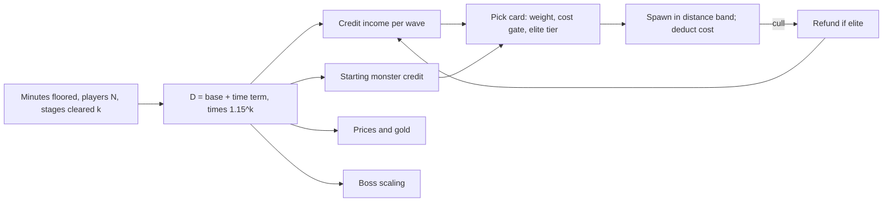

# Risk of Rain 2 director and difficulty (comps note)

Evidence: static code read (level 2 to 3), measured data (level 4, per-stage credit values only), wiki (public). Code is primary; the wiki is used as a cross-check.

## What it does

**The coefficient.** One number D rises with time, players and stages cleared. Let N be participating players, m the whole minutes elapsed (floored), S the difficulty's scaling value, k the stages cleared.

- Item-adjusted scaling: S' = S x (1 + 0.25 x c / N^0.75), where c is the count of one opt-in difficulty item held by the team (zero in a normal run, so S' = S).
- D = (0.7 + 0.3 N + 0.0506 x S' x N^0.2 x m) x 1.15^k.
- A second copy, the "compensated" coefficient, has identical terms in this build and is what the combat director and boss credit read.
- S values: easy 1, normal 2, hard 3, and every one of the eight harder tiers also 3 (the wiki labels these Drizzle, Rainstorm, Monsoon).

Worked example. Solo (N = 1), normal (S = 2), 10 minutes, 0 stages cleared: D = 0.7 + 0.3 = 1.0 base, plus 0.0506 x 2 x 1 x 10 = 1.012, so D = 2.012. At the start of stage 3 (k = 2) with the same clock reading D = 2.012 x 1.3225 = 2.66.

**Ambient level** (what enemy stat growth reads): A = min(1 + (U - (0.7 + 0.3 N)) / 0.33, 99), where U is the same formula but with unfloored minutes and including the stage factor. Monsters use the larger of the team level and the floored ambient level.

**Credit income.** The combat director holds a credit balance. At random wave intervals (set in data) each wave adds interval x multiplier x (1 + 0.4 x D) x (0.5 + 0.5 N) to an accumulator, paying out whole credits. Series gap between spawns: 0.1 to 1 s; reroll gap after a failed pick: 2.33 to 4.33 s (code defaults, data may override).

**Card selection and the cost gate.** Cards are grouped in categories with weights; a card's weight is its own weight times its category's share. Cards locked behind a minimum number of stages cleared are filtered out. A card is picked only if its price fits the balance. If the balance greatly exceeds the price of the pick (price x per-wave cap of 6 is cheaper than the balance) and the dearest card would cost more, the director counts a skip and may wait to save for it. A wave stops at 6 spawns. One card per attempt; its price is deducted per spawn.

**Elite tiers.** Elites cost extra.

| Tier | Cost multiplier | When available |
|---|---|---|
| 0 (none) | 1 | always |
| 1 | 6 | default rules, stages cleared < 2 |
| 2 | 3.5 | elite-only artifact, stages cleared < 2 |
| 3 | 3.5 | elite-only artifact, stages cleared >= 2 |
| 4 | 6 | default rules, stages cleared >= 2 |
| 5 | 36 | after a loop |
| 6 | 6 | lunar rules only |

An elite tier is chosen if card cost x tier multiplier x bias fits the balance; no coefficient threshold gates elites. Elite health and damage multipliers are data.

**Spawn distance bands** (metres from players, scaled by a multiplier and capped): close 8 to 20, standard 25 to 40, far 70 to 120, close-no-minimum 0 to 20. Far is a fallback only when a flag is set (off by default).

**Refunds.** On the refund branch of the health component (the scout called it a cull), an elite's price returns to the balance; a non-elite's goes to a second balance for which no reader was found (looks write-only, inference).

**What reads the coefficient.**

| Reader | Formula |
|---|---|
| Starting monster credit | base x D (ceil in camp and shrine variants) |
| Interactable and shop prices | base x D^1.25 |
| Gold and experience per kill | exp = max(1, cost x mult x 0.2 x D); gold = max(1, cost x mult x 0.4 x D) |
| Barrel reward | x D |
| Boss health | 1 + D / 2.5, then x sqrt(living players) |
| Boss damage | 1 + D / 30 |
| Combat shrine credit | 40 x D at entry x item factor |
| Team level | see next paragraph |

**Team level curve.** Experience to reach level L = 20 x (1.55^(L - 1) - 1) / 0.55. Per level: max health +30% of base, shield +30% of base, regen +20% of base, damage +20% of base; other stats 0 by default. Stats are base + per-level x (level - 1).

**Where the scouts disagree.** The wiki's income formula, creditsPerSecond = creditMultiplier x (1 + 0.4 x coeff) x (playerCount + 1) / 2, is algebraically the same as the code's, since (N + 1) / 2 = 0.5 + 0.5 N. The real differences: (1) the wiki treats time as a smooth continuous variable T (and its stage count as S, which here is the count k), while the code floors whole minutes in D (but not in ambient level), so D steps up once per minute; (2) the wiki omits the item-adjusted scaling; (3) the wiki shows income as a smooth per-second rate, while the code pays lumps at random intervals. Primary: the code. The wiki's per-stage credits (220/100, 280/100, 400/230, 520/230) match the measured table, so those values are confirmed twice.

Staying longer: D rises about 0.0506 x S' x N^0.2 per minute (a step each minute), and 15% per stage. Early gentleness comes from no time term in the first minute and from elites being capped by price.

## Parameters

| Parameter | Value | Source |
|---|---|---|
| Coefficient | (0.7 + 0.3N + 0.0506 S' N^0.2 m) x 1.15^k | RoR2: Run.RecalculateDifficultyCoefficentInternal |
| Item scaling | S x (1 + 0.25 c / N^0.75) | RoR2: Run.RecalculateDifficultyCoefficentInternal |
| Scaling values | 1, 2, 3, then 3 for the eight harder tiers | RoR2: DifficultyCatalog |
| Ambient level | min(1 + (U - 0.7 - 0.3N) / 0.33, 99) | RoR2: Run.ambientLevelCap |
| Wiki coefficient | (playerFactor + T x timeFactor) x 1.15^S | wiki: https://riskofrain2.wiki.gg/wiki/Difficulty |
| Wiki income | creditMultiplier x (1 + 0.4 x coeff) x (players + 1) / 2 | wiki: https://riskofrain2.wiki.gg/wiki/Directors |
| Wave income | interval x mult x (1 + 0.4 D) x (0.5 + 0.5 N) | RoR2: CombatDirector.DirectorMoneyWave.Update |
| creditMultiplier default | 1 | RoR2: CombatDirector.creditMultiplier |
| Wave interval values | not in code | prefab data |
| Series and reroll gaps | 0.1 to 1 s, 2.33 to 4.33 s | RoR2: CombatDirector.Simulate |
| Per-wave spawn cap | 6 | RoR2: CombatDirector.maximumNumberToSpawnBeforeSkipping |
| Consecutive cheap skips | unbounded | RoR2: CombatDirector.maxConsecutiveCheapSkips |
| Card availability | requires stage count | RoR2: DirectorCard.IsAvailable |
| Card cost | spawn card credit cost | prefab data |
| Base elite cost multiplier | 6 | RoR2: CombatDirector.baseEliteCostMultiplier |
| Elite tiers | see table | RoR2: CombatDirector.eliteTiers |
| Elite health and damage multipliers | per elite definition | prefab data |
| Distance bands | 8-20, 25-40, 70-120, 0-20 | RoR2: DirectorCore.GetMonsterSpawnDistance |
| Elite and non-elite refund | elite to balance, non-elite to second balance | RoR2: HealthComponent (refund branch, scout labelled it cull) |
| Price scaling | base x D^1.25 | RoR2: Run.GetDifficultyScaledCost |
| Gold and exp per kill | see readers table | RoR2: CombatDirector.AttemptSpawnOnTarget |
| Boss health and damage | 1 + D/2.5 (x sqrt N), 1 + D/30 | RoR2: CharacterMaster.ScaleDifficultyAsBoss |
| Team level experience | 20 x (1.55^(L-1) - 1) / 0.55 | RoR2: TeamManager |
| Per-level stat growth | 0.3 health, 0.3 shield, 0.2 regen, 0.2 damage | RoR2: CharacterBody.levelMaxHealth |
| Monster cap 40 per map | wiki figure; not verified in code | wiki: https://riskofrain2.wiki.gg/wiki/Directors |
| Per-stage monster and interactable credits | see stage-anatomy table | measured: stage-graphs.csv |
| Ambient level cap 99 | confirmed by wiki | wiki: https://riskofrain2.wiki.gg/wiki/Difficulty |

## Why it works

- **One slow clock, many readers.** A single number scales spawn money, prices, boss strength and enemy level, so the player reads "the world is hardening" from every system at once.
- **Credits pace the density.** Because each spawn is paid from a balance that refills at a rate, spawn density is a rate, not a count. The income has no kill term: it follows the clock and the dial, so a fast player reaches later stages at a lower dial than a slow one.
- **A cost multiplier on elites** keeps strong enemies rare early without a hard rule.
- **Minute steps** make the director's dial legible as a once-a-minute beat. Ambient level uses unfloored minutes, so only the dial steps, not enemy level.

## What Scrapkeep borrows

- **A single hardening number read by spawns, prices and bosses** (principle: readable-capped scaling; the player sees one dial). Amends: BIBLE.md section 6 "Encounters, waves and enemies" and TADR-010.
- **Credit-paced spawning with a price list** (principle: momentum is sacred; income follows the clock and the dial, not kills, so a player who clears fast meets a lower dial at each stage). Amends: TADR-010.
- **Elites as a price multiplier** (principle: readability first; one rare strong enemy at a time). Amends: BIBLE.md section 6 "Encounters, waves and enemies".
- **Spawn distance bands** (principle: readability first; arrivals are never on top of the player). Amends: BIBLE.md section 8 "Spectacle that leaves room to play".
- **A hard cap on the dial** (principle: readable-capped scaling). Amends: BIBLE.md section 6, cap value open (Q-P24).

## What it must not copy

- Item names and the opt-in difficulty item; difficulty tier names and the eight-tier ladder.
- The 0.0506, 0.3, 1.15 and 0.4 constants: Scrapkeep tunes its own from the lab.
- The write-only second refund balance and the unbounded cheap-skip default.
- Code, art and text.

## Lab measure

In the headless lab, run the Scrapkeep director alone for 30 simulated minutes at 1 and 3 players, 20 seeds each. Log D, credits earned and monsters alive per minute. Expected: the dial never exceeds the cap (the value chosen for Q-P24, held in the lab config) and is monotonic in time and stages, D steps once per minute, and total credits earned over the run matches the integral of the income formula to within 5%.
