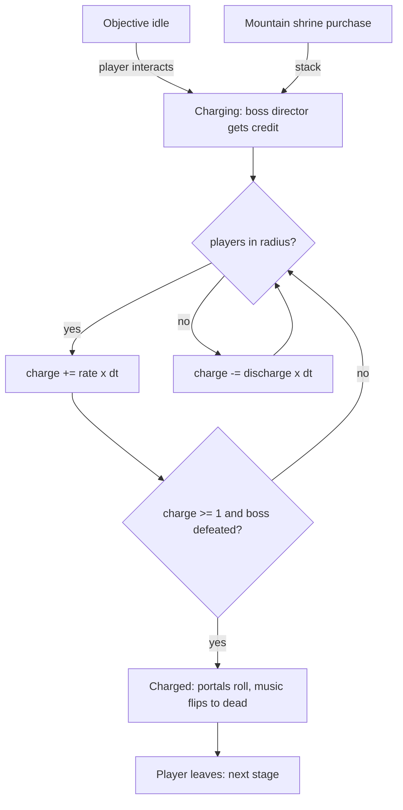

# Risk of Rain 2 events and objectives (comps note)

Evidence: static code read (level 2 to 3; the charge math is level 3, the rest level 2), measured data (level 4, not used here except where stated), wiki (public). Scouts left several questions open; they are listed under "What it does".

## What it does

**The holdout.** The objective is a device with a radius. Players inside the radius charge it. Let N_in be the living players inside and N_living the living players. If N_in > 0 the charge rate per second is (N_in / N_living) ^ s / T, where T is the base charge time and s a scaling exponent (default 1). If nobody is inside, the charge falls at a fixed discharge rate. So all players inside fill the bar in T seconds; half inside at s = 1 fills it in 2T. Player count changes the proportion, not the base time. The wiki gives a minimum of 90 seconds at full occupancy, a dome radius of about 120 m, and a stop on monster spawns at 99% charge; those exact numbers live in prefab data, not code.

**Radius rules.** Radius = base radius + charge x radius delta, smoothed toward its target by a damped follower, never below a minimum. On the harder difficulties the radius is halved. A stackable item divides the radius by (2 x count) and raises charge speed by 30% per count, capped at three counts.

**Boss credit formula.** When charging starts, the boss director receives max(override cost, floor(600 x sqrt(D))) x (1 + shrine stacks + hex stacks), where D is the difficulty coefficient. Then the next spawn is forced to be a boss. Boss count per event was not traced. After a spawn timeout of 1 second with no living boss the event counts as defeated.

**Mountain shrine stacking.** Each purchase adds one stack. A stack multiplies the boss credit by (1 + stacks) and adds one reward per stack to the boss kill: rewards = 1 + stacks, times the number of participating players when the reward is scaled by player count. The wiki says the same in public words: one uncommon item per boss kill per player, each mountain shrine adds 100% more items and 100% more credits. After purchase the shrine is locked for 2 seconds, then its price steps up by a per-purchase multiplier.

**Shrines as trades.**

| Shrine | What you pay | What you get | Risk |
|---|---|---|---|
| Combat | gold | a monster squad, whose credit is base x entry coefficient x (1 + purchases x (coef - 1)); a second system shares the same call | a fight now |
| Chance | gold, rising | a roll for an item, from a table that is swapped by one item | a failure chance (prefab) |
| Blood | a percentage of max health | gold (reward path not fully verified; the ratio is 0.5 gold per health paid) | health |
| Healing | gold | a healing ward whose radius grows with purchases | gold |
| Restack | gold | a random re-deal of your item stacks | gold, and the result is random |
| Mountain | gold | stacks the boss event and its rewards | a harder boss |

**Void field (arena event).** A fog damages anything outside safe zones. Rounds run up to a prefab total; odd rounds 1, 3, 5, 7 add a monster type, rounds 2, 4, 6, 8, 9 add an item stack to the enemy side. Credits per round: (base + per-round step x (round - 1)) x D. After each round the next safe zone opens; after the last, the fog is destroyed and a completion portal may open. One reward set is paid per round, one droplet per participating player, not per kill.

**Scripted encounters and squads.** A scripted encounter spawns directly without the combat director's credit gate; rewards use experience coefficient 0.2 and gold coefficient 1. A squad tracks members, includes summons, caps at 255 and fires a defeat event when its count reaches zero.

**Portals.** When the objective finishes, it tries to spawn every eligible portal: shop, a gold-event portal, a final-stage portal, a hidden-realm portal. The shop portal chance is 0.375 / (shop portals already spawned + 1). Other portals land 10 to 40 m away, the shop portal 0 to 30 m.

**Music state flips.** Charging flips the boss-status switch to alive and the boss track replaces the main track; charged flips it to dead; a proximity parameter maps distance 20 to 250 m onto 0 to 10000; a flag for local player in radius turns on at entry and a pause/unpause is posted on entry or exit.

**Signposting.**

| Cue | Value |
|---|---|
| Discovery radius | 20 m |
| Discovery ping | animation on discovery |
| Radius disc | scale 2 x current radius |
| Objective flashes | when a body is in radius |
| Charged effect | child effect on completion |
| Particle scale refresh | every 0.5 s |

**Unresolved: the cost of staying.** After charge is full and monsters are cleared, the boss director is switched off; the charged state's per-frame update is empty; no post-charge timer was found; an auto-complete flag is never set true in this copy. The interaction that actually ends the stage (the "stay or leave" branch) was not read. So the design question "what does it cost to keep playing after the objective is done" is not answered by the scout's reads. The public answer is indirect: the difficulty clock keeps rising (see director-and-difficulty), so staying costs through the clock, not through an objective penalty. This is inference.

Scout gaps (stated, not guessed): boss count per event; the charged-state exit path; the gold-event beacon and boss; endless-mode wave tuning; no statue class exists in the tree.

## Parameters

| Parameter | Value | Source |
|---|---|---|
| Charge rate | (N_in / N_living)^s / T when occupied | RoR2: HoldoutZoneController.DoUpdate |
| Base charge duration T | not in code | prefab data |
| Player-count exponent s | 1 default | RoR2: HoldoutZoneController.playerCountScaling |
| Discharge rate | not in code | prefab data |
| Radius | base + charge x delta, min clamp, damped | RoR2: HoldoutZoneController.DoUpdate |
| Radius halving on high difficulty | x 0.5 | RoR2: HoldoutZoneController.DoUpdate |
| Convergence item | radius / (2 x count), charge x (1 + 0.3 x count), cap 3, ramp 5 s | RoR2: HoldoutZoneController |
| Boss credit | max(override, int(600 x sqrt(D))) x (1 + shrine + hex stacks) | RoR2: TeleporterInteraction.ChargingState.OnEnter |
| Boss spawn timeout | 1 s | RoR2: TeleporterInteraction.bossSpawnTimeoutDuration |
| Mountain shrine reward | 1 + stacks, x players when scaled | RoR2: BossGroup.bonusRewardCount |
| Shrine refresh lock | 2 s | RoR2: ShrineBossBehavior |
| Combat shrine credit | base x entry coef x (1 + purchases x (coef - 1)) | RoR2: ShrineCombatBehavior |
| Blood shrine ratio | 0.5 gold per health paid | RoR2: ShrineBloodBehavior.goldToPaidHpRatio |
| Healing ward radius | base + bonus x (purchases - 1) | RoR2: ShrineHealingBehavior |
| Void field credit | (base + step x (round - 1)) x D | RoR2: ArenaMissionController.BeginRound |
| Void field round pattern | odd: monster type; even: item stack | RoR2: ArenaMissionController.BeginRound |
| Squad cap | 255 | RoR2: CombatSquad.AddMember |
| Scripted encounter exp and gold coefficients | 0.2, 1 | RoR2: ScriptedCombatEncounter |
| Shop portal chance | 0.375 / (count + 1) | RoR2: TeleporterInteraction.baseShopSpawnChance |
| Portal placement | shop 0 to 30 m; others 10 to 40 m | RoR2: TeleporterInteraction.AttemptToSpawnAllEligiblePortals |
| Discovery radius | 20 | RoR2: TeleporterInteraction |
| Music proximity map | 20 to 250 m onto 0 to 10000 | RoR2: MusicController |
| Dome radius ~120 m, minimum 90 s, spawns stop at 99% | wiki figures | wiki: https://riskofrain2.wiki.gg/wiki/Teleporter |
| Mountain shrine: +100% items and credits per stack | wiki figure | wiki: https://riskofrain2.wiki.gg/wiki/Teleporter |
| Shrine maximum purchases, failure chance | prefab | prefab data |

## Why it works

- **The charge is a position test, not a timer.** Standing in a circle is a decision: you give up roaming to hold ground. Everyone inside speeds it up; leaving costs progress.
- **Shrines are named bets.** Each shrine states what you pay and what you might get. The mountain shrine converts the player's confidence directly into boss credit and reward count, linear both ways.
- **Sound tells the phase.** The track change, proximity filter and pause on entry carry the state without a UI read.
- **Void field rounds** pay once per round, so a long fight has milestones instead of a single payoff at the end.

## What Scrapkeep borrows

- **Hold-ground charge with a proportional rate** (principle: momentum is sacred; the circle must be big enough to fight and move in). Amends: BIBLE.md section 6 "Encounters, waves and enemies" and TADR-010.
- **A risk-stack shrine whose cost and reward move together** (principle: opt-in layers; the player chooses the extra boss). Amends: BIBLE.md section 6 "Themed loot, attunement and fixed secrets".
- **Round-based arenas that pay per round** (principle: readable-capped scaling; each round adds exactly one new thing). Amends: TADR-010, and the pocket arenas in stage-anatomy.
- **Music and proximity cues for objective state** (principle: readability first). Amends: BIBLE.md section 8 "Spectacle that leaves room to play".
- **Portal chance that falls as shop portals appear** (principle: opt-in layers; a bonus detour is offered, rarely). Amends: BIBLE.md section 6 "Runs, regions, exits and saves".

## What it must not copy

- Shrine names and their art, the devices' names, item names, portal colors and meanings, the music tracks and wording, and any prefab values (which the scouts did not read anyway).
- The exact 600 x sqrt(D) constants and 0.375 shop chance as numbers; derive Scrapkeep's own from the lab.
- The dead auto-complete flag and the unread exit path: do not assume Scrapkeep needs them.

## Lab measure

In the headless lab, run the holdout with 1 to 4 simulated players at random occupancy and log charge time against the formula: observed time must equal T / ((N_in / N_living)^s) to within 1% over 100 seeded runs, and discharge must reach zero. Second check: with k mountain stacks, boss credit must equal base x (1 + k) exactly and reward count 1 + k.
