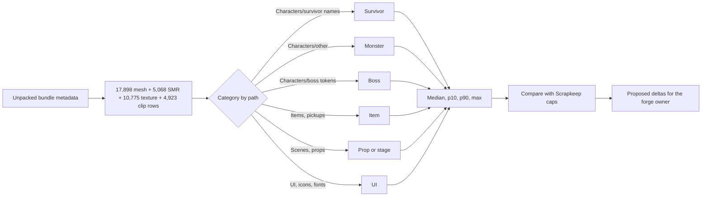

# Production budgets: what a shipped 3D roguelite spends per category

Evidence: measured data (level 4). Counts and statistics were computed from unpacked asset metadata by a script; no asset was exported, copied or viewed. Method, category rules and rerun command are in the source report `production-budgets.md` under the study tree's reports folder. The Scrapkeep side comes from the asset forge's pack file on the branch `claude/reverse-engineer-asset-pipeline-a5025f` and from `sketches/core-loop/VISUAL-SLICE.md:11`. `sketches/core-loop/assets/asset_budgets.json` does not exist in this worktree, so it was not compared.

Read the tables with three caveats. Each row is one Unity object in one bundle, so assets that ship in several bundles count once per bundle. Mesh rows are per mesh piece, not per character, so a character's total is a sum of pieces and is larger than any row. Skinned-renderer rows have no container path, so their categories come from bundle names and are approximate.

## What it does

The study measured four object types across 17,898 meshes, 5,068 skinned renderers, 10,775 textures and 4,923 animation clips, then grouped them by path into survivor, monster, boss, prop or stage, item or pickup, UI and other. The result is a distribution per category (median, p10, p90, max), which shows where a shipped game actually spends its detail.

## Parameters

Triangles per mesh piece:

| Category | Pieces | Median | p10 | p90 | Max | Source |
|---|---|---|---|---|---|---|
| Survivor | 427 | 1,928 | 94 | 11,278 | 24,839 | measured: production-budgets.md |
| Monster | 727 | 528 | 27 | 4,814 | 17,944 | measured: production-budgets.md |
| Boss | 1,027 | 60 | 60 | 860 | 80,240 | measured: production-budgets.md |
| Boss, without Solus bodies | 145 | 480 | 88 | 10,608 | 80,240 | measured: production-budgets.md |
| Prop or stage | 14,814 | 188 | 17 | 3,503 | 420,918 | measured: production-budgets.md |
| Item or pickup | 515 | 668 | 72 | 2,168 | 6,268 | measured: production-budgets.md |
| UI | 204 | 52 | 18 | 192 | 1,928 | measured: production-budgets.md |
| All | 17,898 | 192 | 20 | 3,580 | 420,918 | measured: production-budgets.md |

Reading: survivor pieces are the heaviest per piece, monsters are about a quarter of that, and props are the lightest per piece but make up 14,814 of 17,898 rows. The Boss row is bent by 760 identical 60-triangle Solus pieces, so use the "without Solus" row.

Bones per skinned renderer:

| Category | Renderers | Median | p10 | p90 | Max | Over 64 bones | Source |
|---|---|---|---|---|---|---|---|
| Survivor | 474 | 77 | 9 | 136 | 183 | 331 | measured: production-budgets.md |
| Monster | 949 | 35 | 1 | 155 | 212 | 390 | measured: production-budgets.md |
| Boss | 623 | 27 | 3 | 155 | 155 | 218 | measured: production-budgets.md |
| Prop or stage | 2,476 | 44 | 3 | 141 | 190 | 1,067 | measured: production-budgets.md |
| Item or pickup | 209 | 7 | 3 | 19 | 39 | 0 | measured: production-budgets.md |
| UI | 53 | 7 | 3 | 13 | 104 | 2 | measured: production-budgets.md |

Reading: a survivor renderer carries a median of 77 bones and 331 of 474 exceed 64; the top end (p90 about 136 to 155) is shared by survivors, monsters and bosses. Items and UI are tiny. The category split is approximate.

Textures (larger side, rows by size class):

| Category | Textures | Unique | 256 or less | 257 to 512 | 513 to 1024 | 1025 to 2048 | Over 2048 | Source |
|---|---|---|---|---|---|---|---|---|
| Survivor | 590 | 584 | 259 | 119 | 204 | 8 | 0 | measured: production-budgets.md |
| Monster | 807 | 744 | 408 | 117 | 246 | 36 | 0 | measured: production-budgets.md |
| Boss | 222 | 215 | 97 | 28 | 84 | 13 | 0 | measured: production-budgets.md |
| Prop or stage | 6,292 | 2,023 | 4,826 | 602 | 738 | 123 | 3 | measured: production-budgets.md |
| Item or pickup | 1,079 | 1,058 | 784 | 139 | 149 | 7 | 0 | measured: production-budgets.md |
| UI | 886 | 865 | 561 | 116 | 134 | 75 | 0 | measured: production-budgets.md |
| All | 10,775 | 6,137 | 7,684 | 1,217 | 1,602 | 269 | 3 | measured: production-budgets.md |

Reading: character and item textures are compact and block-compressed (DXT5 or DXT1). No character texture is above 2048; only 3 textures in the whole game are. Prop rows are inflated by small text-atlas textures repeated per scene bundle, so use the unique count (2,023).

Animation clips (seconds):

| Category | Clips | Median | p10 | p90 | Max | Source |
|---|---|---|---|---|---|---|
| Survivor | 1,034 | 0.67 | 0.03 | 1.83 | 14.98 | measured: production-budgets.md |
| Monster | 2,237 | 0.95 | 0.03 | 2.85 | 25.30 | measured: production-budgets.md |
| Boss | 651 | 1.00 | 0.17 | 3.33 | 15.25 | measured: production-budgets.md |
| Prop or stage | 822 | 3.33 | 0.03 | 5.00 | 148.00 | measured: production-budgets.md |
| Item or pickup | 111 | 0.79 | 0.03 | 2.08 | 16.00 | measured: production-budgets.md |
| UI | 17 | 1.00 | 0.47 | 3.33 | 8.48 | measured: production-budgets.md |

Reading: gameplay clips are short; p90 is under 3.4 s in every character category. Per survivor, the 17 survivors hold 1,034 clips (about 15.5 minutes): launch-era survivors have 38 to 50 clips each (Huntress 38, Loader 38, Mage 39, Captain 39), the newest have 128 to 143 (FalseSon 128, Drifter 143). Per-survivor animation scope roughly tripled between launch and the latest additions.

## Why it works

The distribution shows where a shipped game puts weight: heavy characters, light props that are numerous, compact block-compressed textures, short gameplay clips and tiny item rigs. It is a ceiling for a big team. The relationship that matters for Scrapkeep is the shape, not the size: detail follows importance, and numerous things stay cheap.

## What Scrapkeep borrows

Principle: **readability first** (a cheap, numerous prop never competes with a heavy, important character). The relationship is a per-category budget with a floor and a ceiling. Amendment target: the forge owner's pack file (not the Bible; no Bible section sets triangle budgets, and `sketches/core-loop/VISUAL-SLICE.md:11` says its 6500 and 4800 figures are "not performance evidence").

Scrapkeep caps read from the forge pack and the visual-slice file:

| Scrapkeep category | Scrapkeep cap | Nearest RoR2 category and measure | Reading |
|---|---|---|---|
| Model prop, triangles | 150 to 1,500 | Prop: p10 17, median 188, p90 3,503 | Floor too high: RoR2 median 188 and p10 17 mean many props sit below 150. Ceiling fits. |
| Model kit, triangles | 800 to 1,500 | Monster: median 528, p90 4,814 | Both bounds too tight for foes: p90 is about 3x the ceiling and median is below the floor. |
| Model hero, triangles | 3,000 to 6,500 | Survivor: median 1,928, p90 11,278 (per piece) | Fits as a whole-asset band. Per-piece data cannot say if a whole survivor exceeds it. |
| Shell, triangles | 2,000 to 11,000 (6,500 stated in the visual slice) | Survivor pieces | The forge ceiling is looser than the slice's 6,500. Nothing measured contradicts either. |
| Pilot, triangles | at most 4,800 (visual slice) | Survivor median 1,928 | Within RoR2's range. |
| Pickup or item | falls into prop 150 to 1,500 | Item: median 668, p90 2,168, max 6,268 | Ceiling tight at p90. |
| Terrain texture, px | 256 to 1,024 | Prop textures: 4,826 of 6,292 at 256 or less; 3 above 2,048 | Ceiling fits. Floor tight: most RoR2 textures are at or below 256. |
| Sprite frame, px | 16 to 192 | UI textures: 561 of 886 at 256 or less | Fits the small end; UI icons can go to 256. |
| Draw calls per model | prop 12, kit 24, hero 40, shell 10 | not measured | No comparison possible. |
| Bones | no cap found | Survivor median 77, p90 136; item p90 19 | Missing cap. |
| Clips | no cap found | Survivor 38 to 143 clips each; gameplay p90 under 3.4 s | Missing cap. |

Proposed deltas, for the forge owner, not an edit:

| Category | Proposal | Reason (measured) |
|---|---|---|
| Foe (new class beside kit, or widen kit to 500 to 5,000) | triangles 500 to 5,000; boss class up to 10,000 | Monster median 528, p90 4,814; boss without Solus p90 10,608 |
| Prop | floor 150 to 40 | Prop p10 17, median 188 |
| Pickup (new class or prop ceiling) | triangles 70 to 2,200 | Item p10 72, p90 2,168 |
| Hero | keep 3,000 to 6,500, add 80-bone cap | Survivor bone median 77; whole-asset sums were not measured |
| Foe bones | cap 40 | Monster median 35 |
| Pickup bones | cap 8 | Item p90 19, median 7 |
| Texture floor | 256 to 128 | Most rows at or below 256 |
| Clip length | gameplay clip at most 3.5 s | p90 under 3.4 s in every character category |
| Clip count per hero | at most 50 | Launch-era survivors 38 to 50; newest 128 to 143 shows the cost of growth |

Treat the triangle deltas as conditional: they compare per-piece numbers to whole-asset caps, so the true per-asset RoR2 totals would be larger than any row. A summed per-asset pass (group pieces by character) is the follow-up that would settle hero and foe.

## What it must not copy

- The absolute numbers as targets. A rolling-ball mech with three characters and a small team does not need 17 survivors' worth of clips or 497 audio banks.
- RoR2's growth in per-survivor animation scope (38 to 143 clips). Hold the clip cap.
- Any asset, mesh, texture or clip from the game. Only the counts are used here.
- The duplicate-per-bundle pattern: an asset shipped in many bundles inflates counts and disk size.

## Lab measure

Add a headless budget audit to the lab: load every promoted asset, count triangles, bones, clips, longest clip and texture size, group by category, and compare to the caps. Pass when zero assets exceed their category cap, every category has at least one asset (a nonzero count is printed so an empty selection fails), and the audit prints the median and p90 per category so they can be compared with the table above. Report the result next to the forge's own band check, which measures triangles only.
