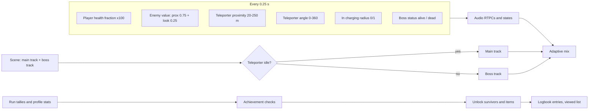

# Progression and music: unlocks as teaching, the logbook, run tallies and the adaptive score

Evidence: static code read of a decompiled study copy (level 2). Wwise curves, state values and track assets are prefab data and were not read. The sound bank inventory comes from file names and sizes only (nothing opened).

## What it does

**Unlocks.** An achievement checks a condition and, when true, grants an unlockable (a survivor, an item). Condition types fall into four families: a profile stat milestone, a run-state check, a single event, and a server-tracked rule. Each condition teaches a behavior by asking the player to do it once.

**Logbook.** A catalog view over items, survivors, stages and monsters. Each entry has a status (None, Unimplemented, Locked, Unencountered, Available, New). Gating comes from the entry's unlockable. A "viewed" list marks what the player has seen, which drives the "new" markers. Lore text lives in language files.

**Run tallies.** The run records loops cleared, stages cleared and time. These feed the director and the exits at run time. Only some of them reach the profile: stages completed, highest stages, kills, deaths, time alive, teleporter bosses witnessed. Loop count is not stored on the profile.

**Music.** A music controller updates every 0.25 seconds. It pushes five continuous values and one state to the audio middleware: player health, enemy value (proximity and look), teleporter proximity, teleporter direction, teleporter player status, and a boss status. A scene defines a main track and a boss track; the controller picks the boss track when the teleporter is not idle. A pause event runs when time scale is zero.

## Parameters

| Parameter | Value | Source |
|---|---|---|
| Kill milestone | 3000 total kills | RoR2: KillTotalEnemiesAchievement (stat check) |
| Death milestone | 5 total deaths | RoR2: Die5TimesAchievement |
| Loop milestone | loop clear count > 0 | RoR2: LoopOnceAchievement |
| Stage milestone | 20 highest stages completed | RoR2: Complete20StagesAchievement |
| Single-event unlock | charge teleporter with no damage taken | RoR2: CompleteTeleporterWithoutInjuryAchievement |
| Server-tracked unlock | three stages without healing | RoR2: CompleteThreeStagesWithoutHealingsAchievement |
| Logbook status values | 6 | RoR2: EntryStatus |
| Profile stats | time alive, kills, deaths, stages completed, highest stages (max), teleporter bosses witnessed | RoR2: StatDef |
| Run tallies | loopClearCount, stageClearCount, stageClearCountInCurrentLoop, time | RoR2: Run |
| Music update interval | 0.25 s | RoR2: MusicController (update interval field) |
| playerHealth RTPC | combined health fraction x 100; -100 when deafened | RoR2: MusicController (player health update) |
| enemyValue RTPC | (proximity x 0.75 + look x 0.25) x 0.025 | RoR2: MusicController (enemy value update) |
| teleporterProximity RTPC | distance clamped 20 to 250, mapped to 0 to 10000 | RoR2: MusicController (teleporter proximity) |
| teleporterDirection RTPC | angle 0 to 360 | RoR2: MusicController (teleporter direction) |
| teleporterPlayerStatus RTPC | 1 inside the charging radius | RoR2: MusicController (teleporter status) |
| bossStatus state | alive while idle or charging, dead when charged | RoR2: MusicController, CommonWwiseIds |
| Track pick | boss track when teleporter not idle, else main | RoR2: MusicController (track selection) |
| Per-scene tracks | main track, boss track | RoR2: SceneDef.mainTrack, SceneDef.bossTrack (assets are prefab data) |
| Track override with priority | track and priority | RoR2: MusicTrackOverride (values are prefab data) |
| RTPC response curves | not in code | prefab data |
| Stage-clear music change | none found in the exit controller (asserted; prefab not checked) | RoR2: SceneExitController |
| Sound bank folder | 497 files, about 1.05 GB, one subfolder | measured: file listing in the progression scout report (names and sizes only, level 2) |
| Largest banks | Global 95.2 MB; Music 52.9 MB; one DLC stage bank 15.2 MB; one boss bank 6.1 MB; one survivor bank 5.1 MB | measured: file listing in the progression scout report (names and sizes only, level 2) |

Sound bank inventory by prefix (counts only, approximate; split on first underscore or digit):

| Prefix | Banks |
|---|---|
| Survivors (`char_*`, `Char_*`) | about 36 plus 4, plus DLC survivor banks |
| Bosses (`Boss_*`) | 24 |
| Stages (`zone*`, DLC stages) | about 40 |
| Items (`item_*`) | 46 |
| Monsters (`Mob_*`) | 42 |
| Use and interact (`use*`) | 28 |
| Void content (`void*`) | 26 |
| Objects (`obj*`) | 26 |
| Shared | `Global`, `Music`, `Init` |

## Why it works

- **Unlocks teach.** Each condition asks the player to try something the game wants them to learn: loop once, treat healing as a cost, charge while unhurt. The reward arrives the moment the lesson lands. (Teaching reading is inference from the conditions.)
- **The logbook gives a record without a menu chore.** Status values plus a viewed list mean the "new" marker is the only prompt.
- **The music reads the world, not the player's buttons.** Five values describe how close the danger is, how hurt the player is and where the objective is. A slow 0.25 s tick is fine because the score does not carry alarms; attack cues come from sound effects. That matches the Bible's rule that "danger must never wait for a beat" (`BIBLE.md:755`).
- **One decision picks the layer.** The boss track follows the teleporter state, so the music changes at an event the player already caused.

## What Scrapkeep borrows

Principle: **jazzy EDM** adaptive score, plus **opt-in layers**. Bible sections it would amend: "Music direction" (`BIBLE.md:749`) and "Runs, regions, exits and saves" (`BIBLE.md:576`) for the unlock and tally model. The relationship, as design inference:

- **Parameters not cues.** Feed the score a few smooth values, read from the same state the HUD reads: pressure (enemies near and looking), player health, objective proximity, crew status. A jazzy EDM arrangement maps these to layers: bass movement and subdivision with pressure, a melodic answer in sustained combat, a stripped bar near death.
- **Phrase boundaries.** The Bible says arrangement changes resolve at phrase boundaries when play allows; RoR2's 0.25 s tick supplies the data, and a phrase quantizer decides when to apply it. Attack cues stay immediate.
- **A release after a clear.** RoR2 has no stage-clear music change in the code read, so Scrapkeep can improve here: drop the busiest layers and let ambience return before the next reward flourish (`BIBLE.md:755`).
- **Crew voices as stems.** With the crew adopted (TADR-013), each crew bot's driver motif (see companions) can be a short loop that joins the mix only while the bot acts, so the music itself says what the crew is doing.
- **Unlocks as lessons.** Use stat and single-event conditions, never grind counts. A 3000-kill milestone teaches nothing; "clear a pocket without taking damage" does.
- **Logbook.** A read-only pass over registered content with a status and a viewed list; no new storage beyond a viewed-set.

## What it must not copy

- Track layouts, composer material, stems or any recorded audio. The Bible requires an original score with no borrowed tune (`BIBLE.md:749`).
- Grind-count unlocks (3000 kills, 5 deaths) as the default condition.
- The no-clear-release behavior.
- The bank-per-everything structure at 497 files; a small team needs a handful of banks.
- Hidden unlock conditions that the logbook cannot show. Show the condition.

## Lab measure

Add an audio-state probe to the lab: replay a recorded run trace, sample the music parameters at 0.25 s, and check every parameter stays in its declared range and every layer change lands on a phrase boundary when the trace allows (at most one bar late) or immediately for flagged danger events. Pass when zero parameters leave range over a 5-minute trace, zero layer changes occur mid-phrase except flagged danger events, and the busiest layers are released within one phrase of stage clear.
