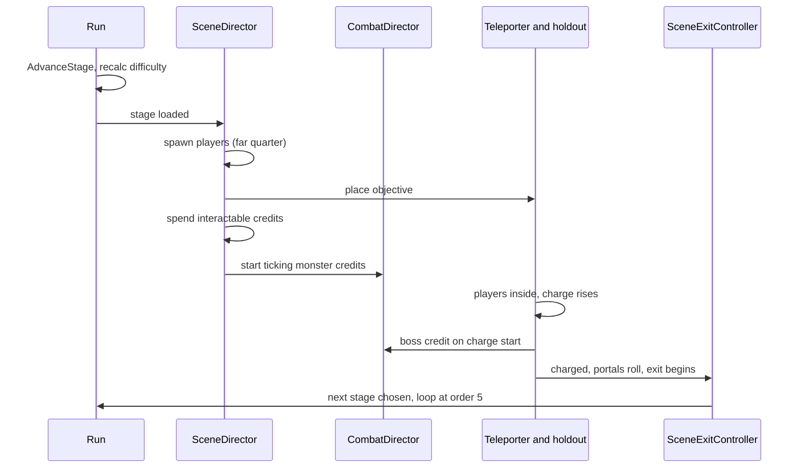

# Risk of Rain 2 run flow (comps note)

Evidence: static code read (level 2 to 3; the exit path after the charged state was not read), measured data (level 4, none used here), wiki (public). Each step names the class that owns it in the source game and a Godot 4 equivalent for Scrapkeep.

## What it does

One stage, start to finish, then the hand-off to the next stage or the loop.

1. **Stage load and advance.** The run object increments the stage count when a normal stage ends, recalculates the difficulty coefficient, regenerates the stage's random streams. Owner: the run object (Run.AdvanceStage). Godot 4: an autoload `RunState` that bumps `stages_cleared`, reseeds a `RandomNumberGenerator` and calls `change_scene_to_packed`.
2. **Difficulty recalculation.** Owner: Run.RecalculateDifficultyCoefficentInternal, run once at load and on a timer. Godot 4: a `RunState.recalc_difficulty()` called from a once-a-second `Timer`.
3. **Scene director: players spawn.** The director picks spawn nodes in the far quarter from the objective. Owner: SceneDirector. Godot 4: a `StageDirector` node that reads the stage's `NavGraph` resource and places the player scene at a chosen marker.
4. **Scene director: objective placed.** Owner: SceneDirector.PlaceTeleporter. Godot 4: `StageDirector.place_objective()` instancing a `PackedScene` at an eligible graph point.
5. **Scene director: loot spend.** Interactables bought with the stage's credit budget. Owner: SceneDirector.PopulateScene. Godot 4: `StageDirector.spend_credits()` over `Resource` cards with `cost` and `weight`.
6. **Combat director runs.** Ticks money waves, picks monster cards, spawns in distance bands. Owner: CombatDirector.Simulate. Godot 4: a `CombatDirector` node with a `_physics_process` accumulator.
7. **Objective discovered and charged.** Owner: TeleporterInteraction with HoldoutZoneController. Godot 4: an `Area3D` with a `HoldoutZone` script counting bodies in group `players`.
8. **Boss spawn.** On charge start the boss director receives its credit. Owner: TeleporterInteraction.ChargingState. Godot 4: `CombatDirector.spawn_boss(credit)` called from the zone's `charging_started` signal.
9. **Charged: portals roll.** Owner: TeleporterInteraction.ChargedState. Godot 4: a `PortalRoller` that instances bonus doors on `charged`.
10. **Exit begins and the destination is picked.** Owner: SceneExitController, using SceneDef destination groups and Run.PickNextStageScene. Godot 4: an `ExitController` that builds a weighted list from the current `StageDef` resource's `destinations`.
11. **Loop.** At stage order 5 the run begins a loop (Run.ShouldBeginLoop, Run.OnLoopBeginServer); after the fifth stage cleared, a second destination group is used. Godot 4: `RunState.begin_loop()` swapping the destination array.
12. **Scoreboard and persistence.** Not traced here; Scrapkeep's own TADR-004 owns this.

What the source game does not decide in the code the scouts read: the interaction that actually triggers exit once charged (not read).

## Parameters

| Parameter | Value | Source |
|---|---|---|
| Stage scene types | menu, stage, intermission, cutscene, timed intermission, untimed stage, junk | RoR2: SceneType |
| Stage count increments | for stage and untimed stage unless blocked | RoR2: Run.AdvanceStage |
| Loop trigger | stage order == 5 | RoR2: Run.ShouldBeginLoop |
| Looped destinations used | stages cleared >= 4 and update flag set | RoR2: SceneDef.AddDestinationsToWeightedSelection |
| Looped destination (exit controller) | loop count > 0 and stages cleared > 5 | RoR2: SceneExitController.GetLoopedStageOrDefault |
| Fallback next stage | uniform over valid stages, excluding previous | RoR2: Run.PickNextStageScene |
| Loop effect on difficulty | none; the formula has no loop term | RoR2: Run.RecalculateDifficultyCoefficentInternal |
| Difficulty step per stage | x 1.15 | RoR2: Run.RecalculateDifficultyCoefficentInternal |
| Per-stage order, credits | see stage-anatomy | measured: stage-graphs.csv |
| Teleporter portal chance and placement | see events-and-objectives | RoR2: TeleporterInteraction |
| Stage order per scene, destination lists | set in scene data | prefab data |
| Public stage list and loop numbers | wiki table | wiki: https://riskofrain2.wiki.gg/wiki/Environments |
| Out-of-bounds handling | zones teleport or kill | RoR2: MapZone |

## Why it works

- **Fixed rhythm, unfixed content.** Every stage is the same six beats: arrive, loot, find, hold, fight, leave. The player learns the beats once and spends the rest of the run on the variation inside them.
- **One owner per beat.** A beat has one class that owns it, so a change to loot spend cannot break the charge.
- **Looping reuses the same flow** with a different destination list, so late-run variety costs nothing in flow code.

## What Scrapkeep borrows

- **A fixed six-beat stage rhythm with one owner per beat** (principle: readability first). Amends: BIBLE.md section 6 "The complete loop" and TADR-010.
- **Destination chosen at exit from weighted groups** (principle: opt-in layers; Scrapkeep's two randomly offered worlds are a weighted draw). Amends: BIBLE.md section 6 "Runs, regions, exits and saves".
- **Difficulty recalculated at stage load** (principle: readable-capped scaling). Amends: TADR-010.
- **Fast restart: stage load rebuilds all state from a seed** (principle: quick restart). Amends: BIBLE.md section 6 "Runs, regions, exits and saves".

## What it must not copy

- Class names, the scene-type list, the stage-order numbering, and the exact "order 5" loop trigger.
- The hardcoded numbers (4 and 5 in the loop rules, which disagree by one in two places and look accidental).
- Stage and portal names, art, text, and code.

## Lab measure

In the headless lab, run 50 seeded full runs of the stage flow with a bot. Log, per stage, the time in each of the six beats and the seed. Expected: every run reaches the exit, a run restarted from its seed reproduces identical beat timings to the frame, and no beat is skipped. Restart latency from the exit to the next stage's first control frame stays under the quick-restart target.
