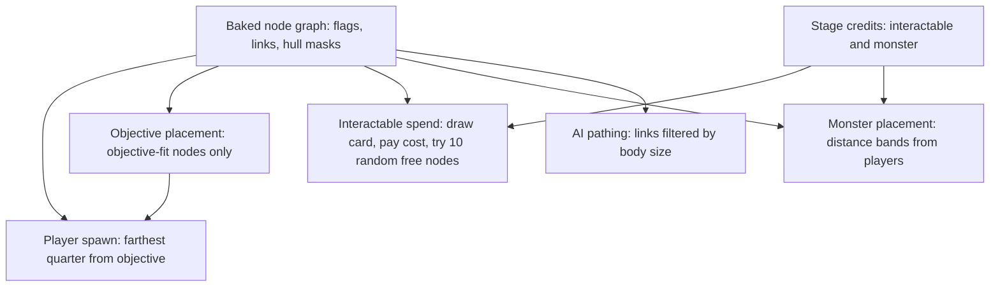

# Risk of Rain 2 stage anatomy (comps note, lead)

Evidence: static code read (level 2 to 3), measured data (level 4, `data/stage-graphs.csv`), wiki (public). Written independently so a stranger could build Scrapkeep's own version without the game.

## What it does

A stage is one open space plus a pile of data that the whole stage runs on. Four things sit on that data:

1. **A node graph.** The designer bakes a set of points over the walkable ground (and a second set in the air). Each point carries a few flags: open sky overhead, fit for the objective, no characters here, no chests here, no shrines here. Links between points record which body sizes can walk the link and how high a jump it needs.
2. **A credit budget per stage.** Two numbers set per stage: how much the stage may spend on interactables (chests, shrines, vendors) and how much on starting monsters. Every spawnable thing has a price and a weight.
3. **An objective.** One teleporter-like device is placed on an eligible node. The stage ends when the players charge it and leave.
4. **A spawn rule for the players.** The group starts in the farthest quarter of the graph from the objective.

The same graph answers four different questions: where may a chest go, where may a monster appear, where may the objective stand, and where may an AI walk. That is the load-bearing idea. One baked structure, many consumers.

**Placement loop.** The director draws a card by weight among cards it can still afford, deducts the cost first, then tries up to 10 random eligible nodes; a node is rejected if it is occupied or the body would overlap geometry. If all 10 attempts fail the credit is simply lost. There is no minimum distance from spawn or objective for interactables, so loot lands uniformly over the graph.

**Objective eligibility** is baked: from a candidate node the tool casts 20 rays downward on a 15 m ring, starting 7 m up, and every ray must hit world geometry. Nodes that pass get the objective-fit flag. A stage with very few such nodes (see table) makes the objective hard to find because there are few places it can be.

**Stage order and loops.** Stages carry an order number 1 to 5, plus a final stage. Credits rise with order (roughly 220, 280, 280, 400, 520 interactable credits; 100 to 230 monster credits). After the fifth stage the run loops and picks destinations from a second group; the loop does not change the difficulty formula, only which stages are offered.

### Stage table (trimmed: base game and the first expansion; simulation, bonus, bazaar and void-raid variants removed)

Footprint is the bounding box of ground nodes in metres, so it overstates area for non-rectangular stages. TeleporterOK share is objective-fit ground nodes divided by ground nodes. A "/" means the data file holds two scene-info objects for that stage.

| Stage key | Order | Interactable credits | Monster credits | Ground nodes | Air nodes | Footprint W x D (m) | Height (m) | TeleporterOK share |
|---|---|---|---|---|---|---|---|---|
| base-blackbeach | 1 | 220/180 | 100/100 | 805 | 1578 | 557 x 403 | 127 | 8% |
| base-blackbeach2 | 1 | 220 | 100 | 1123 | 1582 | 460 x 342 | 130 | 16% |
| base-golemplains | 1 | 220 | 100 | 2400 | 1112 | 483 x 520 | 58 | 50% |
| base-golemplains2 | 1 | 220 | 100 | 1554 | 1726 | 593 x 363 | 75 | 26% |
| dlc1-snowyforest | 1 | 300 | 110 | 1301 | 748 | 410 x 538 | 63 | 36% |
| base-foggyswamp | 2 | 280 | 100 | 2555 | 2524 | 478 x 520 | 100 | 60% |
| base-goolake | 2 | 220 | 100 | 1625 | 1352 | 434 x 707 | 110 | 22% |
| dlc1-ancientloft | 2 | 280 | 100 | 1413 | 1002 | 404 x 580 | 89 | 17% |
| base-frozenwall | 3 | 280 | 100 | 1872 | 1448 | 573 x 526 | 133 | 31% |
| base-wispgraveyard | 3 | 280 | 100 | 2120 | 2107 | 603 x 611 | 114 | 43% |
| dlc1-sulfurpools | 3 | 280 | 100 | 896 | 494 | 417 x 408 | 83 | 2% |
| base-dampcavesimple | 4 | 400 | 230 | 3847 | 2061 | 449 x 700 | 111 | 40% |
| base-rootjungle | 4 | 400 | 230 | 2522 | 3007 | 409 x 494 | 205 | 26% |
| base-shipgraveyard | 4 | 400 | 230 | 1237 | 1897 | 352 x 418 | 217 | 16% |
| base-skymeadow | 5 | 520 | 230 | 2451 | 1828 | 580 x 597 | 206 | 25% |
| base-moon2 (final) | 6 | 0 | 900 | 3933 | 2086 | 1832 x 1561 | 813 | 52% |

Reading the table. The final stage is an outlier in every column (1832 x 1561 m, 813 m tall, no interactable credits, 900 monster credits), so read the ordinary stages separately. Largest ordinary footprint: the order-3 graveyard stage (603 x 611 m, about 37 ha of bounding box), then the order-1 plains variant (593 x 363) and the order-3 frozen stage (573 x 526). Tallest: the order-4 ship stage (217 m), the order-5 meadow (206 m) and the order-4 jungle (205 m). Densest in ground nodes per hectare of bounding box: the order-4 jungle (about 125) and the order-4 cave (about 122), against about 58 for the large graveyard; node count is a proxy for navigable surface, so the cave and jungle are the most intricate. Interactable credits climb with stage order while the footprint does not, so later stages pack the same ground with more loot. The objective-fit share runs from 2% (the order-3 sulfur stage, 896 nodes) to 60% (the order-2 swamp): the low end means the objective has few possible homes and the search is hard.

**Community and wiki cross-reference.** The wiki lists per-stage events and secrets: a stone-door side area, hidden chambers behind pressure plates, a guaranteed rare chest on the order-4 cave stage, an altar that can fail to spawn, a timed chest on the order-3 delta stage. Its credit figures (220/100, 280/100, 400/230, 520/230, 300/110) match the measured data stage for stage, so the wiki corroborates the read of the data. The wiki numbers are probably data-mined from the same files, so this is not independent evidence for the design. On reception, a Steam thread (2024) reports a new player "running around ten minutes trying to" find the teleporter, with replies that it sits opposite the spawn; another (2022) ties early deaths to wisps near the teleporter and too few items per minute. A search excerpt (unverified, no thread pinned) names two stages as the worst for teleporter time. These are few and dated; treat teleporter hunting as a real but thinly evidenced complaint.

## Parameters

| Parameter | Value | Source |
|---|---|---|
| Interactable credits (default) | 200; per-stage value in data | RoR2: ClassicStageInfo.sceneDirectorInteractibleCredits |
| Monster credits (default) | 20; per-stage value in data | RoR2: ClassicStageInfo.sceneDirectorMonsterCredits |
| Per-stage credit values | see table | measured: stage-graphs.csv |
| Interactable credit scale by players | base x (0.5 + 0.5 x players) | RoR2: SceneDirector.PopulateScene |
| Starting monster credit | base x difficulty coefficient | RoR2: SceneDirector.PopulateScene |
| Spend loop iteration cap | 20000 | RoR2: SceneDirector.PopulateScene |
| Placement attempts per card | 10 (random mode) | RoR2: SceneDirector.PopulateScene |
| Cost deducted before placement | yes; lost if all attempts fail | RoR2: SceneDirector.PopulateScene |
| Minimum distance for interactables | 0 | RoR2: DirectorPlacementRule.minDistance |
| Node flags | open sky 1, objective-fit 2, no character 4, no chest 8, no shrine 16 | RoR2: NodeFlags |
| Hull sizes | 3 (human, golem, large) | RoR2: HullMask |
| Free-position test | sphere radius hull x 0.7, lifted 0.25 m on ground | RoR2: DirectorCore.CheckPositionFree |
| Objective-fit test | 20 downward rays, 15 m ring, 7 m up, all must hit | RoR2: MapNode.TestTeleporterOK |
| Player spawn anchor | farthest quarter of golem-hull nodes from objective | RoR2: SceneDirector.PopulateScene |
| Pod spawn restriction | open-sky nodes only | RoR2: SceneDirector.PopulateScene |
| Multi-player manual spawns | sorted by distance to objective, cut to player count | RoR2: SceneDirector.PopulateScene |
| Looping trigger | stage order 5 | RoR2: Run.ShouldBeginLoop |
| Looped destination group threshold | stages cleared >= 4 | RoR2: SceneDef.AddDestinationsToWeightedSelection |
| Per-stage interactable and monster credits, nodes, footprint, objective-fit share | see table above | measured: stage-graphs.csv |
| Wiki stage credits and events | e.g. 220/100, 400/230, 520/230 | wiki: https://riskofrain2.wiki.gg/wiki/Directors |
| Objective-fit flag actually filtered by the director | not established (spawn card data) | prefab data |
| Out-of-bounds zones | teleport players back, kill others | RoR2: MapZone.ZoneType |
| Card category weights, hull radii | not read | prefab data |

## Why it works

- **One structure, many readers.** Placement, objective eligibility, spawn and AI all read the same graph, so a designer edits one thing and the whole stage stays consistent. Every placer reads the same graph, so consistency comes from the shared data, not from a runtime check: the spend loop has no reachability test, and whether the director filters on the objective-fit flag is not established.
- **Money as the only tuning knob.** A stage's character comes from two numbers and a price list. A designer asks "how much loot, how much enemy" and the spend loop does the rest. Stage order raises those numbers, which is the whole difficulty ladder for content density.
- **Far spawn, hidden goal.** Starting players far from the objective turns every run into a loop of explore, loot, then converge. The distance gives the loot phase its time.
- **Baked objective test.** Requiring a flat, open disc means the objective is always playable once found.

## What Scrapkeep borrows

- **One graph feeding spawn, loot, objective and AI** (principle: readability first). Amends: TADR-010 (open stages and event director) and BIBLE.md section 6 "Encounters, waves and enemies".
- **A per-stage credit pair with a price list** (principle: readable-capped scaling; the stage's budget is the cap). Amends: BIBLE.md section 6 "Encounters, waves and enemies".
- **Spawn in the far quarter** (principle: quick restart; a run starts at a readable distance with room to move at speed). Amends: BIBLE.md section 6 "Runs, regions, exits and saves".
- **Baked objective eligibility** (principle: readability first; the objective is never on a ledge a vehicle cannot use). Amends: TADR-010.
- **Open stage with pockets (Andrew's decision, this session).** Concrete proposal, reusing the same graph and credit logic:
  1. Bake one graph for the open stage. Add three flags beyond the borrowed ones: `pocket_door_ok` (a node where a pocket entrance may sit), `main_route` (nodes on the cheapest path spawn to objective), `sightline_ok` (a node with an unobstructed ray to a main-route node within 60 m).
  2. Place the objective first on an objective-fit node, then the player spawn in the far quarter by path distance (not straight distance, so a cliff between them counts as far).
  3. Give each stage a pocket credit pool next to interactable and monster credits. Each pocket card (arena, secret room, trade room) has a price proportional to its reward, its footprint, and the detour it asks of a player.
  4. Draw pocket cards by weight among affordable ones. Place each pocket's door on a `pocket_door_ok` and `sightline_ok` node. Reject a door that is nearer than a set minimum to the spawn (no early freebies), nearer than a set minimum to the objective (no crowding the goal), or nearer than a set minimum to another pocket door. Unlike the source game, refund the credit on a failed placement. Starting values (proposals, tune in the lab): minimum door distance from spawn 60 m, from the objective 80 m, from another door 50 m; pocket credit pool 150 per stage against 400 interactable credits. For the reconciled placement spec see comps/pocket-placement.md.
  5. Bias price to detour: a pocket whose door is farther from the main route costs more credits, because it holds a bigger reward. This ties the pocket's reward to the same credit logic as a chest.
  6. Spend interactable credits afterwards over the open graph, excluding nodes inside a pocket and a small ring around each door, so loot and pockets do not sit on top of each other.
  7. Mark each door in sight of the main route so the player sees the optional content from the open space. Amends: BIBLE.md section 3 "Reading the catalogue" and TADR-010; principle: opt-in layers.
- **Enemy home turf** (principle: natural jungle-gym landforms with enemy home turf): tag graph regions by landform and give monster cards a home-region weight; the source game has no equivalent. Amends: BIBLE.md section 3 per-area pages.

## What it must not copy

- Stage names, region names, enemy and item names, the wiki's secret layouts, and any baked graph or level geometry.
- The 15 m / 7 m / 20-ray constants as a recipe: Scrapkeep's objective is a different size, so derive its own test.
- The lost-credit-on-failure behavior, and the unconstrained interactable placement that leaves loot clustered by chance.
- Code and data structures; the node flag layout; art and text.

## Lab measure

In the headless Godot lab, generate 200 seeded stages of the open-stage-with-pockets shape and log for each: the path distance from spawn to objective as a share of the graph's longest path (target: at least 0.6), the share of pockets whose door passes the sightline test (target: 100%), and the number of pocket doors that violate a minimum-distance rule (target: 0). Expected: zero violations, and a spawn-to-objective share at or above 0.6, on at least 95% of seeds.
